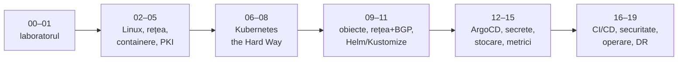

# Start aici: harta drumului

Ai deja un cluster care merge. Repo-ul ăsta construiește trei noduri Talos,
le dă Cilium, Longhorn, Flux și vreo 40 de aplicații, cu backup pe trei niveluri
și un DR exersat. Întrebarea cursului nu e „cum fac asta?” — ai făcut-o. Întrebarea
e **„de ce merge, și ce s-ar strica dacă aș schimba un rând?”**

Pentru asta construiești un al doilea cluster, de data asta fără nimic care să
gândească în locul tău: fără Talos (care îți ascunde sistemul de operare), fără
kubeadm (care îți ascunde certificatele), fără Flux (îl înlocuiești cu ArgoCD,
ca să vezi ce e GitOps și ce e doar Flux).

## Cum e construit cursul

Fiecare modul are aceeași formă:

1. **Conceptul** — explicat de la zero, cu o analogie unde ajută.
2. **Laboratorul** — comenzi pe care le rulezi tu, cu ce trebuie să vezi.
3. **Legătura cu prod** — unde apare același lucru în repo-ul ăsta, cu linkuri
   la fișierele reale (se deschid în viewer).
4. **Taskuri** — bifezi pe măsură ce faci. Un task nebifat e o întrebare la care
   încă nu ai răspuns.
5. **Întrebări de verificare** — încearcă să răspunzi *înainte* să deschizi
   răspunsul. Dacă nu poți, recitește secțiunea.

> [!TIP]
> **🧠 Analogie: permisul de conducere**
> Talos + Flux sunt o mașină automată cu pilot automat: ajungi la destinație și
> nu trebuie să știi ce e un ambreiaj. Cursul ăsta e mașina cu schimbător manual.
> Nu o vei conduce în fiecare zi — dar după ea, când pilotul automat face ceva
> ciudat, știi exact ce piesă a cedat.

### Regula notițelor

Sub fiecare modul ai un câmp de notițe. Folosește-l pentru **un singur lucru**:
scrie, cu cuvintele tale, ce ai înțeles. Dacă nu poți explica simplu, nu ai
înțeles încă — asta e tehnica Feynman și e cel mai eficient lucru din curs.

## Harta repo-ului tău

Înainte să construiești altceva, uită-te la ce ai. Fiecare director de mai jos
are un modul care îl explică.

| Director | Ce face | Unde îl înțelegi |
|---|---|---|
| [`talos/`](../../talos/talconfig.yaml) | Configurația celor trei noduri: IP-uri, VIP, patch-uri kubelet/etcd/sysctl | 06–08 (le faci de mână) |
| [`talos/terraform/`](../../talos/terraform/main.tf) | VM-urile de DR pe Proxmox | 01 |
| [`bootstrap/helmfile.yaml`](../../bootstrap/helmfile.yaml) | Ce se instalează înainte ca Flux să existe: Cilium, CoreDNS, cert-manager, Flux | 12 |
| [`kubernetes/flux/`](../../kubernetes/flux/cluster/ks.yaml) | Rădăcina GitOps: de unde citește Flux | 12 |
| [`kubernetes/apps/`](../../kubernetes/apps/default/kustomization.yaml) | Toate aplicațiile, pe namespace | 09, 11, 12 |
| [`kubernetes/components/common/`](../../kubernetes/components/common/cluster-vars.yaml) | Variabile și secrete injectate în fiecare namespace | 11 |
| [`kubernetes/apps/kube-system/cilium/`](../../kubernetes/apps/kube-system/cilium/app/helm/values.yaml) | CNI, kube-proxy replacement, L2 announcements, Gateway | 08, 10 |
| [`kubernetes/apps/storage/longhorn/`](../../kubernetes/apps/storage/longhorn/app/helmrelease.yaml) | Stocare replicată + backup | 14 |
| [`kubernetes/apps/observability/`](../../kubernetes/apps/observability/kube-prometheus-stack/app/helmrelease.yaml) | Prometheus, Grafana, Loki, alerte | 15 |
| [`.github/workflows/`](../../.github/workflows/flux-local.yaml) | CI: flux-local test/diff, flate | 16 |
| [`.renovaterc.json5`](../../.renovaterc.json5) | Actualizări automate, cu regulile învățate din incidente | 16 |
| [`.sops.yaml`](../../.sops.yaml) | Ce se criptează și cu ce cheie | 13 |
| [`vps/`](../../vps/README.md) | Ansible + Docker Compose pe VPS-ul Oracle | 02, 16 |
| [`docs/`](../../docs/architecture.md), [`DR.md`](../../DR.md) | Arhitectura, operațiunile, recuperarea | 18, 19 |

> [!NOTE]
> **🏠 Comentariile din prod sunt material de curs**
> Fișierele din repo-ul ăsta au comentarii lungi care explică *de ce* — de exemplu
> `election-timeout: "5000"` din [cluster.yaml](../../talos/patches/controller/cluster.yaml)
> vine cu măsurătorile care l-au ales. Pe parcurs, lecțiile te trimit la ele.
> Citește-le ca pe niște studii de caz: sunt incidente reale, din clusterul tău.

## Ce construiești, față în față cu prod

| | Prod (repo-ul ăsta) | Lab (cursul) | De ce diferă |
|---|---|---|---|
| OS noduri | Talos (imutabil, fără SSH) | Ubuntu 24.04 | Vrei să vezi tot ce face Talos |
| Instalare K8s | Talos generează tot | De mână (06–08), apoi kubeadm (19) | „Hard way” |
| Noduri | 3 control plane, câte unul pe host | 3 control plane, pe un host | Ajunge pentru învățat |
| VIP API | VIP Talos (urmează etcd) | keepalived/VRRP | Mecanismul la vedere |
| CNI | Cilium, native routing, fără kube-proxy | Identic | Aceeași bază |
| LoadBalancer | Cilium L2 announcements (ARP) | Cilium **BGP** → router FRR | Cum se face în datacenter |
| GitOps | Flux | **ArgoCD** | Vezi ce e GitOps vs ce e Flux |
| Secrete în Git | SOPS + age | Sealed Secrets | Alt model, aceeași problemă |
| Certificate | Let's Encrypt DNS-01 | CA propriu, apoi opțional LE | Fără dependențe externe la început |
| Stocare | Longhorn, backup pe Garage | Identic, Garage pe router | Aceeași bază |
| CI | flux-local, flate, Renovate | kubeconform, build imagine, Renovate | Plus livrarea unei aplicații |

## Uneltele de pe stația ta

Pe Windows ai deja `mise` (vezi [.mise.toml](../../.mise.toml)) — el îți dă
`kubectl`, `helm`, `cilium`, `flux` cu versiunile fixate. Pentru curs mai ai
nevoie de:

| Unealtă | Pentru | Instalare |
|---|---|---|
| OpenTofu sau Terraform | VM-urile laboratorului | `winget install OpenTofu.Tofu` |
| Un client SSH cu agent | intrarea în lab | OpenSSH din Windows, cu `ssh-agent` pornit |
| Python 3 | interfața asta | deja în `.mise.toml` |
| Un repo GitHub nou, `k8s-lab` | ArgoCD + CI | modulul 12 |

Toate celelalte unelte (etcdctl, crictl, helmfile, argocd…) se instalează pe
**jumpbox**, în lab, de scripturi. Stația ta rămâne curată.

## Taskuri

- [ ] Pornește interfața cu `python learn/serve.py` și deschide-o
- [ ] Deschide din viewer [talconfig.yaml](../../talos/talconfig.yaml) și citește comentariile despre `kubernetes-3`
- [ ] Citește [docs/architecture.md](../../docs/architecture.md) cap-coadă și notează cele 6 reguli de la final
- [ ] Desenează pe hârtie drumul unui request de la telefon la Jellyfin (Cloudflare → tunel → Gateway → pod) — corectezi desenul în modulul 10
- [ ] Notează 5 lucruri din repo pe care azi nu le-ai putea explica cuiva; revino la listă la modulul 19
- [ ] Verifică pe Proxmox că ai ~26 GB RAM liberi pe un host (sau 14 GB cu noduri de 4 GB)

## Întrebări de verificare

De ce un al doilea cluster, și nu experimente pe cel de prod?

Pentru că o parte din învățare înseamnă să strici lucruri intenționat: să oprești
etcd, să ștergi un certificat, să tai o sesiune BGP. Pe prod, asta înseamnă
Jellyfin oprit și date în pericol. Al doilea motiv: prod e construit cu unelte
care ascund exact lucrurile pe care vrei să le vezi.

Ce înseamnă „Git e singura cale de intrare” și unde o vezi în prod?

Nicio schimbare în cluster nu se face cu `kubectl apply` de mână — se face un
commit, iar Flux (sau ArgoCD) o aplică. O vezi în [architecture.md](../../docs/architecture.md):
*„Nothing is configured by hand that could be configured by commit.”* Consecința:
clusterul se poate reconstrui din repo, fiindcă repo-ul *este* clusterul.

