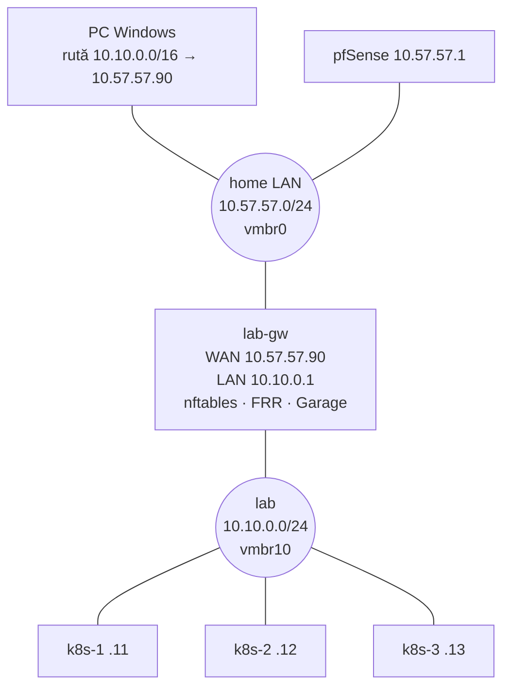
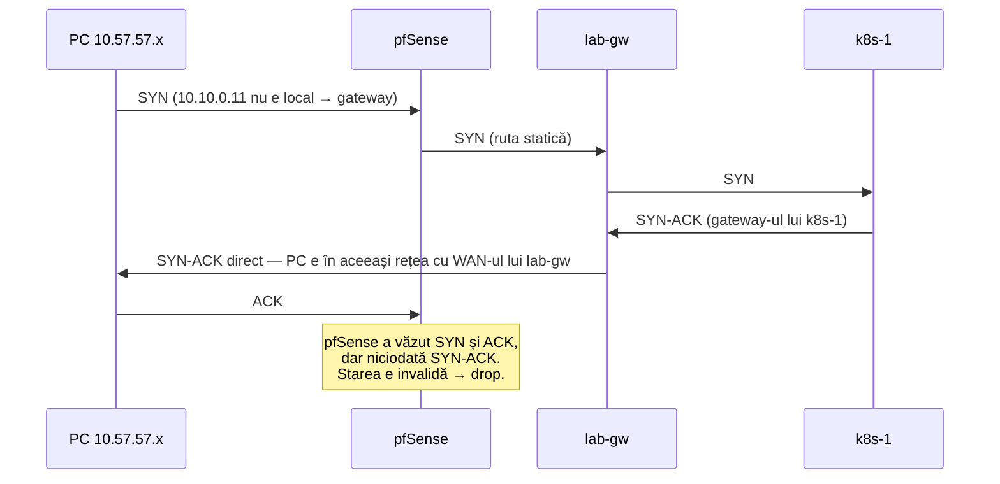

# Laboratorul: Proxmox, OpenTofu, router FRR

Patru VM-uri, create din cod: trei noduri Kubernetes și un router care e și
jumpbox. Rețeaua laboratorului e izolată în spatele routerului — exact cum un
rack de datacenter stă în spatele unui router top-of-rack.

## Topologia și de ce arată așa



| Adresă | Ce e | Echivalent prod |
|---|---|---|
| `10.10.0.1` | lab-gw, gateway-ul laboratorului | pfSense `10.57.57.1` |
| `10.10.0.10` | VIP-ul API-ului (modulul 07) | VIP Talos `10.57.57.88` |
| `10.10.0.11–13` | nodurile | `10.57.57.80, .82, .83` |
| `10.10.100.0/24` | IP-uri LoadBalancer, anunțate prin BGP | `LB_IP_*` din [cluster-vars.yaml](../../kubernetes/components/common/cluster-vars.yaml) |
| `10.244.0.0/16` | pod-uri | `10.42.0.0/16` |
| `10.96.0.0/12` | Services | `10.43.0.0/16` |

Toate sunt în [lab/env.sh](../lab/env.sh) — singurul loc în care le schimbi.

> [!IMPORTANT]
> **❓ De ce un router separat, și nu nodurile direct în LAN-ul de acasă?**
> Trei motive. (1) **Izolare**: poți strica rutarea, DNS-ul sau BGP-ul laboratorului
> fără să atingi pfSense-ul de care depinde toată casa. (2) **BGP are nevoie de un
> vecin**: în modulul 10, nodurile anunță rute unui router; lab-gw e acel router.
> În prod, pfSense ar trebui să fie vecinul — și nu vrei experimente pe el.
> (3) **Realism**: în datacenter, nodurile nu stau niciodată în aceeași rețea cu
> laptopurile; stau în spatele unui router.

> [!TIP]
> **🧠 Analogie: blocul cu interfon**
> LAN-ul de acasă e strada. Laboratorul e un bloc cu o singură intrare: lab-gw.
> Apartamentele (nodurile) au numere interne (10.10.0.x) pe care strada nu le
> cunoaște. Ca să ajungă cineva de pe stradă la un apartament, trebuie să știe că
> „toate numerele 10.10.x sunt prin interfonul de la .90” — asta e ruta statică de
> pe PC-ul tău. Iar când locatarii ies în oraș (internet), portarul le pune adresa
> blocului pe plic (NAT), ca răspunsurile să se întoarcă la bloc.

## Proxmox: bridge-uri și VLAN-uri

Un **bridge Linux** (`vmbr0`) e un switch virtual. Placa fizică a hostului e
„conectată” la el, la fel și plăcile virtuale ale VM-urilor. De aceea un VM pe
`vmbr0` apare în LAN ca orice altă mașină.

`vmbr10` e un bridge **fără placă fizică**: un switch care există doar în
interiorul hostului. VM-urile conectate la el se văd între ele și atât. Singura
ieșire e lab-gw, care are o placă în `vmbr0` și una în `vmbr10`.

Două variante, în [variables.tf](../lab/infra/terraform/variables.tf):

| | Varianta A (implicit) | Varianta B |
|---|---|---|
| Rețeaua lab | `vmbr10`, bridge intern | VLAN 10 pe `vmbr0` |
| Unde rulează VM-urile | toate pe un host | oriunde, dacă switch-ul lasă tag-urile să treacă |
| Cerințe | nimic | `vmbr0` VLAN-aware pe fiecare host |
| Domenii de avarie | unul (hostul) | mai multe, ca în prod |

Pornește cu A. Varianta B e un exercițiu bun după modulul 18, când vrei să vezi
ce se întâmplă cu etcd când moare un host întreg — exact ce a exersat prod pe
2026-09-04 ([THREE-NODE.md](../../talos/THREE-NODE.md)).

## Cloud-init vs ISO + API

> [!NOTE]
> **🏠 Prod pornește altfel**
> [talos/terraform/main.tf](../../talos/terraform/main.tf) bootează un **ISO** Talos.
> Nodul pornește în *maintenance mode* și așteaptă: nu știe nimic despre el până nu
> primește un machine config prin API (`talosctl apply-config --insecure`). De asta
> `dr:apply-talos-configs` din [Taskfile.yaml](../../Taskfile.yaml) scanează portul
> 50000 și potrivește nodurile după MAC.

Laboratorul folosește o **imagine cloud** Ubuntu: un disc gata instalat, nu un
installer. La primul boot, `cloud-init` citește un mic disc atașat de Proxmox
(datasource *NoCloud*) și aplică: hostname, IP static, gateway, DNS, utilizatorul
`ubuntu` cu cheia ta SSH. Apoi nu mai face nimic.

| | Talos | Cloud-init |
|---|---|---|
| Când se aplică config-ul | oricând, prin API; e starea dorită | o dată, la primul boot |
| Cine îl aplică | `machined`, continuu | `cloud-init`, un script |
| Schimbi ceva după | `talosctl apply-config` | SSH, Ansible, sau reconstruiești VM-ul |
| Seamănă cu | Kubernetes (reconciliere) | un script de instalare |

Diferența asta e o temă a întregului curs: **declarativ și reconciliat** (Talos,
Kubernetes, ArgoCD) versus **imperativ, o singură dată** (cloud-init, scripturi).

## OpenTofu / Terraform, pe scurt

Terraform (sau fork-ul open-source OpenTofu — aceleași fișiere, comanda `tofu`)
descrie infrastructura ca **resurse**, și ține minte într-un fișier de **state**
ce a creat. La fiecare `plan`, compară trei lucruri: codul, state-ul, și realitatea
(întreabă API-ul Proxmox). Diferența devine planul.

```bash
tofu init      # descarcă provider-ul bpg/proxmox
tofu plan      # ce s-ar schimba — citește-l întotdeauna
tofu apply     # aplică planul
tofu destroy   # șterge tot ce e în state
```

> [!WARNING]
> **⚠️ State-ul e un secret**
> `terraform.tfstate` conține tot ce știe Terraform, inclusiv valori sensibile. De
> aceea [learn/.gitignore](../.gitignore) îl exclude, la fel ca `.gitignore`-ul din
> rădăcină pentru `talos/terraform/`. Pierde-l și Terraform „uită” VM-urile: un nou
> `apply` ar încerca să le creeze din nou și ar eșua pe VMID-uri ocupate.

## Laborator

### 1. Token API Proxmox

Pe hostul ales (de exemplu `pve-1`), în shell:

```bash
pveum user token add root@pam k8s-lab --privsep 0
```

Notează `full-tokenid` și `value` — valoarea apare o singură dată. `--privsep 0`
înseamnă că tokenul are toate drepturile lui root: comod pentru un lab, greșit în
producție (acolo creezi un utilizator cu un rol minim — un exercițiu bun pentru
modulul 17).

Provider-ul are nevoie și de **SSH ca root** pe host, pentru importul discului din
imaginea cloud. Cheia ta trebuie să fie în `/root/.ssh/authorized_keys` pe host
și fără passphrase (sau încărcată în agent — vezi pasul 3).

### 2. VM-urile

```powershell
cd learn\lab\infra\terraform
copy terraform.tfvars.example terraform.tfvars   # completează URL, token, host, storage
tofu init
tofu plan     # 6 resurse: bridge, imagine, lab-gw, 3 noduri
tofu apply
```

Verifică în UI-ul Proxmox: patru VM-uri cu tag-ul `k8s-lab`, `vmbr10` în
*System → Network* al hostului.

> [!WARNING]
> **⚠️ „bridge vmbr10 does not exist”**
> Proxmox scrie configurația de rețea, dar uneori nu o aplică până nu apeși
> *Apply Configuration* în *System → Network* (sau `ifreload -a` pe host).
> Apoi `tofu apply` din nou — e idempotent, continuă de unde a rămas.

### 3. SSH cu agent, din Windows

```powershell
# o singură dată, PowerShell ca administrator
Get-Service ssh-agent | Set-Service -StartupType Automatic
Start-Service ssh-agent
ssh-add $HOME\.ssh\id_ed25519
```

Adaugă în `~/.ssh/config`:

```ssh-config
Host lab-gw
  HostName 10.57.57.90
  User ubuntu
  ForwardAgent yes

Host k8s-1 k8s-2 k8s-3
  User ubuntu
  ProxyJump lab-gw
Host k8s-1
  HostName 10.10.0.11
Host k8s-2
  HostName 10.10.0.12
Host k8s-3
  HostName 10.10.0.13
```

`ForwardAgent` lasă lab-gw să folosească cheia ta — fără să o copieze — când
intră mai departe pe noduri. `ProxyJump` face același salt automat de pe PC.

### 4. Routerul

```bash
ssh lab-gw
git clone https://github.com/meroxdotdev/infrastructure.git
cd infrastructure/learn/lab
sudo bash infra/router/setup-router.sh
```

Citește [setup-router.sh](../lab/infra/router/setup-router.sh) și apoi regulile
generate: `sudo nft list ruleset`. Ele vin din
[nftables.conf](../lab/infra/router/nftables.conf), și se citesc ca drumul unui
pachet:

| Lanț | Pachete… | Ce permite |
|---|---|---|
| `input` | destinate lui lab-gw însuși | SSH din LAN, orice din lab (BGP, S3, DNS) |
| `forward` | care trec *prin* lab-gw | lab → oriunde; LAN → lab |
| `postrouting` (nat) | chiar înainte să iasă | sursa 10.10.x devine 10.57.57.90 spre WAN |

`ct state established,related accept` e regula cea mai importantă: odată ce o
conexiune a fost permisă, **răspunsurile** ei trec fără alte reguli. Asta face
`conntrack` — tabela de conexiuni a kernelului (`sudo conntrack -L` o arată).

### 5. Ruta de pe PC

PowerShell ca administrator:

```powershell
route -p add 10.10.0.0 mask 255.255.0.0 10.57.57.90
ping 10.10.0.11
ssh k8s-1 'curl -sI https://dl.k8s.io | head -1'
```

## Rutarea asimetrică: de ce ruta stă pe PC, nu pe pfSense

Ar părea mai curat să pui ruta `10.10.0.0/16 → 10.57.57.90` pe pfSense, o dată
pentru toată casa. Încearcă mental drumul unui SYN de la PC la k8s-1:



Dus prin pfSense, întors direct: **rutare asimetrică**. Un firewall stateful
(pfSense, nftables cu `ct state invalid drop`) vede doar jumătate din conversație
și o aruncă. Ping-ul merge (ICMP e tratat mai lejer), HTTPS nu — cel mai derutant
simptom posibil.

Soluțiile reale: ruta pe client (ce faci tu), sau pe pfSense *plus* opțiunea
*System → Advanced → Firewall & NAT → Static route filtering* („bypass firewall
rules for traffic on the same interface”), sau un router BGP care învață rutele
singur și stă pe drumul ambelor direcții.

> [!NOTE]
> **🏠 Același fenomen, în prod**
> Comentariul despre Unbound din [pfsense/REINSTALL.md](../../pfsense/REINSTALL.md)
> și blocul `k8s.merox.dev` din [valorile CoreDNS](../../kubernetes/apps/kube-system/coredns/app/helm/values.yaml)
> descriu o variantă de-a lui: Unbound trimite întrebări pe WAN și pe LAN,
> k8s-gateway nu răspunde niciodată celor de pe WAN, și ~1 din 50 de interogări
> dădea SERVFAIL. Când ceva merge „aproape mereu”, caută drumul de întoarcere.

## Salvează jocul

Înainte de modulul 06, fă snapshot la cele patru VM-uri. Dacă strici ceva în
hard way, te întorci în 30 de secunde în loc să reconstruiești.

```bash
# pe hostul Proxmox
for id in 900 901 902 903; do qm snapshot $id clean-os --description "după modulul 01"; done
# întoarcere:  qm rollback 901 clean-os
```

## Taskuri

- [ ] Creează tokenul API și pune cheia SSH a PC-ului în `/root/.ssh/authorized_keys` pe host
- [ ] Rulează `tofu plan` și explică fiecare din cele 6 resurse înainte de `apply`
- [ ] Rulează `tofu apply`; găsește în UI cele 4 VM-uri și `vmbr10`
- [ ] Rulează din nou `tofu plan` și explică de ce spune „No changes”
- [ ] Configurează `ssh-agent` și `~/.ssh/config`; intră pe k8s-2 direct de pe PC cu `ssh k8s-2`
- [ ] Rulează `setup-router.sh` și explică fiecare regulă din `sudo nft list ruleset`
- [ ] Adaugă ruta pe PC; de pe PC, `ping 10.10.0.12` merge
- [ ] Pe un nod, `ip route` — explică linia `default via 10.10.0.1`
- [ ] Pe lab-gw, `sudo conntrack -L | grep 10.10.0.11` în timp ce faci `curl` de pe nod; găsește traducerea NAT
- [ ] Pe un nod, `cloud-init status --long` și `cat /etc/netplan/50-cloud-init.yaml`: de unde a venit IP-ul?
- [ ] Fă snapshot `clean-os` la toate cele 4 VM-uri

## Întrebări de verificare

<details>
<summary>De ce `overwrite = false` pe imaginea Ubuntu în main.tf?</summary>

URL-ul `.../noble/current/...` se schimbă aproape zilnic. Cu `overwrite = true`,
provider-ul ar vedea că fișierul de la sursă diferă de cel descărcat, l-ar
re-descărca, iar asta ar schimba `file_id` folosit de discurile VM-urilor — și
Terraform ar vrea să **recreeze toate VM-urile** la următorul `apply`. O imagine
de bază se schimbă intenționat, nu de la sine.
</details>

<details>
<summary>Un pachet pleacă de la k8s-1 spre 1.1.1.1. Ce adresă sursă are când iese din lab-gw, și de ce?</summary>

`10.57.57.90`, adresa WAN a lui lab-gw — regula `masquerade` din `postrouting`.
Fără ea, pachetul ar ieși cu sursa `10.10.0.11`, iar pfSense (și internetul) n-ar
ști unde să trimită răspunsul. Mai departe pfSense face încă un NAT, spre IP-ul
public: dublu NAT, normal pentru un lab.
</details>

<details>
<summary>Ping-ul de la PC la un nod merge, dar `ssh` se blochează după un timp. Ce verifici primul?</summary>

Drumul de întoarcere. Simptomul „ICMP merge, TCP nu” e semnătura rutării
asimetrice printr-un firewall stateful. Verifică ruta de pe PC (`route print`),
apoi contorul `invalid` din `sudo nft list ruleset` pe lab-gw și starea
conexiunilor pe pfSense.
</details>

<details>
<summary>Prin ce diferă fundamental cloud-init de un machine config Talos?</summary>

Cloud-init rulează o dată, la primul boot, și apoi tace: dacă schimbi ceva pe
nod, nimic nu repune starea. Un machine config Talos e *starea dorită*, aplicată
continuu de `machined` — aceeași idee ca un Deployment în Kubernetes. Prod
documentează exact capcana diferenței: editarea `talconfig.yaml` nu schimbă nimic
până nu e aplicată pe nod ([THREE-NODE.md](../../talos/THREE-NODE.md), „Editing
talconfig.yaml changes nothing on its own”).
</details>
