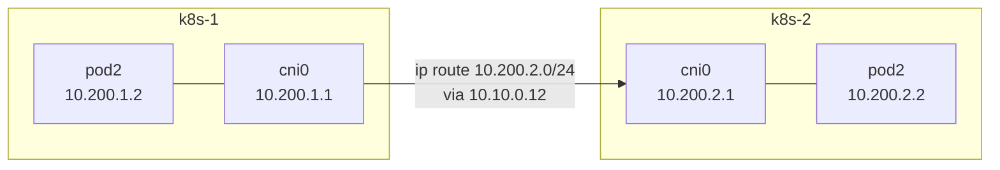
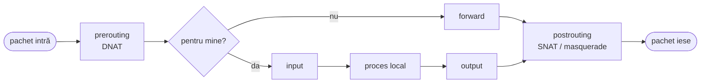

# Rețelistică Linux: de la IP la rețeaua unui pod

Un CNI nu inventează nimic. Creează un network namespace, o pereche veth, dă o
adresă, adaugă rute și, uneori, reguli NAT. În modulul ăsta faci exact asta, de
mână, pe două noduri — și la final vei ști ce face Cilium înainte de eBPF.

## Straturile care contează

| Strat | Unitate | Adresă | Cine decide drumul | Unealta ta |
|---|---|---|---|---|
| L2 — legătură | cadru (frame) | MAC | switch / bridge, după tabela MAC | `ip link`, `ip neigh`, `bridge fdb` |
| L3 — rețea | pachet | IP | router, după tabela de rutare | `ip addr`, `ip route` |
| L4 — transport | segment | port | kernelul, după socket | `ss`, `conntrack` |

Un pachet de la un pod la altul pe alt nod urcă și coboară prin toate trei: L4
în pod, L3 pe rute, L2 pe fir până la următorul hop, din nou L3, din nou L4.

## CIDR fără calculator

`10.96.0.0/12` înseamnă: primii 12 biți sunt fixați, restul de 20 sunt liberi.

| Prefix | Adrese | Exemplu în curs | Interval |
|---|---|---|---|
| `/32` | 1 | un IP LoadBalancer anunțat prin BGP | `10.10.100.20` |
| `/24` | 256 | pod CIDR-ul unui nod | `10.244.1.0 – 10.244.1.255` |
| `/16` | 65 536 | toate pod-urile | `10.244.0.0 – 10.244.255.255` |
| `/12` | 1 048 576 | toate Services | `10.96.0.0 – 10.111.255.255` |

Trucul pentru `/12`: al doilea octet are 8 biți, din care 4 sunt fixați (12 − 8),
deci variază ultimii 4 → blocuri de 16. `10.96` până la `10.96+15 = 10.111`.

**Longest prefix match**: dintre toate rutele care conțin destinația, câștigă cea
mai specifică. `10.10.100.20/32` bate `10.10.0.0/16`, care bate `0.0.0.0/0`.

```bash
ip route                  # tabela
ip route get 1.1.1.1      # ce rută ar folosi kernelul, și ce sursă
ip route get 10.10.0.12
```

## ARP: cum afli MAC-ul unui IP

Ca să trimită un pachet unui IP din aceeași rețea, kernelul are nevoie de MAC-ul
lui. Strigă în rețea: *„who-has 10.10.0.12? tell 10.10.0.11”*. Proprietarul
răspunde. Rezultatul stă în cache: `ip neigh`.

Un **ARP gratuit** e un răspuns nesolicitat: *„10.10.0.10 e la MAC-ul meu”*. Așa
se mută un IP virtual de pe o mașină pe alta în câteva milisecunde — keepalived
(modulul 07) și Cilium L2 announcements din prod folosesc exact mecanismul ăsta.

> [!NOTE]
> **🏠 De ce pool-ul LoadBalancer din prod e chiar rețeaua nodurilor**
> [networks.yaml](../../kubernetes/apps/kube-system/cilium/app/networks.yaml) din
> prod are pool-ul `10.57.57.0/24` — aceeași rețea ca nodurile. Cu ARP nu se poate
> altfel: un nod poate răspunde la „who-has” doar pentru adrese din segmentul lui.
> Cu BGP (modulul 10), adresele sunt **rutate**, nu rezolvate, deci pot fi oriunde.

## Namespaces, veth, bridge: rețeaua unui pod, de mână

Un **network namespace** e o stivă de rețea separată: propriile interfețe, rute,
reguli de firewall, `localhost`. Un **veth** e un cablu virtual cu două capete:
ce intră pe unul iese pe celălalt. Un capăt stă în namespace, celălalt în host.

> [!TIP]
> **🧠 Analogie: camerele de hotel**
> Hostul e hotelul, fiecare namespace e o cameră cu propriul telefon intern. Veth-ul
> e firul de la telefonul din cameră până la centrală (bridge-ul). Centrala știe ce
> număr e în ce cameră (tabela MAC), iar pentru apeluri în afara hotelului totul
> trece prin recepție (gateway-ul, rutarea hostului) — care pune numărul hotelului
> ca apelant (NAT).

### Laborator 1 — două „pod-uri” pe un nod

Pe **k8s-1** (încă e curat; tot ce faci aici dispare la final sau la rollback):

```bash
sudo -i
# Bridge-ul: centrala. Primește prima adresă din „pod CIDR”-ul nodului.
ip link add cni0 type bridge
ip addr add 10.200.1.1/24 dev cni0
ip link set cni0 up

for i in 2 3; do
  ip netns add pod$i
  # cablul: vethpod$i în host, eth0 în pod
  ip link add vethpod$i type veth peer name eth0 netns pod$i
  ip link set vethpod$i master cni0 up
  ip -n pod$i addr add 10.200.1.$i/24 dev eth0
  ip -n pod$i link set eth0 up
  ip -n pod$i link set lo up
  ip -n pod$i route add default via 10.200.1.1
done

ip netns exec pod2 ping -c2 10.200.1.3     # pod la pod, prin bridge (L2)
ip netns exec pod2 ping -c2 10.200.1.1     # pod la gateway
bridge fdb show br cni0 | grep -v permanent # MAC-urile învățate de „centrală”
```

Acum spre internet. Pachetul pleacă din pod cu sursa `10.200.1.2`, adresă pe care
nimeni din afară n-o cunoaște. Hostul trebuie să ruteze (`ip_forward=1`) și să
rescrie sursa:

```bash
sysctl net.ipv4.ip_forward              # 0 pe un Ubuntu proaspăt: hostul nu rutează
sysctl -w net.ipv4.ip_forward=1         # temporar; modulul 06 îl face permanent
nft add table ip podnat
nft add chain ip podnat post '{ type nat hook postrouting priority srcnat; }'
nft add rule ip podnat post ip saddr 10.200.1.0/24 oifname != "cni0" masquerade
ip netns exec pod2 ping -c2 1.1.1.1
```

Ai construit, cu mâna ta, ce face plugin-ul CNI `bridge` (pe care Kubernetes îl
folosea implicit cu kubenet) și ce face `bpf.masquerade` din
[valorile Cilium](../lab/k8s-lab/platform/cilium/values.yaml) — doar că acolo în eBPF.

### Laborator 2 — pod-uri pe noduri diferite, fără tunel

Pe **k8s-2**, același lucru cu `10.200.2.0/24` (înlocuiește `1` cu `2` în al
treilea octet). Apoi, ca pod2 de pe k8s-1 să ajungă la pod2 de pe k8s-2, fiecare
nod trebuie să știe pe unde e CIDR-ul celuilalt:

```bash
# pe k8s-1
ip route add 10.200.2.0/24 via 10.10.0.12
# pe k8s-2
ip route add 10.200.1.0/24 via 10.10.0.11

# pe ambele noduri: excepție de la NAT — între pod-uri, adresele rămân reale
nft insert rule ip podnat post ip daddr 10.200.0.0/16 return
# pe k8s-1
ip netns exec pod2 ping -c3 10.200.2.2
```

Asta e **native routing** cu **autoDirectNodeRoutes**: „pentru pod-urile nodului
X, trimite la X”. Funcționează doar când nodurile sunt în aceeași rețea L2 (pot
ajunge unul la altul fără router). Dacă n-ar fi, ai avea două opțiuni: un tunel
(VXLAN — pachetul de pod e împachetat într-un pachet între noduri) sau un router
care să învețe rutele (BGP, modulul 10).



> [!NOTE]
> **🏠 Exact configurația din prod**
> [values.yaml Cilium](../../kubernetes/apps/kube-system/cilium/app/helm/values.yaml):
> `routingMode: native`, `autoDirectNodeRoutes: true`,
> `ipv4NativeRoutingCIDR: "10.42.0.0/16"`. Cele trei noduri stau în același
> `10.57.57.0/24`, deci Cilium instalează pe fiecare rute ca cele de mai sus, spre
> celelalte două. Fără tunel nu există overhead de MTU și pachetele sunt lizibile
> în tcpdump.

### Laborator 3 — tcpdump pe fiecare hop

În timp ce `ip netns exec pod2 ping 10.200.2.2` rulează pe k8s-1, deschide trei
terminale:

```bash
# k8s-1, capătul veth al pod-ului: vezi 10.200.1.2 → 10.200.2.2
tcpdump -ni vethpod2 icmp
# k8s-1, placa fizică: aceleași adrese — native routing, fără încapsulare
tcpdump -ni ens18 icmp
# k8s-2, bridge-ul: pachetul a ajuns
tcpdump -ni cni0 icmp
```

Apoi un `ping 1.1.1.1` din pod și același `tcpdump -ni ens18`: acum sursa e
`10.10.0.11` — NAT-ul a rescris-o. Încă un nivel mai sus, pe lab-gw, sursa devine
`10.57.57.90`.

### Curățenie

```bash
# pe fiecare nod
for i in 2 3; do ip netns del pod$i; done
ip link del cni0
nft delete table ip podnat
ip route del 10.200.2.0/24 2>/dev/null; ip route del 10.200.1.0/24 2>/dev/null
```

## netfilter: unde intervin firewall-ul și NAT-ul



| Hook | Ce faci aici | Exemplu |
|---|---|---|
| `prerouting` | DNAT: schimbi destinația înainte de decizia de rutare | kube-proxy: IP-ul Service-ului → IP-ul unui pod |
| `input` | filtrezi ce ajunge la host | SSH doar din LAN |
| `forward` | filtrezi ce trece prin host | lab-gw: lab ⇄ LAN |
| `postrouting` | SNAT/masquerade: schimbi sursa la ieșire | pod → internet |

**conntrack** ține minte fiecare conexiune și traducerea ei, ca răspunsurile să fie
rescrise invers automat. `sudo conntrack -L` o arată.

> [!IMPORTANT]
> **❓ De ce Cilium, și nu iptables, în prod?**
> kube-proxy implementează fiecare Service cu reguli iptables în `prerouting`/`output`:
> cu 1 000 de Services sunt zeci de mii de reguli, parcurse **liniar**, iar orice
> schimbare rescrie tabela. Cilium pune programe eBPF direct în calea pachetului
> (la socket și la placa de rețea) cu tabele hash: căutarea e O(1) indiferent de
> număr, și se actualizează o intrare, nu toată tabela. `kubeProxyReplacement: true`
> înseamnă că iptables nu mai e pe drumul unui Service deloc. Modulul 10 intră în
> detaliu.

## DNS pe un nod Ubuntu

```bash
cat /etc/resolv.conf                 # nameserver 127.0.0.53 — stub-ul systemd-resolved
resolvectl status                    # serverele reale, pe interfață
cat /run/systemd/resolve/resolv.conf # fișierul cu serverele reale
dig +short dl.k8s.io
dig @1.1.1.1 +short dl.k8s.io        # ocolind resolver-ul local
```

`127.0.0.53` e o adresă **din loopback-ul hostului**. Dată unui pod, ar însemna
loopback-ul pod-ului — unde nu ascultă nimic. Mai rău, CoreDNS face forward la
`/etc/resolv.conf` și s-ar întreba pe sine (plugin-ul `loop` îl oprește). De aceea
kubelet-ul din [06-nodes.sh](../lab/hardway/06-nodes.sh) primește
`resolvConf: /run/systemd/resolve/resolv.conf`.

> [!NOTE]
> **🏠 DNS-ul din prod**
> [machine-network.yaml](../../talos/patches/global/machine-network.yaml):
> `disableSearchDomain: true` și resolvere publice fixe. Fără search domain, un nume
> scurt nu e completat cu domeniul LAN-ului — o sursă clasică de interogări
> surpriză și întârzieri.

## Taskuri

- [ ] Calculează intervalul lui `10.96.0.0/12` și spune dacă `10.100.0.1` și `10.112.0.1` sunt în el
- [ ] Pe un nod, `ip route get 10.10.0.12` și `ip route get 8.8.8.8` — explică diferența de rezultat
- [ ] Pe lab-gw, `ip neigh` după un ping la fiecare nod; apoi `sudo ip neigh flush all` și `tcpdump -ni <LAN> arp` în timp ce dai ping
- [ ] Laborator 1: două namespace-uri pe k8s-1 se văd între ele și ies pe internet
- [ ] Laborator 2: pod2 de pe k8s-1 dă ping la pod2 de pe k8s-2 fără NAT între ele
- [ ] Laborator 3: în tcpdump pe `ens18`, arată că adresele de pod circulă nemodificate între noduri
- [ ] Șterge excepția de NAT de pe k8s-1 și explică ce vede acum k8s-2 ca sursă
- [ ] Rulează curățenia pe ambele noduri (sau rollback la snapshot-ul `clean-os`)
- [ ] Explică de ce un pod n-ar avea voie să primească `nameserver 127.0.0.53`

## Întrebări de verificare

<details>
<summary>Cu autoDirectNodeRoutes, ce se întâmplă dacă un nod e mutat într-o altă subrețea, în spatele unui router?</summary>

Rutele de tipul `10.244.2.0/24 via 10.10.0.12` cer ca `10.10.0.12` să fie direct
accesibil (on-link). Dintr-o altă subrețea, next-hop-ul nu mai e on-link și ruta
nu poate fi instalată — pod-urile acelui nod devin inaccesibile pentru celelalte.
Soluțiile: tunel (VXLAN/Geneve) sau BGP, ca routerul dintre ele să învețe CIDR-urile.
</details>

<details>
<summary>De ce o excepție de la NAT pentru traficul pod-la-pod?</summary>

Kubernetes cere ca orice pod să vadă adresa *reală* a celuilalt pod — fără NAT
între ele. Altfel politicile de rețea (care selectează după identitatea sursei),
logurile și protocoalele care comunică adrese (gossip, clustere de baze de date)
ar vedea IP-ul nodului, nu al pod-ului. `ipv4NativeRoutingCIDR` îi spune lui Cilium
exact asta: în interiorul acestui CIDR, nu face masquerade.
</details>

<details>
<summary>Care e diferența dintre DNAT în prerouting și SNAT în postrouting, cu un exemplu din Kubernetes?</summary>

DNAT schimbă **destinația** înainte ca kernelul să decidă ruta: un pachet spre IP-ul
unui Service (`10.96.0.50:80`) devine un pachet spre un pod (`10.244.1.7:8080`) —
asta făcea kube-proxy. SNAT/masquerade schimbă **sursa** chiar înainte de ieșire:
un pod care iese spre internet apare cu IP-ul nodului. Conntrack le inversează pe
amândouă la răspuns.
</details>
