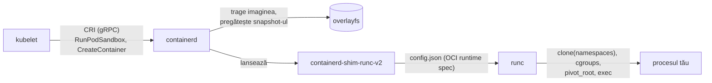

# Containere de la zero

Un container nu e o mașină virtuală mică. E **un proces Linux obișnuit**, căruia
kernelul îi arată o versiune restrânsă a lumii (namespaces), îi limitează
resursele (cgroups) și îi dă alt sistem de fișiere rădăcină (overlayfs + pivot_root).
Nimic altceva. În modulul ăsta construiești unul fără Docker, apoi vezi cum
containerd și runc fac același lucru.

## Cele trei ingrediente

| Ingredient | Ce face | Fișierul din kernel |
|---|---|---|
| **namespaces** | ce *vede* procesul: PID-uri, rețea, mount-uri, hostname, utilizatori | `/proc/<pid>/ns/*` |
| **cgroups v2** | cât *poate folosi*: CPU, memorie, PID-uri, I/O | `/sys/fs/cgroup/...` |
| **rootfs** | ce *fișiere* are: un director devenit `/` | `pivot_root(2)` |

Plus restricții de securitate: **capabilities** (bucăți din puterea lui root),
**seccomp** (ce syscall-uri sunt permise), **AppArmor/SELinux**.

> [!TIP]
> **🧠 Analogie: ochelarii, portofelul și camera**
> Namespaces sunt **ochelarii**: procesul vede doar ce îi arată ei — alt hostname,
> alte procese, altă rețea. Cgroups sunt **portofelul**: oricât ar vrea, nu poate
> cheltui mai mult de 64 MiB de memorie. Rootfs-ul e **camera** în care e închis:
> mobila (fișierele) e alta decât în restul casei. Kernelul e casa — una singură,
> împărțită de toți. De aceea un bug de kernel scapă din orice container, iar o
> mașină virtuală, care are propriul kernel, nu.

| Namespace | Izolează | Flag `unshare` |
|---|---|---|
| `pid` | arborele de procese — procesul tău devine PID 1 | `--pid --fork` |
| `net` | interfețe, rute, firewall (modulul 03) | `--net` |
| `mnt` | punctele de montare | `--mount` |
| `uts` | hostname-ul | `--uts` |
| `ipc` | memorie partajată, cozi de mesaje | `--ipc` |
| `user` | maparea UID-urilor (root în container ≠ root pe host) | `--user` |
| `cgroup` | ce parte din arborele cgroup vede | `--cgroup` |

## Laborator 1 — un container cu unshare

Pe **k8s-1** (sau lab-gw), ca root.

```bash
sudo -i
# Un rootfs: Alpine are ~3 MB.
mkdir -p /tmp/ctr/rootfs && cd /tmp/ctr
curl -fsSL https://dl-cdn.alpinelinux.org/alpine/v3.22/releases/x86_64/alpine-minirootfs-3.22.0-x86_64.tar.gz \
  | tar -xz -C rootfs

# Namespaces noi pentru PID, mount, hostname, IPC, rețea; apoi chroot în rootfs.
unshare --pid --fork --mount --uts --ipc --net --mount-proc=rootfs/proc \
  chroot rootfs /bin/sh -c 'hostname container; exec /bin/sh'
```

Înăuntru:

```sh
hostname            # container
ps                  # doar sh și ps: PID 1 e shell-ul tău
ip addr             # doar lo, și e down — net namespace gol
ls /                # rootfs-ul Alpine, nu al hostului
```

Dintr-un **alt** terminal, pe host:

```bash
ps -ef | grep '/bin/sh' | grep -v grep     # același proces, cu un PID mare, normal
ls -l /proc/<pid>/ns/                       # namespace-uri diferite de ale tale
```

Același proces are **două PID-uri**: 1 în namespace-ul lui, ~4000 pe host. Asta e
tot „containerul”.

> [!NOTE]
> **📝 chroot față de pivot_root**
> Am folosit `chroot`, nu `pivot_root`. `chroot` doar schimbă directorul rădăcină
> pentru căutări; un proces root poate ieși din el. `pivot_root` mută efectiv
> montarea rădăcinii și o demontează pe cea veche — ce folosește runc. Pentru
> laborator, `chroot` arată ideea.

## Laborator 2 — cgroups v2 de mână

```bash
# Un cgroup nou, cu limită de memorie de 50 MiB.
mkdir /sys/fs/cgroup/lab
echo "+memory +pids" > /sys/fs/cgroup/cgroup.subtree_control 2>/dev/null || true
echo $((50 * 1024 * 1024)) > /sys/fs/cgroup/lab/memory.max
echo 20 > /sys/fs/cgroup/lab/pids.max

# Mută shell-ul curent în cgroup, apoi încearcă să aloci 100 MiB.
echo $$ > /sys/fs/cgroup/lab/cgroup.procs
python3 -c 'b = bytearray(100*1024*1024); print("am alocat")'   # Killed
dmesg -T | tail -3                                                # oom-kill … memcg /lab
cat /sys/fs/cgroup/lab/memory.events                              # oom_kill 1
```

Asta face kubelet-ul pentru `resources.limits.memory: 64Mi`: scrie `memory.max` în
cgroup-ul containerului. Când procesul trece de limită, kernelul îl omoară —
`OOMKilled`, exit code 137 (modulul 02).

```bash
# Ieși din cgroup înainte să-l ștergi.
echo $$ > /sys/fs/cgroup/cgroup.procs && rmdir /sys/fs/cgroup/lab
```

> [!IMPORTANT]
> **❓ De ce `cgroupDriver: systemd` peste tot?**
> Pe un host cu systemd, systemd e proprietarul arborelui cgroup. Dacă și kubelet-ul,
> și containerd ar scrie direct în `/sys/fs/cgroup` (driverul `cgroupfs`), ar fi doi
> manageri pentru același arbore, cu vederi diferite despre cât e folosit — iar sub
> presiune de memorie nodul devine instabil. Cu driverul `systemd`, ambii îi cer lui
> systemd să creeze cgroup-urile (ca *slice*-uri și *scope*-uri). De aceea
> [06-nodes.sh](../lab/hardway/06-nodes.sh) setează `SystemdCgroup = true` în
> containerd și `cgroupDriver: systemd` în kubelet — trebuie să fie identice.

## Imagini OCI: straturi și overlayfs

O imagine nu e un disc. E o listă de **straturi** (arhive tar cu diferențe de
fișiere), un **config** (comanda, variabilele, utilizatorul) și un **manifest** care
le leagă prin hash-uri sha256. Totul e adresat după conținut: același strat folosit
de zece imagini e descărcat și stocat o singură dată.

La rulare, straturile sunt suprapuse cu **overlayfs**: straturile imaginii sunt
`lowerdir` (doar citire), iar containerul primește un `upperdir` gol unde ajunge
orice scriere. Ștergi containerul — dispare `upperdir`, imaginea rămâne neatinsă.

```bash
# Un overlay de mână
mkdir -p /tmp/ov/{lower,upper,work,merged}
echo "din imagine" > /tmp/ov/lower/a.txt
mount -t overlay overlay -o lowerdir=/tmp/ov/lower,upperdir=/tmp/ov/upper,workdir=/tmp/ov/work /tmp/ov/merged
echo "modificat în container" > /tmp/ov/merged/a.txt
cat /tmp/ov/lower/a.txt     # neschimbat
cat /tmp/ov/upper/a.txt     # copia modificată: copy-on-write
umount /tmp/ov/merged
```

> [!NOTE]
> **🏠 `discard_unpacked_layers` în prod**
> [machine-files.yaml](../../talos/patches/global/machine-files.yaml) setează în
> containerd `discard_unpacked_layers = false`. Implicit, containerd aruncă arhivele
> straturilor după ce le-a despachetat (economisește disc). Păstrarea lor permite
> unui nod să servească straturile altor noduri — ce face Spegel, un cache P2P de
> imagini. Prod l-a scos când a rămas cu un singur nod (vezi comentariul din
> [kube-system/kustomization.yaml](../../kubernetes/apps/kube-system/kustomization.yaml)).

## Cine face ce: kubelet → containerd → runc



| Componentă | Rol | Comandă de inspecție |
|---|---|---|
| **kubelet** | decide *ce* containere trebuie să ruleze pe nod | `journalctl -u kubelet` |
| **containerd** | imagini, snapshot-uri, ciclul de viață; servește **CRI** | `sudo ctr -n k8s.io containers ls` |
| **shim** | rămâne părintele containerului; containerd poate reporni fără să-l omoare | `ps -ef \| grep shim` |
| **runc** | face syscall-urile din laboratorul 1 și iese | — (rulează milisecunde) |
| **crictl** | clientul CRI, pentru tine: vezi ce vede kubelet-ul | `sudo crictl ps` |

Un **pod** e, la nivelul ăsta, un *sandbox*: un container minuscul („pause”) care
ține namespace-urile de rețea și IPC, plus containerele tale care **intră** în
namespace-urile lui. De aceea containerele unui pod își vorbesc pe `localhost`.

## Laborator 3 — o imagine bună, ca în prod

Imaginile din prod rulează cu restricții pe care orice imagine nouă ar trebui să
le suporte. Din [helmrelease-ul Radarr](../../kubernetes/apps/default/radarr/app/helmrelease.yaml):

```yaml
securityContext:
  allowPrivilegeEscalation: false   # niciun setuid nu mai urcă privilegii
  readOnlyRootFilesystem: true      # nimic nu scrie în imagine
  capabilities: { drop: ["ALL"] }   # nici măcar puterile mici ale lui root
defaultPodOptions:
  securityContext:
    runAsNonRoot: true
    runAsUser: 1000
```

Citește [Dockerfile-ul lab-app](../lab/k8s-lab/src/lab-app/Dockerfile): build în
două etape, binar static, imagine finală `distroless/static:nonroot` — fără shell,
fără manager de pachete, utilizator 65532. Funcționează sub toate restricțiile de
mai sus. Îl vei construi în CI în modulul 16; acum doar înțelege-l.

> [!WARNING]
> **⚠️ `readOnlyRootFilesystem` și aplicațiile care scriu în /tmp**
> Multe aplicații scriu fișiere temporare. Cu rootfs read-only, eșuează. Soluția nu
> e să renunți la restricție, ci să montezi un `emptyDir` exact unde scriu — vezi
> `tmp: type: emptyDir` în Radarr. Prod are și un caz mai subtil, pentru Loki:
> [statefulset-sidecar-tmpdir.yaml](../../kubernetes/apps/observability/loki/app/patches/statefulset-sidecar-tmpdir.yaml).

## Taskuri

- [ ] Laborator 1: pornește shell-ul izolat; arată că `ps` vede doar 2 procese și că rețeaua e goală
- [ ] Găsește același proces pe host și compară `ls -l /proc/<pid>/ns` cu `ls -l /proc/self/ns`
- [ ] Laborator 2: provoacă un OOM kill într-un cgroup cu `memory.max` și găsește-l în `dmesg` și `memory.events`
- [ ] Setează `pids.max` la 5 și rulează un fork bomb controlat (`for i in $(seq 10); do sleep 100 & done`) — ce eroare apare?
- [ ] Laborator overlayfs: arată că o scriere în `merged` ajunge în `upper`, nu în `lower`
- [ ] Explică, în notițe, de ce un pod are un container „pause”
- [ ] Citește Dockerfile-ul lab-app și explică fiecare linie, inclusiv de ce `go.mod` e copiat înaintea codului
- [ ] Curăță: `rm -rf /tmp/ctr /tmp/ov`

## Întrebări de verificare

<details>
<summary>Un container rulează ca root (UID 0). E același root ca pe host?</summary>

Fără user namespace, **da**: UID 0 în container e UID 0 pe host, limitat doar de
capabilities, seccomp și AppArmor. Dacă scapă din container (bug de kernel sau o
montare greșită), e root pe nod. De aceea prod insistă pe `runAsNonRoot` și
`drop: ALL`. Cu user namespaces (`hostUsers: false` în Kubernetes), UID 0 din
container e mapat pe un UID neprivilegiat al hostului.
</details>

<details>
<summary>containerd repornește. Ce se întâmplă cu containerele care rulează?</summary>

Nimic — continuă să ruleze. Părintele lor e shim-ul, nu containerd, iar unit-ul
are `KillMode=process`, deci systemd oprește doar procesul containerd. La pornire,
containerd se reconectează la shim-uri. Fără asta, un upgrade de containerd ar
reporni toate pod-urile de pe nod.
</details>

<details>
<summary>Două imagini diferite pornesc din același `debian:12`. Câtă memorie de disc ocupă stratul de bază?</summary>

O singură dată. Straturile sunt adresate după hash-ul conținutului; containerd vede
că digest-ul există deja și nu-l descarcă și nu-l stochează din nou. De aceea
imaginile cu o bază comună sunt ieftine, iar `imageMaximumGCAge` din prod curăță
straturi pe care nu le mai folosește nimeni.
</details>
