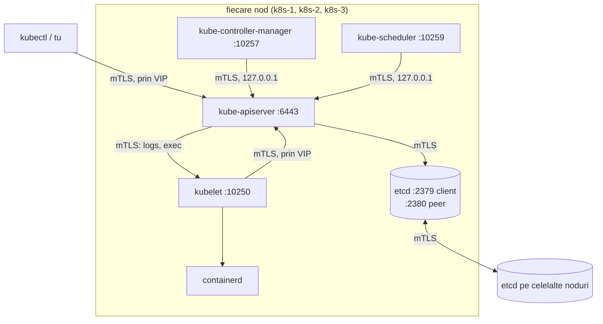

# Hard Way I: PKI-ul clusterului și etcd HA

Trei module, un cluster: azi certificatele și baza de date, în 07 control plane-ul,
în 08 nodurile. Lucrezi pe **lab-gw** (jumpbox-ul) din `~/infrastructure/learn/lab`.
Fiecare pas e un script comentat din [hardway/](../lab/hardway/lib.sh): **citește-l
înainte să-l rulezi** — comentariile sunt jumătate din lecție.

## Harta clusterului



**Regula de aur**: doar apiserver-ul vorbește cu etcd. Toate celelalte componente —
inclusiv scheduler-ul și controller-manager-ul — sunt clienți ai apiserver-ului, ca
și tine cu kubectl. Apiserver-ul e singura poartă: autentifică, autorizează, validează,
apoi scrie în etcd.

| Port | Cine ascultă | Cine se conectează |
|---|---|---|
| 6443 | kube-apiserver | toată lumea |
| 2379 | etcd (clienți) | doar apiserver-ul (și tu cu etcdctl) |
| 2380 | etcd (peers) | ceilalți membri etcd |
| 2381 | etcd (metrici, HTTP) | Prometheus — ca `listen-metrics-urls` din prod |
| 10250 | kubelet | apiserver-ul (logs, exec), metrics-server |
| 10257 / 10259 | controller-manager / scheduler (health, metrici) | Prometheus |

## Cine prezintă ce certificat, cui

Asta e tabelul pe care îl vei consulta de fiecare dată când apare un `x509`. Toate
fișierele sunt generate de [02-pki.sh](../lab/hardway/02-pki.sh).

| Conexiune | Clientul prezintă | Serverul prezintă | Serverul verifică clientul cu |
|---|---|---|---|
| kubectl → apiserver | `admin` (CN=admin, O=system:masters) | `apiserver` | `ca` (`--client-ca-file`) |
| kubelet → apiserver | `kubelet-<nod>` (CN=system:node:&lt;nod&gt;) | `apiserver` | `ca` |
| controller-manager, scheduler → apiserver | `controller-manager`, `scheduler` | `apiserver` | `ca` |
| apiserver → etcd | `apiserver-etcd-client` | `etcd/<nod>-server` | `etcd/ca` |
| etcd ⇄ etcd | `etcd/<nod>-peer` | `etcd/<nod>-peer` | `etcd/ca` |
| apiserver → kubelet | `apiserver-kubelet-client` | `kubelet-<nod>-serving` | `ca` (în config-ul kubelet) |
| apiserver → metrics-server (agregare) | `front-proxy-client` | certificatul metrics-server | `front-proxy-ca` |

Plus două lucruri care **nu** sunt certificate: `sa.key`/`sa.pub` semnează și verifică
token-urile ServiceAccount (JWT-uri), iar `encryption.key` criptează Secretele în etcd.

> [!TIP]
> **🧠 Analogie: ecusoanele dintr-o clădire de birouri**
> Fiecare angajat are un ecuson (certificat client) emis de departamentul de
> securitate (CA). Pe ecuson scrie numele și departamentul (CN și O). Portarul
> (apiserver-ul) nu ține o listă de oameni — se uită doar dacă ecusonul e emis de
> departamentul lui și ce departament scrie pe el. Seiful din subsol (etcd) are alt
> departament de securitate, cu alte ecusoane: un ecuson de angajat obișnuit nu
> deschide seiful, oricât de autentic ar fi.

> [!NOTE]
> **🏠 Unde stau toate acestea în prod**
> Talos le generează din [talsecret.sops.yaml](../../talos/talsecret.sops.yaml) —
> CA-urile clusterului, criptate cu SOPS. `additionalApiServerCertSans` din
> [talconfig.yaml](../../talos/talconfig.yaml) e exact lista de SAN-uri a
> certificatului `apiserver` de mai sus, iar `endpoint: https://10.57.57.88:6443`
> e VIP-ul pe care îl vor folosi kubeconfig-urile.

## Pasul 00 — jumpbox-ul

```bash
cd ~/infrastructure/learn/lab
bash hardway/00-jumpbox.sh
exec bash -l          # ~/.local/bin intră în PATH
kubectl version --client && etcdctl version && helm version --short
```

Scriptul descarcă fiecare binar o singură dată în `~/hardway/downloads` și îi
verifică **sha256**-ul publicat de proiect. Versiunile vin din
[versions.env](../lab/versions.env).

## Pasul 01 — sistemul de operare

```bash
bash hardway/01-prepare-nodes.sh
```

Citește comentariile din [01-prepare-nodes.sh](../lab/hardway/01-prepare-nodes.sh):
swap oprit, module de kernel, sysctl-uri, pachete, hostname. Pe Talos totul e
deja în imagine — iar `iscsi_tcp` și `open-iscsi` sunt motivul pentru care prod
construiește imagini cu extensia `iscsi-tools` (comentariul de la `kubernetes-1` din
[talconfig.yaml](../../talos/talconfig.yaml)).

## Pasul 02 — PKI-ul

Înainte de script, fă **un** certificat de mână, ca să vezi că scriptul nu face nimic
special. Certificatul de client al kubelet-ului de pe k8s-1:

```bash
mkdir -p ~/hardway/manual && cd ~/hardway/manual
# Ai nevoie de CA. Scriptul îl creează; rulează doar partea de CA, apoi revino:
bash ~/infrastructure/learn/lab/hardway/02-pki.sh >/dev/null   # creează tot, inclusiv CA-ul
openssl genpkey -algorithm EC -pkeyopt ec_paramgen_curve:P-256 -out k1.key
openssl req -new -key k1.key -subj "/O=system:nodes/CN=system:node:k8s-1" -out k1.csr
printf 'basicConstraints=critical,CA:FALSE\nkeyUsage=critical,digitalSignature\nextendedKeyUsage=clientAuth\n' > k1.ext
openssl x509 -req -in k1.csr -CA ~/hardway/pki/ca.crt -CAkey ~/hardway/pki/ca.key \
  -CAcreateserial -days 365 -sha256 -extfile k1.ext -out k1.crt
diff <(openssl x509 -in k1.crt -noout -subject -ext extendedKeyUsage) \
     <(openssl x509 -in ~/hardway/pki/kubelet-k8s-1.crt -noout -subject -ext extendedKeyUsage)
cd ~/infrastructure/learn/lab
```

Niciun `diff` = același subiect, aceeași utilizare. Acum uită-te la ce a creat scriptul:

```bash
ls ~/hardway/pki ~/hardway/pki/etcd
openssl x509 -in ~/hardway/pki/apiserver.crt -noout -ext subjectAltName
```

> [!IMPORTANT]
> **❓ De ce `10.96.0.1` e în SAN-urile apiserver-ului?**
> Pod-urile găsesc API-ul prin Service-ul `kubernetes` din namespace-ul `default`,
> care primește **primul** IP din `--service-cluster-ip-range` — `10.96.0.1`. Un pod
> care apelează `https://kubernetes.default.svc` ajunge la `10.96.0.1`, iar
> certificatul trebuie să fie valabil pentru adresa *apelată*. Uită acest SAN și
> fiecare controller din cluster (Cilium, ArgoCD, cert-manager) eșuează cu
> „certificate is valid for …, not 10.96.0.1”.

## Pasul 03 — kubeconfig-urile

```bash
bash hardway/03-kubeconfigs.sh
kubectl config view --kubeconfig ~/hardway/kubeconfigs/kubelet-k8s-1.kubeconfig --minify
```

Un kubeconfig are trei bucăți: **cluster** (URL + CA), **user** (certificat + cheie),
**context** (care user pe care cluster). Numele utilizatorului din fișier e o etichetă
locală; apiserver-ul nu-l vede niciodată — vede doar certificatul.

De ce două URL-uri diferite: `admin` și kubelet-ele merg la **VIP** (trebuie să
supraviețuiască unui nod mort), controller-manager-ul și scheduler-ul la
**127.0.0.1** (rulează lângă un apiserver; dacă VIP-ul se mută, ele nu observă nimic).

## etcd: o bază de date care votează

etcd păstrează **toată** starea clusterului: fiecare obiect pe care `kubectl get` îl
arată e o cheie sub `/registry/...`. Restul control plane-ului e fără stare — îl poți
șterge și reporni oricând. etcd nu.

Pentru a rămâne consistent pe trei mașini, etcd folosește algoritmul **Raft**:

1. Membrii aleg un **lider**. Doar liderul acceptă scrieri.
2. Liderul adaugă scrierea în jurnalul lui (WAL, cu `fsync` pe disc) și o trimite
   celorlalți.
3. Scrierea e **confirmată** (commit) când o *majoritate* a scris-o pe disc.
4. Dacă un follower nu aude de la lider timp de `election-timeout`, pornește o alegere.

| Membri | Majoritate (quorum) | Pot pierde | Notă |
|---|---|---|---|
| 1 | 1 | 0 | prod până în august 2026 |
| 2 | 2 | **0** | mai rău decât 1: două puncte de cădere, zero toleranță |
| 3 | 2 | 1 | prod azi, lab |
| 4 | 3 | 1 | la fel ca 3, dar mai lent |
| 5 | 3 | 2 | |

> [!TIP]
> **🧠 Analogie: consiliul de administrație**
> Trei administratori. O decizie (scriere) e valabilă doar cu semnătura a doi.
> Președintele (liderul) propune; ceilalți semnează după ce au trecut decizia în
> registrul lor (fsync). Dacă președintele nu mai răspunde la telefon un timp
> (`election-timeout`), ceilalți doi aleg alt președinte. Dacă rămâne unul singur,
> nu mai poate decide nimic — dar poate încă *citi* registrul vechi.

> [!NOTE]
> **🏠 etcd în prod: discul face legea**
> Pentru că un commit cere o majoritate, **cei mai rapizi doi** membri dictează
> viteza, nu cel mai lent ([THREE-NODE.md](../../talos/THREE-NODE.md), „etcd sits on
> three very different disks”). Iar `election-timeout: "5000"` din
> [cluster.yaml](../../talos/patches/controller/cluster.yaml) vine cu măsurătoarea:
> 38 de fsync-uri peste 1 s în trei zile, fiecare citit drept „lider mort” cu
> valoarea implicită de 1000 ms — alegeri false, de 13 ori pe zi. Lab-ul păstrează
> valorile implicite (100/1000): discurile lui sunt rapide. Citește comentariul
> întreg; e cel mai bun text despre tuning etcd pe care îl vei găsi.

## Pasul 04 — etcd

```bash
bash hardway/04-etcd.sh
```

Scriptul construiește pentru fiecare nod un director de *staging* care oglindește
`/`-ul nodului, îl împinge cu `tar | ssh | tar`, și pornește cei trei membri **în
paralel**. Uită-te ce ajunge pe k8s-1:

```bash
find ~/hardway/stage/04-etcd/k8s-1 -type f | sort
```

`Type=notify` + quorum: un membru singur nu poate deveni „ready”, deci pornirea
secvențială s-ar bloca la primul. Încearcă-o mai jos, intenționat.

## Laborator — strică etcd

```bash
source ~/hardway/etcdctl.env
etcdctl endpoint status --cluster -w table      # cine e liderul? (IS LEADER)
etcdctl put /lab/salut "din etcd"
etcdctl get /lab/salut
```

**Pierzi un membru** — clusterul supraviețuiește:

```bash
ssh k8s-3 sudo systemctl stop etcd
etcdctl endpoint health --cluster               # k8s-3 unhealthy, ceilalți ok
etcdctl put /lab/doi "merge cu 2 din 3"         # merge: quorum 2/3
```

**Pierzi al doilea** — clusterul îngheață:

```bash
ssh k8s-2 sudo systemctl stop etcd
etcdctl put /lab/trei "nu va merge"             # timeout: fără quorum, nicio scriere
etcdctl get /lab/salut                          # timeout: și citirea implicită cere quorum
etcdctl --endpoints=https://10.10.0.11:2379 get /lab/salut --consistency=s   # merge: citire locală
```

Citirea **serializabilă** (`--consistency=s`) răspunde din copia locală, fără să
întrebe ceilalți membri — poate fi învechită, dar răspunde. Citirea implicită
(**linearizabilă**) garantează cea mai nouă valoare și de aceea cere quorum.

**Repornește** și urmărește alegerea:

```bash
ssh k8s-2 sudo systemctl start etcd; ssh k8s-3 sudo systemctl start etcd
etcdctl endpoint status --cluster -w table
ssh k8s-1 'sudo journalctl -u etcd --since "5 min ago" | grep -iE "elected|became leader|lost leader"'
```

**Mută liderul**: oprește doar liderul curent, numără secundele până când `put`
merge din nou, și compară cu `--election-timeout=1000` din unit.

## Taskuri

- [ ] Rulează `00-jumpbox.sh`; verifică că `kubectl`, `etcdctl`, `helm`, `cilium` sunt în PATH
- [ ] Rulează `01-prepare-nodes.sh`; pe un nod, verifică `swapon --show` (gol) și `sysctl net.ipv4.tcp_congestion_control`
- [ ] Emite de mână certificatul client al kubelet-ului k8s-1 și compară-l cu cel din `02-pki.sh`
- [ ] Listează SAN-urile din `apiserver.crt` și explică fiecare intrare
- [ ] Explică, pentru `apiserver-etcd-client.crt`, de ce e semnat de `etcd/ca` și nu de `ca`
- [ ] Rulează `03-kubeconfigs.sh`; decodează certificatul dintr-un kubeconfig (`client-certificate-data` | base64 -d | openssl x509 -noout -subject)
- [ ] Rulează `04-etcd.sh`; `etcdctl member list -w table` arată 3 membri `started`
- [ ] Pierde un membru și scrie; pierde doi și arată că scrierea eșuează, dar citirea serializabilă merge
- [ ] Oprește liderul și măsoară timpul până la alegerea unui nou lider
- [ ] Pe un nod, `sudo ls -la /var/lib/etcd/member` — găsește WAL-ul și snapshot-urile
- [ ] Citește comentariul `election-timeout` din [cluster.yaml](../../talos/patches/controller/cluster.yaml) și rezumă-l în 3 propoziții în notițe
- [ ] Fă snapshot Proxmox `etcd-up` la cele trei noduri

## Întrebări de verificare

<details>
<summary>De ce nu are sens un cluster etcd cu 2 membri?</summary>

Quorum-ul lui 2 e 2: pierzi oricare membru și nu mai ai majoritate. Ai dublat
punctele de cădere (oricare din cele două mașini oprește clusterul) fără să câștigi
toleranță. Cu 3 membri, quorum-ul e tot 2, dar poți pierde unul. De aceea clusterele
etcd au număr impar de membri.
</details>

<details>
<summary>Prod nu face backup la etcd. Cum e asta o decizie corectă?</summary>

[architecture.md](../../docs/architecture.md) clasifică etcd ca **tier 3**: tot ce
conține poate fi recreat. Starea dorită e în Git (Flux o reaplică), volumele sunt în
backup-urile Longhorn, iar trei membri în trei carcase reconstruiesc un membru
pierdut din ceilalți doi. Pierderea tuturor trei odată înseamnă reconstruire DR din
repo — exersată pe 2026-08-29. E o decizie posibilă **doar** pentru că GitOps face
etcd reconstruibil; într-un cluster unde oamenii fac `kubectl apply` de mână, etcd
ar fi tier 1. În modulul 18 vei face totuși un snapshot, ca să știi cum.
</details>

<details>
<summary>Apiserver-ul de pe k8s-1 vorbește cu etcd-ul de pe k8s-1. Ce se întâmplă dacă doar etcd-ul de pe k8s-1 moare?</summary>

Nimic vizibil: apiserver-ul are în `--etcd-servers` toți trei membrii și trece la
altul. De aceea flag-ul primește lista completă, nu doar `127.0.0.1`. Clusterul etcd
are încă quorum (2/3), deci scrierile continuă.
</details>

<details>
<summary>Ce reprezintă flag-urile `--initial-cluster*` după prima pornire?</summary>

Nimic — sunt ignorate odată ce `--data-dir` conține date. Membrii și ID-urile lor
trăiesc în data dir. Consecința practică: ca să adaugi sau să scoți un membru nu
editezi flag-ul, ci folosești `etcdctl member add/remove`, iar membrul nou pornește
cu `--initial-cluster-state=existing`.
</details>
