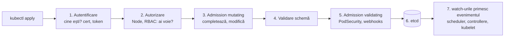

# Hard Way II: control plane HA și VIP

etcd ține starea. Acum pui deasupra creierul: **apiserver-ul** (poarta), **scheduler-ul**
(decide unde) și **controller-manager-ul** (face realitatea să semene cu ce s-a cerut).
Câte unul pe fiecare nod, iar în față un IP virtual care urmează un apiserver sănătos.

## Cele trei componente

| Componentă | Ce face | Stare? | Câte active odată |
|---|---|---|---|
| **kube-apiserver** | API REST: autentifică, autorizează, validează, scrie/citește etcd, servește *watch*-uri | nu | toate trei (active-active) |
| **kube-scheduler** | pentru fiecare pod fără nod: filtrează nodurile posibile, le dă scor, alege unul | nu | unul (leader election) |
| **kube-controller-manager** | ~40 de bucle de control: Deployment → ReplicaSet → Pod, Node lifecycle, EndpointSlice, ServiceAccount, semnare CSR, alocare pod CIDR | nu | unul (leader election) |

> [!TIP]
> **🧠 Analogie: restaurantul**
> Apiserver-ul e **ospătarul**: singurul care vorbește cu clienții și singurul care
> scrie în **registrul de comenzi** (etcd). Bucătarii nu vin niciodată în sală.
> Scheduler-ul e **șeful de sală**: vede o comandă nealocată și decide la ce stație
> se gătește. Controller-manager-ul e **șeful bucătar**: se uită constant la
> registru — „s-au cerut 3 porții, sunt doar 2 pe pass” — și dă comanda pentru a
> treia. Kubelet-ul (modulul 08) e **bucătarul de la stație**, care chiar gătește.
> Nimeni nu-și dă ordine direct: toți citesc și scriu în registru, prin ospătar.

## Drumul unui request



| Pas | Flag-ul care îl configurează | Eroarea când refuză |
|---|---|---|
| Autentificare | `--client-ca-file`, `--service-account-key-file` | `401 Unauthorized` |
| Autorizare | `--authorization-mode=Node,RBAC` | `403 Forbidden: User "x" cannot …` |
| Admission | `--enable-admission-plugins=NodeRestriction` (+ cele implicite) | `admission webhook … denied`, `violates PodSecurity` |
| Validare | schema OpenAPI a tipului | `field is immutable`, `unknown field` |

Pasul 7 e cheia întregului Kubernetes: **nimeni nu e notificat direct**. Fiecare
componentă ține un *watch* deschis pe apiserver și reacționează la evenimente.
Scheduler-ul vede un pod nou fără `nodeName`; kubelet-ul vede un pod cu `nodeName`
egal cu el.

> [!NOTE]
> **🏠 Admission în prod**
> [admission-controller-patch.yaml](../../talos/patches/controller/admission-controller-patch.yaml)
> configurează plugin-ul **PodSecurity**: `enforce: privileged` (nimic nu e
> blocat), `warn` și `audit: restricted` (orice pod care n-ar trece de profilul
> strict apare în avertismente și audit). Comentariul explică și o capcană de merge:
> o listă goală în patch **nu** suprascrie lista implicită a Talos. Modulul 17 face
> același lucru în lab, prin etichete pe namespace.

## Flag-urile care contează

Unit-urile sunt generate de [05-control-plane.sh](../lab/hardway/05-control-plane.sh).
Nu le memora pe toate; înțelege-le pe acestea:

**kube-apiserver**

| Flag | De ce |
|---|---|
| `--advertise-address=<IP nod>` | adresa pe care o publică în Endpoints-ul Service-ului `kubernetes` |
| `--etcd-servers=<toți 3>` | dacă etcd-ul local moare, folosește altul |
| `--service-cluster-ip-range=10.96.0.0/12` | de unde se aloca IP-urile Services; primul (`.1`) e al API-ului |
| `--service-account-issuer`, `--service-account-signing-key-file` | apiserver-ul semnează token-urile pod-urilor cu `sa.key`; oricine are `sa.pub` le poate verifica |
| `--kubelet-certificate-authority` | verifică certificatul de server al kubelet-ului — fără el, apiserver-ul ar accepta orice kubelet |
| `--requestheader-*`, `--proxy-client-*` | stratul de agregare: apiserver-ul trimite mai departe cereri către API-uri externe (metrics-server) și le spune cine e utilizatorul prin headere semnate |
| `--enable-aggregator-routing=true` | trimite cererile agregate direct la pod, nu prin ClusterIP — util fără kube-proxy pe drumul apiserver-ului; identic cu prod |
| `--encryption-provider-config` | Secretele sunt criptate înainte să ajungă în etcd |
| `--audit-policy-file`, `--audit-log-path` | cine a făcut ce, când (modulul 17) |

**kube-controller-manager**

| Flag | De ce |
|---|---|
| `--allocate-node-cidrs`, `--cluster-cidr`, `--node-cidr-mask-size=24` | dă fiecărui nod un `/24` din `10.244.0.0/16` (`.spec.podCIDR`); Cilium cu `ipam.mode: kubernetes` îl folosește |
| `--cluster-signing-cert/key-file` | semnează CSR-urile aprobate (certificate de kubelet, de utilizator) |
| `--service-account-private-key-file` | semnează token-urile pentru ServiceAccount-uri |
| `--use-service-account-credentials` | fiecare controller rulează cu propriul ServiceAccount, cu RBAC minim, nu cu identitatea întregului controller-manager |
| `--leader-elect` | doar o copie lucrează; celelalte așteaptă |
| `--bind-address=0.0.0.0` | portul de metrici (10257) accesibil Prometheus-ului — prod setează exact asta în [cluster.yaml](../../talos/patches/controller/cluster.yaml) |

## Pasul 05

```bash
bash hardway/05-control-plane.sh
```

La final scriptul instalează keepalived (vezi mai jos), aplică un ClusterRoleBinding
și îți arată cine deține lease-urile. De pe lab-gw, kubeconfig-ul `admin` merge deja:

```bash
kubectl get --raw='/readyz?verbose' | tail
kubectl get namespaces
kubectl get nodes        # niciun nod: kubelet-ele vin în modulul 08
```

## Leader election

Scheduler-ul și controller-manager-ul rulează pe toate cele trei noduri, dar doar
unul lucrează. Ceilalți încearcă periodic să preia un **Lease** — un obiect mic în
`kube-system` cu numele deținătorului și un termen. Deținătorul îl reînnoiește la
câteva secunde; dacă nu mai reînnoiește, altul îl preia.

```bash
kubectl -n kube-system get lease kube-scheduler kube-controller-manager -o wide
# Oprește liderul controller-manager-ului și urmărește lease-ul schimbându-și deținătorul:
HOLDER=$(kubectl -n kube-system get lease kube-controller-manager -o jsonpath='{.spec.holderIdentity}' | cut -d_ -f1)
ssh "$HOLDER" sudo systemctl stop kube-controller-manager
watch -n2 'kubectl -n kube-system get lease kube-controller-manager -o jsonpath="{.spec.holderIdentity}{\"\n\"}"'
ssh "$HOLDER" sudo systemctl start kube-controller-manager
```

> [!IMPORTANT]
> **❓ De ce leader election și nu toate trei active?**
> Două controllere care fac același lucru simultan s-ar călca pe picioare: amândouă
> văd „lipsește un pod” și creează câte unul — acum sunt prea multe, și amândouă
> șterg câte unul. Apiserver-ul, în schimb, nu ia decizii: fiecare cerere e
> independentă, iar etcd serializează scrierile. De aceea apiserver-ele sunt
> active-active, iar controllerele active-pasiv.

## Secretele, criptate la rest

```bash
kubectl create secret generic proba --from-literal=parola=foarte-secret
source ~/hardway/etcdctl.env
etcdctl get /registry/secrets/default/proba | hexdump -C | head
```

Vezi `k8s:enc:secretbox:v1:key1:` urmat de bytes ilizibili. Fără
`--encryption-provider-config`, ai vedea `foarte-secret` în clar — Secretele sunt
doar base64 în API, iar base64 nu e criptare. Cine are acces la discul etcd sau la un
snapshot are toate secretele clusterului, dacă nu sunt criptate aici.

## VIP-ul: un IP care urmează un apiserver sănătos

Ai trei apiserver-e, dar un client vrea **o** adresă. Opțiunile, de la simplu la
complex:

| Mecanism | Cum | Activ | Folosit de |
|---|---|---|---|
| **VIP VRRP** (keepalived) | nodurile votează cine deține IP-ul; deținătorul răspunde la ARP | active-pasiv | lab |
| **VIP Talos** | deținătorul e cine are un lease în etcd | active-pasiv | prod (`vip.ip: 10.57.57.88`) |
| **kube-vip** | VIP ca static pod, prin ARP sau BGP | active-pasiv sau BGP ECMP | mulți cu kubeadm |
| **HAProxy + keepalived** | VIP în fața unui load balancer TCP | active-active | kubeadm „clasic” |
| **Load balancer local** | pe fiecare nod, un proxy pe 127.0.0.1 către toate apiserver-ele | active-active | prod: KubePrism `127.0.0.1:7445` |

**VRRP**, pe scurt: nodurile își trimit anunțuri la fiecare secundă (`advert_int 1`)
cu prioritatea lor. Cel cu prioritatea cea mai mare e MASTER și adaugă VIP-ul pe
interfață, anunțând asta cu un ARP gratuit (modulul 03). Scriptul de verificare
scade prioritatea cu 50 când apiserver-ul local nu răspunde la `/readyz` — iar VIP-ul
pleacă spre următorul.

Citește [keepalived.sh](../lab/hardway/keepalived.sh) și configurația de pe un nod:

```bash
ssh k8s-1 sudo cat /etc/keepalived/keepalived.conf
for n in k8s-1 k8s-2 k8s-3; do echo -n "$n: "; ssh $n "ip -4 -o addr show | grep -q ' 10.10.0.10/' && echo VIP || echo -"; done
```

> [!NOTE]
> **🏠 Prod are două mecanisme, și Cilium îl folosește pe al doilea**
> VIP-ul Talos (`10.57.57.88`) e pentru clienții din afară (kubectl, talosctl). În
> interiorul nodurilor, Talos rulează **KubePrism**: un load balancer pe
> `127.0.0.1:7445` spre toate apiserver-ele. De aceea
> [valorile Cilium din prod](../../kubernetes/apps/kube-system/cilium/app/helm/values.yaml)
> au `k8sServiceHost: 127.0.0.1` / `k8sServicePort: 7445` — iar lab-ul, fără
> KubePrism, pune VIP-ul.

## Laborator — failover

Pe lab-gw, un terminal care măsoară disponibilitatea API-ului:

```bash
while true; do
  printf '%s ' "$(date +%T)"
  curl -sk -o /dev/null -w '%{http_code}\n' --max-time 1 https://10.10.0.10:6443/readyz
  sleep 0.5
done
```

În alt terminal, oprește apiserver-ul de pe nodul care are VIP-ul:

```bash
ssh k8s-1 sudo systemctl stop kube-apiserver
ssh k8s-1 sudo journalctl -u keepalived -n 20 --no-pager    # „Script chk_apiserver now returning 7”, „Entering BACKUP STATE”
ssh k8s-2 "ip -4 -o addr show | grep 10.10.0.10"           # VIP-ul s-a mutat
ssh k8s-1 sudo systemctl start kube-apiserver               # și se întoarce (preempt)
```

Numără câte linii fără `200` vezi: `fall 2` × `interval 3` ≈ 6 secunde de detecție,
plus ~1 secundă de VRRP. Încearcă apoi `tcpdump -ni ens18 arp` pe lab-gw în timpul
failover-ului ca să prinzi ARP-ul gratuit.

## Taskuri

- [ ] Rulează `05-control-plane.sh`; `kubectl get --raw='/readyz?verbose'` se termină cu `readyz check passed`
- [ ] Pe un nod, `systemctl cat kube-apiserver` și explică cinci flag-uri din tabel fără să te uiți la el
- [ ] `kubectl get --raw /api/v1/namespaces/default/endpoints/kubernetes` — de ce sunt trei adrese și de unde vin?
- [ ] Oprește liderul controller-manager-ului și arată că lease-ul trece la alt nod în ~15 s
- [ ] Creează un Secret și arată în etcd că e criptat (`k8s:enc:secretbox`)
- [ ] Rulează bucla de `curl` și provoacă un failover de VIP; notează câte secunde a durat
- [ ] Prinde ARP-ul gratuit al failover-ului cu `tcpdump` pe lab-gw
- [ ] `sudo tail -f /var/log/kubernetes/audit.log | jq -c '{user: .user.username, verb, uri: .requestURI}'` pe nodul cu VIP, în timp ce rulezi un `kubectl create`
- [ ] Explică în notițe de ce controller-manager-ul și scheduler-ul vorbesc cu `127.0.0.1`, nu cu VIP-ul
- [ ] Fă snapshot Proxmox `control-plane-up`

## Întrebări de verificare

<details>
<summary>Toate cele trei kube-scheduler sunt oprite. Ce se întâmplă cu pod-urile care rulează? Și cu un Deployment nou?</summary>

Pod-urile existente rulează mai departe: kubelet-ul nu are nevoie de scheduler ca să
le țină în viață. Un pod nou rămâne `Pending` fără niciun eveniment de scheduling —
nimeni nu-i completează `nodeName`. Deployment-ul și ReplicaSet-ul se creează normal
(asta e treaba controller-manager-ului). E un test bun de înțelegere: fiecare
componentă are o singură responsabilitate.
</details>

<details>
<summary>Dacă VIP-ul e pe k8s-1 și etcd-ul de pe k8s-1 moare, se mută VIP-ul?</summary>

Nu neapărat. Apiserver-ul de pe k8s-1 trece la alt membru etcd (are toată lista),
deci `/readyz` rămâne verde și VIP-ul stă pe loc — corect, pentru că API-ul încă
funcționează. VIP-ul pleacă doar dacă `/readyz` local cade: apiserver-ul a murit sau
nu mai ajunge la **niciun** membru etcd cu quorum.
</details>

<details>
<summary>De ce `--use-service-account-credentials` contează pentru securitate?</summary>

Fără el, toate controllerele rulează cu identitatea `system:kube-controller-manager`,
care are nevoie de drepturile tuturor la un loc. Cu el, fiecare controller primește un
ServiceAccount propriu în `kube-system` (de exemplu `deployment-controller`) cu un
ClusterRole minim. O vulnerabilitate într-un controller dă acces doar la ce îi trebuie
lui. E principiul pe care prod îl aplică la [homepage](../../kubernetes/apps/default/homepage/app/rbac.yaml):
doar `get/list/watch`, nimic în plus.
</details>
