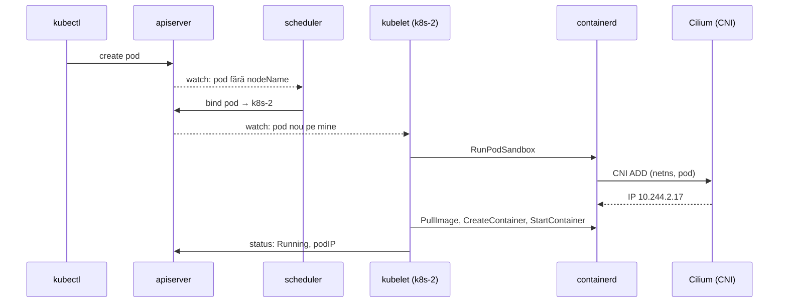

# Hard Way III: containerd, kubelet, Cilium, CoreDNS

Control plane-ul există, dar n-are unde să ruleze nimic. Azi fiecare nod primește
un runtime (containerd + runc), un agent (kubelet), o rețea (Cilium) și DNS
(CoreDNS). La final ai un cluster complet, construit piesă cu piesă — și un tabel cu
tot ce face Talos în locul tău.

## Kubelet-ul: agentul de pe nod

Kubelet-ul e singura componentă Kubernetes care chiar pornește procese. Bucla lui:

1. Se înregistrează: creează obiectul `Node` (cu certificatul lui, ca `system:node:k8s-1`).
2. Ține un *watch* pe pod-urile cu `spec.nodeName` = el.
3. Pentru fiecare: cere containerd-ului (prin CRI) sandbox-ul, trage imaginile,
   montează volumele, pornește containerele.
4. Rulează probele, raportează `status` înapoi la apiserver.
5. La fiecare ~10 s reînnoiește un Lease în `kube-node-lease` — inima nodului. Fără
   ea ~40 s, nodul devine `NotReady`, iar după ~5 minute pod-urile lui sunt evacuate.



## Pasul 06 — runtime și kubelet

```bash
bash hardway/06-nodes.sh
kubectl get nodes -o wide
```

Toate trei apar, toate `NotReady`. De ce:

```bash
kubectl describe node k8s-1 | grep -A3 -i 'Ready '
# … container runtime network not ready … cni plugin not initialized
ssh k8s-1 ls /etc/cni/net.d/        # gol: niciun CNI configurat
```

Kubelet-ul refuză să declare nodul gata până când există o rețea pentru pod-uri.
Corect: un pod fără IP nu e un pod.

Uită-te la runtime, direct, cu ce vede kubelet-ul:

```bash
ssh k8s-1 sudo crictl info | jq '.config.containerd.runtimes.runc.options.SystemdCgroup, .status.conditions'
ssh k8s-1 sudo crictl ps -a          # nimic încă
ssh k8s-1 systemctl status kubelet --no-pager | head -5
```

> [!WARNING]
> **⚠️ `cgroupDriver` nepotrivit**
> Dacă kubelet-ul are `systemd` și containerd `cgroupfs` (sau invers), nodul pare
> să meargă — până sub presiune de memorie, când pod-urile mor fără motiv aparent.
> [06-nodes.sh](../lab/hardway/06-nodes.sh) verifică explicit `SystemdCgroup = true`
> și refuză să continue altfel.

## CNI: contractul

CNI (Container Network Interface) e o specificație minusculă: containerd rulează un
binar din `/opt/cni/bin` cu o configurație JSON din `/etc/cni/net.d`, cu comanda
`ADD` (dă-i pod-ului ăsta, din namespace-ul ăsta de rețea, o interfață și un IP) sau
`DEL`. Atât. În modulul 03 ai făcut exact `ADD`, de mână.

**Cilium** instalează un astfel de binar (`cilium-cni`) și o configurație, dar munca
reală o face **agentul** — un DaemonSet pe fiecare nod — care încarcă programe
**eBPF** în kernel: pe interfețele pod-urilor, pe placa fizică și la nivel de socket.
Ele fac rutarea, NAT-ul, load balancing-ul pentru Services și politicile de rețea, fără
iptables.

## Valorile Cilium, rând cu rând

Fișierul e [platform/cilium/values.yaml](../lab/k8s-lab/platform/cilium/values.yaml) —
același pe care îl va folosi ArgoCD în modulul 12. Compară-l cu
[cel din prod](../../kubernetes/apps/kube-system/cilium/app/helm/values.yaml).

| Valoare | Lab | Prod | De ce |
|---|---|---|---|
| `kubeProxyReplacement` | `true` | `true` | Cilium face Services în eBPF; nu există kube-proxy |
| `k8sServiceHost:Port` | `10.10.0.10:6443` | `127.0.0.1:7445` | fără kube-proxy, Cilium nu poate folosi Service-ul `kubernetes` ca să găsească API-ul; prod are KubePrism, lab-ul VIP-ul |
| `ipam.mode` | `kubernetes` | `kubernetes` | folosește `/24`-ul alocat de controller-manager fiecărui nod |
| `routingMode` + `autoDirectNodeRoutes` | native + true | native + true | modulul 03, laboratorul 2 |
| `ipv4NativeRoutingCIDR` | `10.244.0.0/16` | `10.42.0.0/16` | fără masquerade în interiorul lui |
| `bpf.masquerade` | `true` | `true` | NAT spre exterior în eBPF |
| `loadBalancer.mode` | `snat` | `dsr` | modulul 10 compară |
| `l2announcements` / `bgpControlPlane` | BGP | L2 (ARP) | modulul 10 |
| `gatewayAPI.enabled` | `true` | `true` | Envoy-ul Cilium e controller-ul de ingress |
| `hubble.tls.auto.method` | `cronJob` | implicit | ArgoCD ar vedea certificate noi la fiecare randare |
| `cgroup.autoMount`, `cgroup.hostRoot` | — | `false`, `/sys/fs/cgroup` | **Talos** montează deja cgroup2; Cilium nu trebuie să încerce |
| `securityContext.capabilities` | — | listă explicită | **Talos** nu permite `SYS_MODULE`; lista exclude ce nu e permis |
| `bpf.hostLegacyRouting` | — | `true` | o problemă **Talos** documentată ([siderolabs/talos#10002](https://github.com/siderolabs/talos/issues/10002)) |
| `cni.exclusive` | — | `false` | prod lasă loc pentru Multus |

Ultimele patru rânduri sunt instructive: o bună parte din configurația Cilium din prod
**nu e despre Cilium**, e despre Talos. Pe Ubuntu, valorile implicite merg.

## Pasul 07 — Cilium și CoreDNS

```bash
bash hardway/07-addons.sh
```

Scriptul aplică întâi CRD-urile Gateway API (operatorul Cilium activează controller-ul
de Gateway doar dacă le găsește la pornire), apoi Cilium, apoi CoreDNS. Urmărește
nodurile devenind `Ready`:

```bash
kubectl get nodes -w
cilium status
kubectl -n kube-system exec ds/cilium -- cilium-dbg status --verbose | sed -n '1,40p'
ssh k8s-1 ls /etc/cni/net.d/ /opt/cni/bin/ | head
```

**CoreDNS** primește IP-ul fix `10.96.0.10` (`service.clusterIP` din
[valorile lui](../lab/k8s-lab/platform/coredns/values.yaml)) — aceeași adresă pe care
kubelet-ul o scrie în `/etc/resolv.conf` al fiecărui pod (`clusterDNS`). Dacă cele
două nu se potrivesc, DNS-ul din pod-uri pur și simplu nu răspunde.

## Testul de fum

Fiecare linie testează o piesă construită de tine. Dacă una eșuează, știi exact unde
să cauți.

```bash
kubectl create namespace smoke
kubectl -n smoke create deployment web --image=traefik/whoami:v1.11.0 --replicas=3 -- /whoami --port=8080
kubectl -n smoke expose deployment web --port=80 --target-port=8080
kubectl -n smoke rollout status deploy/web
kubectl -n smoke get pods -o wide                  # 1. scheduler + kubelet + CNI: pod-uri pe noduri diferite, cu IP-uri din 10.244.x

kubectl -n smoke run t --rm -it --image=busybox:1.37 --restart=Never -- sh -c '
  nslookup web.smoke.svc.cluster.local &&          # 2. CoreDNS
  wget -qO- http://web | head -3 &&                # 3. Service ClusterIP în eBPF
  wget -qO- -T 3 --no-check-certificate https://kubernetes.default.svc/version'   # 4. API din pod, prin 10.96.0.1

kubectl -n smoke logs deploy/web | head -3         # 5. apiserver → kubelet (RBAC)
kubectl -n smoke exec deploy/web -- /whoami --help 2>&1 | head -2   # 6. exec
kubectl -n smoke port-forward deploy/web 8080:8080 & sleep 2; curl -s localhost:8080 | head -3; kill %1   # 7. port-forward

kubectl -n smoke expose deployment web --name=web-np --type=NodePort --port=80 --target-port=8080
curl -s http://10.10.0.12:$(kubectl -n smoke get svc web-np -o jsonpath='{.spec.ports[0].nodePort}') | head -3   # 8. NodePort, din afara clusterului
```

Opțional, dar merită o dată: `cilium connectivity test` (~10 minute, zeci de
scenarii, inclusiv politici). La final: `kubectl delete namespace smoke cilium-test-1`.

## Laborator — strică-l ca să-l înțelegi

**RBAC apiserver → kubelet.** Scriptul 05 a aplicat binding-ul automat. Scoate-l:

```bash
kubectl delete clusterrolebinding kube-apiserver-kubelet-client
kubectl -n smoke logs deploy/web
# Error from server (Forbidden): Forbidden (user=kube-apiserver-kubelet-client, verb=get, resource=nodes, subresource=proxy)
```

Citește eroarea cu atenție: e **kubelet-ul** care refuză apiserver-ul, după ce l-a
întrebat pe apiserver dacă `kube-apiserver-kubelet-client` are voie (`authorization:
Webhook`). Re-aplică binding-ul rulând din nou `bash hardway/05-control-plane.sh`
(e idempotent).

**Un nod moare.** Oprește kubelet-ul pe k8s-3 și cronometrează:

```bash
ssh k8s-3 sudo systemctl stop kubelet
kubectl get nodes -w                               # ~40 s până la NotReady
kubectl get lease -n kube-node-lease k8s-3 -o jsonpath='{.spec.renewTime}{"\n"}'
ssh k8s-3 sudo systemctl start kubelet
```

Pod-urile de pe k8s-3 nu au murit: containerd le ține în viață chiar fără kubelet.
Kubelet-ul e doar cel care raportează și aplică schimbări.

## Ce face Talos în locul tău

| Ce ai făcut de mână | Fișierul/scriptul tău | Ce face Talos |
|---|---|---|
| swap, module kernel, sysctl | `01-prepare-nodes.sh` | imaginea + `machine.sysctls` ([patch](../../talos/patches/global/machine-sysctls.yaml)) |
| 3 CA-uri, ~25 de certificate | `02-pki.sh` | `talosctl gen secrets` → [talsecret.sops.yaml](../../talos/talsecret.sops.yaml), rotite automat |
| kubeconfig-uri | `03-kubeconfigs.sh` | generate intern; `talosctl kubeconfig` pentru tine |
| etcd systemd, `--initial-cluster` | `04-etcd.sh` | `talosctl bootstrap` pe un nod; ceilalți se alătură singuri |
| unit-uri apiserver/cm/scheduler | `05-control-plane.sh` | static pods generate din `cluster:` ([cluster.yaml](../../talos/patches/controller/cluster.yaml)) |
| keepalived | `keepalived.sh` | `vip.ip` în [talconfig.yaml](../../talos/talconfig.yaml) + KubePrism |
| containerd + runc + config | `06-nodes.sh` | în imagine; `machine.files` pentru ajustări ([patch](../../talos/patches/global/machine-files.yaml)) |
| `KubeletConfiguration` | `06-nodes.sh` | `machine.kubelet.extraConfig` ([patch](../../talos/patches/global/machine-kubelet.yaml)) |
| SSH ca să depanezi | `ssh k8s-1` | nu există: `talosctl logs`, `talosctl dmesg`, `talosctl get` |
| upgrade = înlocuiești binare | modulul 18 | `talosctl upgrade` — imagine nouă, atomic, cu rollback |

> [!IMPORTANT]
> **❓ Atunci de ce n-ai folosi Talos peste tot?**
> Ai folosi — prod-ul tău e dovada. Talos elimină o categorie întreagă de probleme
> (configurație care deviază, pachete neactualizate, acces SSH) și face nodurile
> înlocuibile. Costul e că *nu vezi*. Acum, când un comentariu din prod spune că
> „Longhorn are nevoie de `iscsi-tools`”, știi ce înseamnă: `iscsiadm` trebuie să
> existe pe host, pentru că un volum Longhorn e montat ca un disc iSCSI local.

## Taskuri

- [ ] Rulează `06-nodes.sh`; explică de ce nodurile sunt `NotReady` citind condiția din `kubectl describe node`
- [ ] `crictl info` pe un nod arată `SystemdCgroup: true`
- [ ] Rulează `07-addons.sh`; toate nodurile `Ready`, `cilium status` verde
- [ ] `kubectl get node k8s-2 -o jsonpath='{.spec.podCIDR}'` — de unde vine valoarea?
- [ ] Rulează tot testul de fum; fiecare din cele 8 puncte trece
- [ ] Șterge binding-ul RBAC, reprodu eroarea Forbidden, apoi repară
- [ ] Oprește kubelet-ul pe un nod; măsoară timpul până la `NotReady`; arată că pod-urile încă rulează în `crictl ps`
- [ ] `kubectl -n kube-system exec ds/cilium -- cilium-dbg service list` — găsește Service-ul `web` și backend-urile lui
- [ ] Compară valorile Cilium din lab și din prod și marchează în notițe care diferențe sunt din cauza Talos
- [ ] (Opțional) `cilium connectivity test`
- [ ] Fă snapshot Proxmox `cluster-up` la cele trei noduri — punctul de plecare pentru restul cursului

## Întrebări de verificare

<details>
<summary>Un pod e `ContainerCreating` de 5 minute. Unde te uiți, în ordine?</summary>

`kubectl describe pod` → secțiunea Events: aproape mereu spune exact (imagine care nu
se trage, volum care nu se montează, CNI care nu dă IP). Apoi kubelet-ul nodului:
`journalctl -u kubelet` pe nod. Apoi runtime-ul: `crictl pods`, `crictl ps -a`,
`journalctl -u containerd`. Apoi CNI-ul: logurile agentului Cilium de pe acel nod.
</details>

<details>
<summary>De ce trebuie instalate CRD-urile Gateway API **înainte** de Cilium?</summary>

Operatorul Cilium verifică la pornire dacă tipurile Gateway API există și activează
controller-ul de Gateway doar dacă da. Instalate după, ar trebui să repornești
operatorul. Același motiv pentru care prod le aplică în `apply_crds` din
[bootstrap-apps.sh](../../scripts/bootstrap-apps.sh), înainte de helmfile.
</details>

<details>
<summary>Ce se întâmplă cu un nod ale cărui certificate de kubelet expiră peste noapte?</summary>

Kubelet-ul nu se mai poate autentifica la apiserver: nu mai reînnoiește Lease-ul,
nodul devine `NotReady`, iar după timeout pod-urile lui sunt evacuate. Containerele
existente rulează în continuare, dar nimeni nu le mai administrează. În lab
certificatele sunt făcute de mână, cu un an valabilitate (`rotateCertificates:
false`) — modulul 18 te pune să le rotești. Talos și kubeadm le rotesc automat.
</details>
