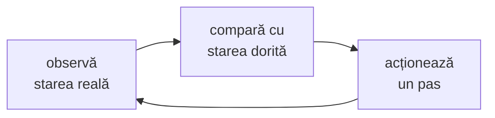

# Obiecte, controllere și bucla de reconciliere

Dacă ai înțeles un singur lucru din Kubernetes, să fie acesta: **tu nu dai comenzi,
declari stări**. Un controller compară permanent ce ai cerut (`spec`) cu ce există
(`status`) și face un pas spre ce ai cerut. Totul — Deployment-uri, Longhorn, ArgoCD,
cert-manager — e construit din bucla asta. GitOps e aceeași buclă, cu Git ca `spec`.

## Bucla de reconciliere



> [!TIP]
> **🧠 Analogie: termostatul**
> Nu-i spui caloriferului „pornește 20 de minute”. Îi spui termostatului „vreau 21°C”.
> El măsoară, compară și pornește sau oprește centrala — la nesfârșit, inclusiv când
> cineva deschide geamul. Dacă deschizi geamul de zece ori, nu trebuie să-i spui de zece
> ori ce vrei. Un controller Kubernetes e un termostat pentru un tip de obiect. ArgoCD e
> un termostat pentru tot clusterul, iar „21°C” e scris în Git.

Proprietăți care decurg din asta și pe care le vei vedea peste tot:

- **Idempotent**: aplicarea aceleiași stări de două ori nu schimbă nimic.
- **Auto-vindecare**: ștergi un pod al unui Deployment, apare altul.
- **Eventual consistent**: între cerere și realitate trece timp; `status` îți spune unde e.
- **Nivel, nu eveniment**: controllerul reacționează la *diferență*, nu la ce s-a
  întâmplat. Dacă ratează un eveniment, la următoarea trecere vede tot diferența.

## Anatomia unui obiect

```yaml
apiVersion: apps/v1          # grupul API + versiunea
kind: Deployment
metadata:
  name: web
  namespace: smoke
  labels: {app: web}         # pentru selecție
  annotations: {}            # pentru unelte, nu pentru selecție
  ownerReferences: []        # cine m-a creat — cine mă șterge
  finalizers: []             # „nu mă șterge până nu termin X”
spec: {}                     # ce vrei — scris de tine
status: {}                   # ce este — scris de controller
```

**ownerReferences** leagă obiectele în arbori: Deployment → ReplicaSet → Pod. Ștergi
Deployment-ul, *garbage collector*-ul șterge copiii. **finalizers** opresc ștergerea
până când un controller își face curățenia — ce face `resources-finalizer.argocd.argoproj.io`
în modulul 12, și motivul pentru care un namespace poate rămâne `Terminating`.

## Laborator 1 — urmărește bucla

```bash
kubectl create namespace obj
kubectl -n obj create deployment web --image=traefik/whoami:v1.11.0 --replicas=3 -- /whoami --port=8080
kubectl -n obj get deploy,rs,pod --show-labels
kubectl -n obj get pod -l app=web -o jsonpath='{.items[0].metadata.ownerReferences}' | jq

# Șterge un pod și uită-te cine îl recreează:
kubectl -n obj delete "$(kubectl -n obj get pod -l app=web -o name | head -1)"
kubectl -n obj get events --sort-by=.lastTimestamp | tail -5

# Un rollout este un ReplicaSet nou și unul vechi care scade:
kubectl -n obj set image deploy/web whoami=traefik/whoami:v1.10.1
kubectl -n obj get rs -w            # Ctrl+C când cel nou are 3/3
kubectl -n obj rollout history deploy/web
kubectl -n obj rollout undo deploy/web
```

## Workload-urile și când alegi fiecare

| Tip | Pentru | Identitate | Exemplu în prod |
|---|---|---|---|
| **Deployment** | aplicații fără stare locală, interschimbabile | niciuna: pod-uri cu nume aleatoare | Radarr, Sonarr (stare pe PVC, o replică) |
| **StatefulSet** | fiecare replică are nume și disc propriu, stabile | `nume-0`, `nume-1`, … + PVC per replică | Prometheus, Alertmanager, Loki |
| **DaemonSet** | exact un pod pe fiecare nod (eligibil) | per nod | Cilium, node-exporter, longhorn-manager |
| **Job** / **CronJob** | ceva care se termină; programat | — | `RecurringJob`-urile Longhorn sunt CR-uri care creează Job-uri |

## Probe: trei întrebări diferite

| Probă | Întrebarea | Când eșuează |
|---|---|---|
| `startupProbe` | „ai pornit?” | celelalte două așteaptă; după `failureThreshold` × `periodSeconds`, restart |
| `readinessProbe` | „pot să-ți trimit trafic?” | pod-ul iese din EndpointSlice-uri; **nu** e repornit |
| `livenessProbe` | „ești blocat?” | kubelet-ul **repornește** containerul |

> [!WARNING]
> **⚠️ Liveness care verifică dependențe**
> Un `livenessProbe` care eșuează când baza de date nu răspunde va reporni *toate*
> pod-urile odată, de fiecare dată când baza de date clipește — transformi o problemă
> în două. Liveness verifică doar procesul. De aceea [lab-app](../lab/k8s-lab/src/lab-app/main.go)
> are `/healthz` (doar „procesul răspunde”) separat de `/readyz`. Prod folosește
> același endpoint `/ping` pentru amândouă la Radarr ([helmrelease](../../kubernetes/apps/default/radarr/app/helmrelease.yaml)),
> ceea ce e în regulă *pentru că* `/ping` nu verifică nimic extern.

### Oprirea grațioasă și cursa cu EndpointSlice-ul

La ștergerea unui pod se întâmplă **în paralel**: kubelet-ul trimite SIGTERM, iar
controller-ul de EndpointSlice scoate pod-ul din Service. Propagarea scoaterii până la
fiecare nod (Cilium) și la Envoy ia câteva sute de milisecunde, uneori secunde. Un pod
care moare instantaneu la SIGTERM pierde request-urile care încă sosesc. Remediul:
aplicația nu mai e „ready” la SIGTERM, dar mai servește câteva secunde
(`SHUTDOWN_DELAY` în lab-app), apoi se oprește. `terminationGracePeriodSeconds`
trebuie să fie mai mare decât suma.

## Resurse și clase QoS

```yaml
resources:
  requests: {cpu: 100m, memory: 512Mi}   # ce rezervă scheduler-ul
  limits:   {memory: 4Gi}                # plafonul impus de cgroup
```

- **requests** decid *plasarea*: scheduler-ul pune un pod doar pe un nod cu destulă
  capacitate nerezervată. Nu limitează nimic la rulare.
- **limits** sunt impuse de kernel (modulul 04): memoria peste limită → OOMKilled; CPU
  peste limită → throttling (procesul e încetinit, nu omorât).

| Clasa QoS | Când | La presiune de memorie pe nod |
|---|---|---|
| `Guaranteed` | requests = limits, pentru CPU și memorie | evacuat ultimul |
| `Burstable` | are requests, dar nu egale cu limits | la mijloc |
| `BestEffort` | nimic setat | evacuat primul |

> [!NOTE]
> **🏠 Rețeta din prod**
> Radarr: `requests: cpu 100m, memory 512Mi`, `limits: memory 4Gi`, **fără limită de
> CPU**. E o alegere deliberată și comună: limita de CPU produce throttling chiar și
> când nodul are CPU liber; limita de memorie protejează nodul de un leak. Rezultatul
> e QoS `Burstable`.

## Scheduling: unde ajunge un pod

Scheduler-ul **filtrează** (ce noduri sunt posibile) și apoi **dă scor** (care e cel mai
bun). Filtrele pe care le controlezi:

| Mecanism | Pe cine pui regula | Exemplu |
|---|---|---|
| `nodeSelector` / `nodeAffinity` | pe pod: „vreau noduri cu eticheta X” | Jellyfin cere `gpu.intel.com/i915` (un resource, dar aceeași idee) |
| `taints` + `tolerations` | pe nod: „nu primesc pe nimeni, decât pe cine tolerează” | `node-role.kubernetes.io/control-plane:NoSchedule` |
| `podAntiAffinity` / `topologySpreadConstraints` | pe pod: „nu lângă replicile mele” | whoami și lab-app se întind pe noduri |
| `resources.requests` | capacitate | un pod de 64 CPU nu încape nicăieri — exercițiul 05 |

> [!NOTE]
> **🏠 Incidentul cu taint-ul de pe kubernetes-3**
> Citește blocul lui `kubernetes-3` din [talconfig.yaml](../../talos/talconfig.yaml) și
> secțiunea „Longhorn keeps one replica per node” din [THREE-NODE.md](../../talos/THREE-NODE.md).
> Un taint `NoSchedule` pe nod a făcut ca scheduler-ul **Longhorn** (care e un
> controller separat, cu reguli proprii) să refuze orice replică acolo — „no disk
> candidates found” — chiar dacă pod-urile Longhorn aveau toleranța. Lecția generală:
> o toleranță spune „am voie să rulez acolo”, nu „vreau să rulez acolo”, iar
> controllerele cu propriul scheduler își interpretează singure regulile.

## PodDisruptionBudget: cât poți strica deodată

Un PDB îi spune lui `kubectl drain` (și oricărei evacuări voluntare) câte pod-uri ale
unei aplicații pot lipsi simultan.

```yaml
spec:
  maxUnavailable: 1          # sau minAvailable: N
  selector: {matchLabels: {app.kubernetes.io/name: lab-app}}
```

> [!NOTE]
> **🏠 Drain-ul blocat din 2026-10-26**
> Sumarul task-ului `upgrade-node` din [.taskfiles/talos/Taskfile.yaml](../../.taskfiles/talos/Taskfile.yaml):
> Longhorn 1.13 a pus PDB-uri `minAvailable=1` pe `csi-attacher` și `csi-provisioner`,
> care rulau cu **o singură replică**. `minAvailable: 1` cu o replică = zero
> întreruperi permise = drain-ul așteaptă la nesfârșit. Repararea n-a fost în drain, ci
> în numărul de replici. Exercițiul 07 din modulul 18 reproduce exact asta.

## Configurație: ConfigMap și Secret

Ambele sunt perechi cheie-valoare montate ca variabile de mediu sau ca fișiere.
Diferența practică: Secretele au RBAC separat, sunt criptate în etcd (modulul 07) și
nu apar în `kubectl describe`. **Ambele sunt citite la pornirea containerului** ca
variabile — o schimbare nu ajunge într-un pod care rulează. Ca fișiere montate, se
actualizează în ~1 minut, dar aplicația trebuie să le recitească.

Două soluții, ambele în curs: prod folosește **Reloader**
(`reloader.stakater.com/auto: "true"` pe Radarr) care repornește pod-urile la
schimbare; lab-app folosește **configMapGenerator** din Kustomize, care pune un hash
în numele ConfigMap-ului — o schimbare de conținut schimbă numele, deci pod template-ul,
deci face rollout (modulul 11).

## Laborator 2 — QoS, OOM, probe

```bash
# Un pod Guaranteed și unul BestEffort; compară clasele:
kubectl -n obj run g --image=busybox:1.37 --restart=Never \
  --overrides='{"spec":{"containers":[{"name":"g","image":"busybox:1.37","command":["sleep","3600"],"resources":{"requests":{"cpu":"50m","memory":"32Mi"},"limits":{"cpu":"50m","memory":"32Mi"}}}]}}'
kubectl -n obj run b --image=busybox:1.37 --restart=Never -- sleep 3600
kubectl -n obj get pod g b -o custom-columns=NAME:.metadata.name,QOS:.status.qosClass

# Unde stă limita, pe nod:
NODE=$(kubectl -n obj get pod g -o jsonpath='{.spec.nodeName}')
UID_=$(kubectl -n obj get pod g -o jsonpath='{.metadata.uid}' | tr - _)
ssh "$NODE" "cat /sys/fs/cgroup/kubepods.slice/kubepods-pod${UID_}.slice/memory.max"
```

Ultima comandă e tot laboratorul 2 din modulul 04, scris de kubelet. Apoi aplică
exercițiile [03-not-ready.yaml](../lab/exercises/03-not-ready.yaml) și
[04-oom.yaml](../lab/exercises/04-oom.yaml) în namespace-ul `obj` și diagnostichează-le.

## Taskuri

- [ ] Laborator 1: șterge un pod și arată în events cine l-a recreat
- [ ] Afișează lanțul ownerReferences Pod → ReplicaSet → Deployment
- [ ] Fă un rollout, urmărește ReplicaSet-urile, apoi `rollout undo`
- [ ] Laborator 2: un pod `Guaranteed`, unul `BestEffort`; găsește `memory.max` al primului pe nod
- [ ] Diagnostichează `03-not-ready.yaml` doar din `kubectl describe` și EndpointSlice
- [ ] Diagnostichează `04-oom.yaml`: găsește `OOMKilled` și exit code 137
- [ ] Aplică un taint pe k8s-3 (`kubectl taint node k8s-3 lab=test:NoSchedule`), scalează `web` la 6 și arată unde ajung pod-urile; apoi scoate taint-ul (`…NoSchedule-`)
- [ ] Creează un PDB `minAvailable: 3` pentru `web` (3 replici) și încearcă `kubectl drain` pe un nod cu `--timeout=30s`; explică eroarea; șterge PDB-ul și `uncordon`
- [ ] Explică în notițe, în 5 rânduri, de ce bucla de reconciliere face posibil GitOps
- [ ] Curăță: `kubectl delete namespace obj`

## Întrebări de verificare

<details>
<summary>Ștergi ReplicaSet-ul unui Deployment (nu Deployment-ul). Ce se întâmplă?</summary>

Garbage collector-ul șterge pod-urile ReplicaSet-ului (ownerReference). Controller-ul
de Deployment vede că nu mai există un ReplicaSet pentru template-ul curent și creează
unul nou, care creează pod-uri noi. Rezultat: un restart al tuturor pod-urilor, fără
nicio schimbare de configurație. Bucla repară; nu știe și nu-i pasă *de ce* lipsea.
</details>

<details>
<summary>Un pod e `Running` dar `0/1 READY`. Primește trafic de la un Service?</summary>

Nu. Doar pod-urile *ready* apar ca endpoint-uri active în EndpointSlice, iar Cilium
balansează doar spre ele. Un pod care nu devine niciodată ready nu e niciodată
repornit (asta e treaba liveness-ului) — stă acolo, inutil. De aceea `0/1 READY` e
un simptom de investigat, nu de așteptat.
</details>

<details>
<summary>De ce mulți pun limită de memorie, dar nu și de CPU?</summary>

Memoria e incompresibilă: dacă un proces o ia, alt proces nu o mai are, iar nodul
ajunge să omoare pod-uri la întâmplare. Limita o oprește înainte. CPU-ul e
compresibil: la contenție, kernelul împarte timpul proporțional cu `requests`. O limită
de CPU produce throttling chiar și pe un nod liber, adică latență degeaba. Prod
aplică exact rețeta asta.
</details>
