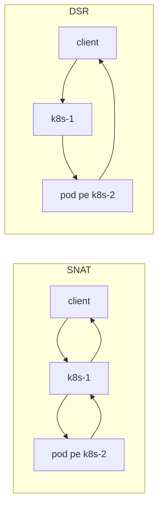
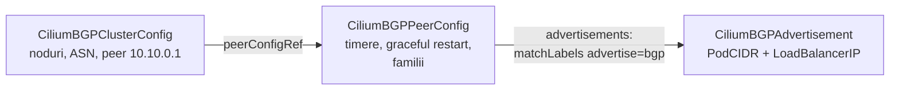

# Rețeaua Kubernetes: Services, BGP, Gateway API, politici

Modulul cel mai lung, pentru că rețeaua e locul unde Kubernetes pare cel mai magic.
Nu e. Un Service e o intrare într-o tabelă eBPF. Un LoadBalancer e un `/32` anunțat
prin BGP. Un Gateway e un Envoy. O politică e un filtru pe identitatea pod-ului.

## 1. Services: un IP care nu există pe nicio interfață

```bash
kubectl create namespace net
kubectl -n net create deployment web --image=traefik/whoami:v1.11.0 --replicas=3 -- /whoami --port=8080
kubectl -n net expose deployment web --port=80 --target-port=8080
kubectl -n net get svc web                       # CLUSTER-IP 10.96.x.y
kubectl -n net get endpointslices -l kubernetes.io/service-name=web -o wide
ssh k8s-1 "ip -4 addr | grep -c 10.96"           # 0: adresa nu e pe nicio interfață
```

Un ClusterIP e **virtual**: e o cheie într-o tabelă. Cineva trebuie să traducă
`10.96.x.y:80` în `10.244.a.b:8080` — kube-proxy cu iptables, sau Cilium cu eBPF.

| Tip | Cine ajunge la el | Cum |
|---|---|---|
| `ClusterIP` | doar din cluster | IP virtual, tradus pe nodul sursă |
| `NodePort` | oricine ajunge la un nod | portul 30000–32767 deschis pe toate nodurile |
| `LoadBalancer` | oricine ajunge la IP-ul extern | un IP dintr-un pool (LB IPAM), anunțat prin ARP sau BGP; include un NodePort |
| *headless* (`clusterIP: None`) | din cluster, prin DNS | DNS întoarce direct IP-urile pod-urilor; pentru StatefulSet-uri |

### Cum îl face Cilium — și de ce tcpdump te minte

Cilium are două locuri unde traduce:

- **la socket** (pentru trafic pornit din pod-uri sau de pe noduri): când procesul face
  `connect(10.96.x.y:80)`, eBPF-ul rescrie destinația **înainte** să existe vreun
  pachet. Pachetul pleacă direct spre IP-ul pod-ului.
- **la placa de rețea** (pentru trafic venit din afară: NodePort, LoadBalancer):
  pachetele sunt traduse la intrare, la nivel `tc`/XDP.

```bash
# Un pod client pe k8s-1 și o captură pe veth-ul lui:
kubectl -n net run c --image=busybox:1.37 --overrides='{"spec":{"nodeName":"k8s-1"}}' -- sleep 3600
kubectl -n net wait --for=condition=Ready pod/c
CIP=$(kubectl -n net get pod c -o jsonpath='{.status.podIP}')
ssh k8s-1 "sudo tcpdump -ni any host $CIP and tcp -c 6" &
kubectl -n net exec c -- wget -qO- http://web >/dev/null
```

În captură nu apare niciodată `10.96.x.y` — doar IP-ul unui pod `web`. Asta e
*socket-level load balancing*. Cu kube-proxy, ai fi văzut ClusterIP-ul pe veth și
traducerea mai târziu, în iptables.

```bash
kubectl -n kube-system exec ds/cilium -- cilium-dbg service list | grep -A4 "$(kubectl -n net get svc web -o jsonpath='{.spec.clusterIP}')"
kubectl -n kube-system exec ds/cilium -- cilium-dbg bpf lb list | head -20
```

> [!TIP]
> **🧠 Analogie: numărul de telefon al unei firme**
> ClusterIP-ul e numărul central al firmei. Nu sună nicăieri: centrala (eBPF) îl
> transformă în interiorul unui angajat liber *înainte* să formezi. kube-proxy era o
> centrală în care un operator căuta numele într-o listă tipărită, rând cu rând (iptables);
> Cilium e o agendă indexată (hash map): găsește la fel de repede la 10 sau la 10 000 de
> angajați.

### `externalTrafficPolicy`: `Cluster` sau `Local`

| | `Cluster` (implicit) | `Local` |
|---|---|---|
| Nodul care primește traficul | îl trimite la orice pod, și pe alte noduri | doar la pod-urile de pe el |
| IP-ul clientului văzut de pod | IP-ul nodului (SNAT) — cu `mode: snat` | IP-ul real |
| Noduri fără pod | servesc oricum | nu servesc (și nu se anunță prin BGP) |

## 2. SNAT vs DSR

Cu `loadBalancer.mode: snat`, un request care intră pe k8s-1 pentru un pod de pe k8s-2
e trimis mai departe cu sursa rescrisă la k8s-1, iar **răspunsul se întoarce tot prin
k8s-1**. Cu `dsr` (Direct Server Return, ce rulează prod), k8s-2 răspunde **direct**
clientului, cu sursa = IP-ul serviciului; k8s-1 vede doar jumătatea de intrare.



DSR păstrează IP-ul clientului și economisește un hop la răspuns, care e de obicei
partea mare (o pagină, un stream Jellyfin). Costul: nodul backend trebuie să poată
trimite pachete cu sursa = IP-ul serviciului, iar rețeaua să le accepte. Exercițiul de
la final schimbă modul și îl vezi în tcpdump.

## 3. BGP: cum își anunță clusterul adresele

**BGP** (Border Gateway Protocol) e protocolul prin care rețelele își spun una alteia
„prefixul X e la mine”. E protocolul internetului — și, de vreo zece ani, protocolul din
interiorul datacenterelor.

| Concept | Ce înseamnă | În lab |
|---|---|---|
| **AS** (Autonomous System) | o rețea cu o politică de rutare, identificată de un număr | lab-gw = 65000, clusterul = 65001 (numere private) |
| **sesiune** | o conexiune TCP pe portul 179 între doi vecini (*peers*) | fiecare nod ⇄ lab-gw |
| **eBGP** / **iBGP** | între AS-uri diferite / în același AS | eBGP |
| **UPDATE** | „anunț prefixul P, next-hop N” sau „retrag P” | nodul: `10.10.100.20/32 via 10.10.0.12` |
| **keepalive / hold** | „încă sunt aici” / după cât timp fără veste te consider mort | 3 s / 9 s |
| **ECMP** | același prefix de la mai mulți vecini → mai multe drumuri egale | un `/32` cu 3 next-hop-uri |

> [!TIP]
> **🧠 Analogie: indicatoarele de la o intersecție**
> L2 announcements (prod) e ca și cum o singură casă de pe stradă ar striga „eu sunt
> numărul 112” — toată lumea vine la ea, iar dacă se mută, strigă alta. BGP e
> primăria care pune **indicatoare** la intersecție: „spre 112: oricare din cele trei
> străzi”. Routerul împarte mașinile pe toate trei. Dacă o stradă se închide, indicatorul
> ei e scos în câteva secunde, iar celelalte două preiau traficul.

| | L2 announcements (prod) | BGP (lab) |
|---|---|---|
| Unde poate fi IP-ul | doar în subrețeaua nodurilor | oriunde — e rutat |
| Câte noduri primesc traficul unui IP | unul (deținătorul lease-ului) | toate cele care îl anunță (ECMP) |
| Failover | lease expirat → alt nod trimite ARP gratuit | sesiune BGP căzută → rută retrasă |
| Ce trebuie pe rețea | nimic | un router care vorbește BGP |
| Potrivit pentru | homelab, o rețea plată | datacenter, rețele rutate, scară |

### Cele trei obiecte Cilium

Citește [bgp.yaml](../lab/k8s-lab/platform/cilium/config/bgp.yaml):



Și partea routerului, [frr.conf](../lab/infra/router/frr.conf): un peer-group `K8S` cu
cei trei vecini, un **route-map** de intrare care acceptă doar ce clusterul are voie să
anunțe (`/32` din pool, `/24` din pod CIDR) și unul de ieșire care nu anunță nimic.

> [!IMPORTANT]
> **❓ De ce filtre la intrare?**
> Fără ele, un nod compromis (sau o greșeală de configurare) ar putea anunța
> `0.0.0.0/0` sau rețeaua de acasă și ar atrage tot traficul spre el. În producție,
> fiecare sesiune BGP are un filtru explicit — FRR îl cere chiar implicit pentru eBGP
> (RFC 8212: fără politică, nicio rută acceptată sau trimisă).

### Laborator BGP

```bash
# pe lab-gw
sudo bash ~/infrastructure/learn/lab/infra/router/setup-frr.sh
sudo vtysh -c 'show bgp summary'               # 3 vecini, stare Active: clusterul încă nu vorbește

# configurația Cilium (ArgoCD o va prelua în modulul 12)
kubectl apply -k ~/infrastructure/learn/lab/k8s-lab/platform/cilium/config
cilium bgp peers                               # Established, după câteva secunde
sudo vtysh -c 'show bgp summary'               # PfxRcd = 1 de la fiecare: pod CIDR-ul lui
sudo vtysh -c 'show ip route bgp'              # 10.244.0.0/24 via 10.10.0.11 …
```

Un LoadBalancer adevărat:

```bash
kubectl create namespace whoami
kubectl apply -k ~/infrastructure/learn/lab/k8s-lab/apps/whoami
kubectl -n whoami get svc whoami               # EXTERNAL-IP 10.10.100.20
cilium bgp routes advertised ipv4 unicast
sudo vtysh -c 'show bgp ipv4 unicast 10.10.100.20/32'   # 3 căi, „multipath”
ip route show 10.10.100.20                     # nexthop via .11, .12, .13 — ECMP în kernel
```

De pe **PC** (ruta `10.10.0.0/16` acoperă și `10.10.100.0/24`):

```powershell
1..6 | % { (curl.exe -s http://10.10.100.20 | Select-String Hostname).Line }
```

Răspunsuri de la pod-uri diferite. Acum **pierzi un nod** în timp ce măsori:

```bash
# pe lab-gw, un terminal
while true; do printf '%s %s\n' "$(date +%T)" "$(curl -s -m1 http://10.10.100.20 | grep Hostname)"; sleep 0.5; done
# pe hostul Proxmox: oprire bruscă, fără shutdown
qm stop 903
# pe lab-gw
sudo vtysh -c 'show bgp summary'               # k8s-3 iese din Established după hold time (9 s)
ip route show 10.10.100.20                     # 2 next-hop-uri
qm start 903                                   # pe host, la final
```

Pod-urile din cluster accesibile direct, fără Service, de pe PC:

```powershell
route -p add 10.244.0.0 mask 255.255.0.0 10.57.57.90
ping <IP-ul unui pod whoami>
```

## 4. LB IPAM

[lb-pool.yaml](../lab/k8s-lab/platform/cilium/config/lb-pool.yaml) definește de unde
primesc adrese Service-urile `LoadBalancer`. Un IP anume se cere cu adnotarea
`lbipam.cilium.io/ips` (ca în [service-ul whoami](../lab/k8s-lab/apps/whoami/service.yaml)
și ca toate `LB_IP_*` din prod). Două Service-uri pot împărți un IP pe porturi diferite
cu `lbipam.cilium.io/sharing-key`.

> [!NOTE]
> **🏠 Un IP dedicat, ca să poți scrie o regulă despre el**
> [loadbalancer.yaml-ul Jellyfin](../../kubernetes/apps/default/jellyfin/app/loadbalancer.yaml)
> din prod are propriul IP (`LB_IP_JELLYFIN`) doar ca un ACL Tailscale să poată da unui
> dispozitiv de oaspete acces la **exact** serviciul ăsta. Un IP e și o identitate pentru
> firewall-urile din afara clusterului.

## 5. Gateway API

**Ingress** a fost primul API de HTTP routing: un singur obiect, fiecare controller cu
propriile adnotări. **Gateway API** îl înlocuiește cu roluri separate:

| Obiect | Cine îl deține | Ce spune |
|---|---|---|
| `GatewayClass` | furnizorul (Cilium) | „eu implementez Gateway-uri” |
| `Gateway` | echipa de platformă | „ascult pe 10.10.100.10, :443, pentru `*.lab.merox.dev`, cu certificatul X; accept rute din namespace-urile Y” |
| `HTTPRoute` | echipa aplicației | „`whoami.lab.merox.dev` → Service-ul `whoami:80`” |
| `ReferenceGrant` | proprietarul țintei | „rutele din namespace-ul A au voie să trimită la Service-urile mele” |

Cilium transformă fiecare `Gateway` într-un Service `LoadBalancer`
(`cilium-gateway-<nume>`) și configurează **Envoy**-ul care rulează în agentul de pe
fiecare nod. Traficul HTTP intră prin eBPF în Envoy, care termină TLS și alege backend-ul
după rută.

> [!NOTE]
> **🏠 Două Gateway-uri în prod**
> [internal.yaml](../../kubernetes/apps/kube-system/cilium/gateway/internal.yaml) și
> [external.yaml](../../kubernetes/apps/kube-system/cilium/gateway/external.yaml):
> aceeași formă, IP-uri diferite. Internul e pentru LAN și Tailscale. Externul nu e
> expus nicăieri direct — [tunelul Cloudflare](../../kubernetes/apps/network/cloudflare-tunnel/app/resources/config.yaml)
> trimite traficul public la `cilium-gateway-external.kube-system.svc`. O rută devine
> publică doar dacă se atașează de `external` **și** numele ei e în
> [dnsendpoint.yaml](../../kubernetes/apps/network/cloudflare-tunnel/app/dnsendpoint.yaml) —
> „fiecare nume public, de mână: fiecare e o decizie într-un diff”.

Gateway-ul lab-ului, cu certificat, vine în modulul 13. Acum unul minimal, HTTP:

```bash
kubectl apply -f - <<'EOF'
apiVersion: gateway.networking.k8s.io/v1
kind: Gateway
metadata: {name: test, namespace: net}
spec:
  gatewayClassName: cilium
  listeners: [{name: http, protocol: HTTP, port: 80}]
---
apiVersion: gateway.networking.k8s.io/v1
kind: HTTPRoute
metadata: {name: web, namespace: net}
spec:
  parentRefs: [{name: test}]
  hostnames: ["web.test"]
  rules: [{backendRefs: [{name: web, port: 80}]}]
EOF
kubectl -n net get gateway test               # PROGRAMMED True, ADDRESS din pool
GW=$(kubectl -n net get gateway test -o jsonpath='{.status.addresses[0].value}')
curl -s -H 'Host: web.test' "http://$GW/" | head -3
curl -s -o /dev/null -w '%{http_code}\n' -H 'Host: altceva' "http://$GW/"    # 404: nicio rută
```

## 6. Politici de rețea

Fără nicio politică, orice pod vorbește cu orice pod. Primul moment în care un pod e
**selectat** de o politică de *ingress*, tot traficul de intrare nepermis explicit e
aruncat. Așa se construiește un *default deny*.

| | `NetworkPolicy` (Kubernetes) | `CiliumNetworkPolicy` |
|---|---|---|
| Selectează după | etichete de pod/namespace, CIDR | la fel, plus **entități** (`host`, `world`, `ingress`, `kube-apiserver`) |
| Nivel | L3/L4 | L3/L4 **și L7** (HTTP path, metodă), FQDN pentru egress |
| Implementat de | orice CNI care îl suportă | Cilium, pe identități (nu pe IP-uri) |

> [!NOTE]
> **🏠 Lecțiile scrise în politicile din prod**
> [flux-system/network-policy.yaml](../../kubernetes/apps/flux-system/network-policy.yaml)
> are trei greșeli reale în comentarii, toate găsite cu `hubble observe --verdict DROPPED`:
> (1) portul din politică e al **pod-ului** (9090), nu al Service-ului (80) — politica vede
> pachetul după traducere; (2) traficul venit prin Gateway are entitatea **`ingress`**,
> nu `world`; (3) un controller are două audiențe și prima variantă a uitat-o pe una —
> fiecare reconciliere din cluster a încetinit. [default/network-policy.yaml](../../kubernetes/apps/default/network-policy.yaml)
> explică *de ce* există: aplicații de încredere scăzută lângă aplicații valoroase.

### Hubble: vezi fiecare pachet aruncat

Hubble e observabilitatea Cilium: fiecare flux, cu identitatea sursei și a destinației,
și verdictul. Agentul de pe fiecare nod are CLI-ul inclus:

```bash
# o funcție care întreabă toți agenții
hobs() { for p in $(kubectl -n kube-system get pod -l k8s-app=cilium -o name); do
  kubectl -n kube-system exec "$p" -c cilium-agent -- hubble observe "$@" 2>/dev/null; done; }
hobs -n net --last 20
hobs --verdict DROPPED --last 20
cilium hubble ui &                         # UI-ul, prin port-forward, pe http://localhost:12000
```

Laboratorul de politici e exercițiul [06-netpol.yaml](../lab/exercises/06-netpol.yaml):
aplică-l în namespace-ul `drill`, confirmă că `client` nu mai ajunge la `server`, găsește
cauza **doar** din `hobs -n drill --verdict DROPPED`, și repară politica.

## 7. DNS în cluster

```bash
kubectl -n net exec c -- cat /etc/resolv.conf
# nameserver 10.96.0.10
# search net.svc.cluster.local svc.cluster.local cluster.local
# options ndots:5
```

`ndots:5` înseamnă: un nume cu mai puțin de 5 puncte e încercat **întâi** cu fiecare
domeniu din `search`. `api.github.com` (2 puncte) devine 4 interogări înainte de cea
reală. Plugin-ul `autopath` din [valorile CoreDNS](../lab/k8s-lab/platform/coredns/values.yaml)
(identice cu prod) scurtează lanțul pe server: CoreDNS știe namespace-ul pod-ului și
răspunde direct cu varianta bună.

| Nume | Rezolvă la |
|---|---|
| `web` | Service-ul `web` din *același* namespace |
| `web.net` | Service-ul `web` din namespace-ul `net` |
| `web.net.svc.cluster.local` | forma completă |
| `pod-0.svc-headless.ns.svc.cluster.local` | un pod anume al unui StatefulSet |

## Exercițiu — DSR, ca prod

Schimbă `loadBalancer.mode` în `dsr` în
[values.yaml](../lab/k8s-lab/platform/cilium/values.yaml), aplică
(`helm upgrade cilium cilium/cilium --version 1.20.4 -n kube-system -f …`), apoi pe un
nod **fără** pod whoami rulează `tcpdump -ni ens18 host 10.10.100.20` în timp ce faci
`curl` de pe PC. În SNAT vezi ambele direcții pe nodul de intrare; în DSR, răspunsul
pleacă de pe nodul cu pod-ul. Notează diferența, apoi decide dacă păstrezi DSR (commit
în modulul 12) sau revii.

## Taskuri

- [ ] Arată că un ClusterIP nu există pe nicio interfață și găsește-l în `cilium-dbg service list`
- [ ] Captura pe veth-ul unui pod client nu conține ClusterIP-ul; explică de ce
- [ ] `setup-frr.sh` + `kubectl apply -k …/cilium/config`: 3 sesiuni `Established`
- [ ] `show ip route bgp` pe lab-gw arată câte un `/24` de pod-uri de la fiecare nod
- [ ] whoami primește `10.10.100.20`; pe lab-gw ruta are 3 next-hop-uri
- [ ] De pe PC, `curl` repetat la `10.10.100.20` arată mai multe pod-uri
- [ ] Oprește brusc k8s-3 și măsoară cât timp `curl`-ul eșuează; compară cu hold time-ul de 9 s
- [ ] De pe PC, `ping` direct la IP-ul unui pod
- [ ] Modifică `K8S-ALLOWED` pe lab-gw ca să refuze pool-ul LB, `clear bgp * soft in`, arată că `10.10.100.20` dispare; repune
- [ ] Gateway-ul HTTP de test răspunde pentru `Host: web.test` și dă 404 pentru alt host
- [ ] Exercițiul 06: găsește cauza cu Hubble, repară, explică ce greșeală din prod e aceeași
- [ ] Explică `ndots:5` și numără interogările pentru `api.github.com` cu `tcpdump -ni any port 53` pe nodul pod-ului
- [ ] (Exercițiu) DSR vs SNAT în tcpdump
- [ ] Corectează desenul din modulul 00 (telefon → Jellyfin) cu tot ce știi acum
- [ ] Curăță: `kubectl delete namespace net drill` (păstrează `whoami`)

## Întrebări de verificare

<details>
<summary>Cu BGP și `externalTrafficPolicy: Local`, ce noduri anunță IP-ul unui Service?</summary>

Doar nodurile care au cel puțin un pod *ready* al Service-ului. Un nod fără backend nu
are ce face cu traficul (Local interzice trimiterea mai departe), deci nu-l atrage. Cu
`Cluster`, toate nodurile anunță, iar cel care primește trimite mai departe. Local
păstrează IP-ul clientului și evită un hop, cu prețul unei distribuții mai puțin
uniforme.
</details>

<details>
<summary>Prod rulează L2 announcements. Ce s-ar schimba dacă ar trece pe BGP cu pfSense?</summary>

Pool-ul LB n-ar mai trebui să stea în `10.57.57.0/24` — ar putea fi un `/24` separat,
rutat. Traficul unui IP s-ar împărți pe toate nodurile (ECMP), nu ar trece printr-un
singur nod. pfSense ar avea nevoie de pachetul FRR și de filtre ca în `frr.conf`. Și ar
apărea problema din modulul 01: clienții din același LAN cu nodurile ar avea un drum de
întoarcere direct, nu prin pfSense — rutare asimetrică, de rezolvat explicit.
</details>

<details>
<summary>O politică permite `fromEndpoints` cu `app: prometheus` pe portul 80 al unui Service care țintește portul 8080. De ce nu merge?</summary>

Politica e evaluată pe pachetul care ajunge la pod, după ce Service-ul a fost tradus:
destinația e deja `pod:8080`. Portul din politică trebuie să fie 8080. E exact greșeala
documentată la `source-controller-ingress` din politicile flux-system ale prod-ului.
</details>

<details>
<summary>De ce traficul prin Gateway apare ca entitatea `ingress` și nu ca `world`?</summary>

Pentru că pachetul care ajunge la pod nu vine de la client: vine de la Envoy-ul Cilium,
care a terminat conexiunea clientului și a deschis una nouă spre backend. Cilium îi dă
lui Envoy identitatea rezervată `ingress`. O politică ce permite doar `world` aruncă tot
traficul HTTP venit prin Gateway — jellyfin din prod a pățit exact asta.
</details>
