# GitOps cu ArgoCD

Până acum clusterul a fost construit cu comenzi. De aici, **Git e singura cale de
intrare**: tot ce rulează în lab e descris în repo-ul `k8s-lab`, iar ArgoCD face
clusterul să semene cu repo-ul — la fiecare 3 minute, sau imediat după un push.

## Ce e GitOps, și ce e doar Flux

Cele patru principii [OpenGitOps](https://opengitops.dev/):

1. **Declarativ** — starea dorită e descrisă, nu scriptată.
2. **Versionat și imuabil** — stă în Git; istoria e auditul, `git revert` e rollback-ul.
3. **Tras automat** (*pull*) — un agent din cluster citește repo-ul; nimeni din afară nu
   împinge în cluster. CI-ul nu are credențiale de cluster.
4. **Reconciliat continuu** — agentul corectează orice abatere, inclusiv modificările de
   mână.

Flux și ArgoCD implementează amândouă aceleași patru principii. Diferă în *cum*: Flux e un
set de controllere mici, fără UI, configurate prin CRD-uri; ArgoCD e o aplicație cu UI,
un model centrat pe obiectul `Application`, și o părere puternică despre „sync”.

> [!TIP]
> **🧠 Analogie: partitura și dirijorul**
> Repo-ul e **partitura**. Clusterul e **orchestra**. ArgoCD e **dirijorul**: nu cântă el,
> dar ascultă tot timpul și, când un instrument cântă altceva decât scrie, îl corectează.
> Dacă vrei altă muzică, nu strigi la violoniști (`kubectl edit`) — schimbi partitura și
> dirijorul se ocupă. Un violonist care improvizează e readus la partitură în trei minute
> (`selfHeal`).

## Harta Flux → ArgoCD, pe repo-ul tău

| Prod (Flux) | Fișier | Lab (ArgoCD) | Fișier |
|---|---|---|---|
| `GitRepository` `flux-system` | [flux-instance values](../../kubernetes/apps/flux-system/flux-instance/app/helm/values.yaml) (`sync:`) | `repoURL` + `targetRevision` în fiecare sursă | [root.yaml](../lab/k8s-lab/argocd/root.yaml) |
| `Kustomization` rădăcină `cluster-apps` | [cluster/ks.yaml](../../kubernetes/flux/cluster/ks.yaml) | Application `root` (app of apps) | [root.yaml](../lab/k8s-lab/argocd/root.yaml) |
| `Kustomization` per aplicație | `*/ks.yaml` | `Application` per componentă | [argocd/apps/](../lab/k8s-lab/argocd/apps/cilium.yaml) |
| `OCIRepository` + `HelmRelease` | [cilium helmrelease](../../kubernetes/apps/kube-system/cilium/app/helmrelease.yaml) | sursă `chart:` + `helm.valueFiles` | [cilium.yaml](../lab/k8s-lab/argocd/apps/cilium.yaml) |
| `valuesFrom: ConfigMap` generat | `kustomizeconfig.yaml` | multi-source: `ref: values` + `$values/…` | idem |
| `dependsOn` | `ks.yaml` (`dependsOn: longhorn`) | **sync waves** + health pe `Application` | adnotări `sync-wave` |
| `wait: true`, `healthChecks` | `ks.yaml` | health assessment, implicit pe resurse | — |
| `prune: true` | `ks.yaml` | `syncPolicy.automated.prune` | — |
| corectarea abaterilor (implicit) | — | `syncPolicy.automated.selfHeal` | — |
| `interval: 1h`, `retryInterval` | `ks.yaml` | `timeout.reconciliation: 180s`, `retry.backoff` | [argocd values](../lab/k8s-lab/platform/argocd/values.yaml) |
| `postBuild.substituteFrom: cluster-vars` | [cluster-vars.yaml](../../kubernetes/components/common/cluster-vars.yaml) | **niciun echivalent direct** — valori explicite, Helm, Kustomize `replacements`, generatori ApplicationSet | — |
| `decryption: sops` | `ks.yaml` | **niciun echivalent nativ** — Sealed Secrets (lab), ESO, KSOPS | modulul 13 |
| `Receiver` (webhook GitHub) | [receiver.yaml](../../kubernetes/apps/flux-system/flux-instance/app/receiver.yaml) | endpoint `/api/webhook` al argocd-server | task de mai jos |
| `Alert` + `Provider` (Telegram) | [notifications](../../kubernetes/apps/flux-system/notifications/app/alert.yaml) | argocd-notifications | task opțional |
| flux-local `test`/`diff` în CI | [flux-local.yaml](../../.github/workflows/flux-local.yaml) | `scripts/validate.sh` + `argocd app diff` | modulul 16 |
| un `Kustomization` per director, scris de mână | `default/kustomization.yaml` | `ApplicationSet` cu generator de directoare | [apps.yaml](../lab/k8s-lab/argocd/apps/apps.yaml) |

> [!IMPORTANT]
> **❓ Două goluri care contează: substituția și SOPS**
> Prod pune fiecare IP de infrastructură **o singură dată**, în `cluster-vars`, iar Flux
> le înlocuiește în orice manifest (`${LB_IP_JELLYFIN}`, `${SECRET_DOMAIN}`). ArgoCD
> refuză intenționat substituția de variabile: ce e în Git e ce se aplică, ca să poți citi
> repo-ul și să știi ce rulează. Prețul: în lab, `10.10.100.20` stă direct în
> `service.yaml`. Al doilea gol: Flux decriptează SOPS nativ; ArgoCD nu. Ambele sunt
> compromisuri reale de design, nu lipsuri accidentale — și motive concrete pentru care
> o echipă alege una sau alta.

## Cum lucrează ArgoCD

| Componentă | Rol |
|---|---|
| **repo-server** | clonează repo-ul, rulează `helm template` / `kustomize build`, întoarce manifestele |
| **application-controller** | compară manifestele cu clusterul (*diff*), calculează sync status și health, aplică |
| **argocd-server** | API + UI + CLI; primește webhook-uri |
| **applicationset-controller** | generează `Application`-uri din șabloane |
| **redis** | cache pentru manifeste și starea clusterului |

Două stări, independente:

| Sync status | Health status |
|---|---|
| `Synced` — clusterul = Git | `Healthy` — resursele funcționează (Deployment disponibil, PVC Bound…) |
| `OutOfSync` — diferă | `Progressing` — încă ajunge acolo |
| | `Degraded` — a eșuat (CrashLoop, Job eșuat) |
| | `Missing` — în Git, nu în cluster |

O aplicație poate fi `Synced` și `Degraded` (ai aplicat exact ce scrie în Git, și ce scrie
în Git e stricat), sau `OutOfSync` și `Healthy` (cineva a scalat de mână; merge, dar nu e
ce ai cerut).

> [!WARNING]
> **⚠️ ArgoCD nu face `helm install`**
> Repo-server-ul randează chart-ul cu `helm template` și controller-ul aplică manifestele
> ca pe orice YAML. Nu există release Helm, `helm list` nu arată nimic, hook-urile Helm
> sunt traduse în hook-uri ArgoCD. Când ArgoCD *preia* un release instalat de helmfile
> (bootstrap-ul de mai jos), Secretul `sh.helm.release.v1.*` rămâne orfan. Șterge-l dacă
> vrei — dar **niciodată** `helm uninstall`: ar șterge resursele pe care acum le deține ArgoCD.

## Repo-ul k8s-lab

Citește întâi [README-ul lui](../lab/k8s-lab/README.md). Structura, pe scurt:

```
bootstrap/       helmfile + bootstrap.sh — ce există înainte de ArgoCD
argocd/root.yaml singurul obiect aplicat de mână
argocd/apps/     ce e pornit acum, ordonat cu sync waves
argocd/later/    ce porniți în modulele 13–15, cu git mv
platform/<x>/    values.yaml (Helm) + config/ (manifeste extra)
apps/            workload-uri; ApplicationSet-ul face câte o Application pe director
```

### Sync waves: `dependsOn` al ArgoCD

```mermaid
flowchart LR
  P["-100 projects"] --> G["-20 gateway-api-crds"] --> C["-15 cilium"] --> D["-14 coredns"] --> A["-13 argocd"] --> CC["-12 cilium-config"] --> M["-10 metrics-server<br/>sealed-secrets"] --> CM["-9 cert-manager"] --> GW["-6 gateway"] --> K["-5 k8s-gateway"] --> L["-4 longhorn"] --> KP["-2 kube-prometheus-stack"] --> AS["10 apps (ApplicationSet)"]
```



Application-ul `root` aplică copiii în ordinea valului și **așteaptă ca un val să fie
`Healthy`** înainte de următorul. Asta funcționează doar datorită verificării de health
pentru `argoproj.io/Application` din [platform/argocd/values.yaml](../lab/k8s-lab/platform/argocd/values.yaml):
din ArgoCD 1.8 un `Application` copil nu mai are health calculat, iar fără Lua-ul acela
toate valurile ar porni aproape simultan.

Valurile funcționează și **în interiorul** unei aplicații: în
[lab-ca.yaml](../lab/k8s-lab/platform/cert-manager/config/lab-ca.yaml), issuer-ul
self-signed are valul 1, CA-ul 2, issuer-ul CA 3 — după chart-ul cert-manager (valul 0),
al cărui webhook trebuie să ruleze ca să le valideze.

### Finalizatori: ce șterge ștergerea

`resources-finalizer.argocd.argoproj.io` pe un `Application` înseamnă: când îl ștergi,
șterge și tot ce a creat. Lab-ul îl pune pe aplicațiile obișnuite și **îl omite**
intenționat pe `cilium`, `argocd`, `longhorn` și `sealed-secrets` — comentariile din
fiecare fișier spun ce s-ar pierde.

## Laborator — bootstrap

### 1. Repo-ul tău

```bash
# pe lab-gw (sau pe PC)
cp -r ~/infrastructure/learn/lab/k8s-lab ~/k8s-lab && cd ~/k8s-lab
git init -b main && git add -A && git commit -m "feat: k8s-lab from learn/lab template"
gh repo create meroxdotdev/k8s-lab --public --source=. --push      # sau creează-l din UI și git push
```

Alt owner? Rulează înlocuirile din [README](../lab/k8s-lab/README.md) **înainte** de primul push.

### 2. Prima decizie: versiunea ArgoCD

```bash
helm repo add argo https://argoproj.github.io/argo-helm && helm repo update argo
helm search repo argo/argo-cd --versions | head -5
```

Șablonul fixează `8.0.0`. Dacă există una mai nouă, citește notele de upgrade de la
[argo-helm releases](https://github.com/argoproj/argo-helm/releases), actualizează **ambele**
locuri (`bootstrap/helmfile.yaml` și `argocd/apps/argocd.yaml`) și fă commit. E primul
exemplu din curs de regula din prod: o versiune e o decizie într-un diff.

### 3. Bootstrap

```bash
bash bootstrap/bootstrap.sh
kubectl -n argocd get applications -w
```

Scriptul: CRD-urile Gateway API → `helmfile sync` (Cilium și CoreDNS sunt deja instalate
din modulul 08, cu aceleași valori: no-op; ArgoCD e nou) → `kubectl apply -f argocd/root.yaml`.
Din clipa aia, ArgoCD citește `argocd/apps/` și preia tot: inclusiv Cilium, CoreDNS și pe sine.

```bash
kubectl -n argocd port-forward svc/argocd-server 8080:80 &
# UI: http://localhost:8080 (de pe lab-gw; de pe PC: ssh -L 8080:localhost:8080 lab-gw)
# CLI, pe lab-gw:
curl -sSL -o ~/.local/bin/argocd https://github.com/argoproj/argo-cd/releases/latest/download/argocd-linux-amd64 && chmod +x ~/.local/bin/argocd
argocd login localhost:8080 --plaintext --username admin \
  --password "$(kubectl -n argocd get secret argocd-initial-admin-secret -o jsonpath='{.data.password}' | base64 -d)"
argocd app list
argocd app get cilium --show-operation
```

> [!NOTE]
> **🏠 Același bootstrap, în prod**
> [scripts/bootstrap-apps.sh](../../scripts/bootstrap-apps.sh): namespace-uri → secretele
> SOPS de care are nevoie Flux ca să decripteze restul → CRD-uri → helmfile (Cilium,
> CoreDNS, cert-manager, CRD-urile Prometheus, Flux). Lab-ul sare peste pasul cu secretele
> pentru că ArgoCD nu decriptează nimic singur. Observă și trucul cu CRD-urile Prometheus din
> prod: aplicate cu `--field-manager=helm` și etichetele de adopție, ca chart-ul care vine
> după să le considere ale lui — descoperit la DR-ul din 2026-08-03.

## Laborator — GitOps în practică

**Self-heal.** Fă o modificare de mână și privește-o dispărând:

```bash
kubectl -n whoami scale deploy whoami --replicas=1
argocd app get whoami                      # OutOfSync…
kubectl -n whoami get deploy whoami -w     # … înapoi la 3 în câteva secunde
```

**Schimbare prin Git.** Pe PC sau pe lab-gw, în `~/k8s-lab`:

```bash
sed -i 's/replicas: 3/replicas: 4/' apps/whoami/deployment.yaml
git commit -am "feat(whoami): 4 replicas" && git push
argocd app get whoami --refresh            # nu aștepta cele 3 minute
```

**Prune.** Adaugă o aplicație nouă ca director (`apps/echo/` cu un Deployment), push,
vezi ApplicationSet-ul creând `Application`-ul `echo`. Apoi `git rm -r apps/echo`, push,
și vezi totul dispărând — inclusiv namespace-ul? (Verifică. Explică.)

**OutOfSync permanent.** Editează în Git `platform/cilium/values.yaml` cu o valoare pe care
chart-ul o normalizează (de exemplu `operator.replicas: "2"`, ca string). Observă diff-ul
în UI care nu dispare după sync și repară. Apoi citește în
[documentația ArgoCD](https://argo-cd.readthedocs.io/en/stable/user-guide/diffing/) cum se
folosește `ignoreDifferences` și **de ce** e ultima soluție, nu prima.

**Webhook.** În loc de polling la 3 minute: un webhook GitHub spre `/api/webhook`. În lab,
GitHub nu poate ajunge la clusterul tău (e în spatele NAT-ului) — exact motivul pentru care
prod expune `flux-webhook.merox.dev` prin tunelul Cloudflare ([DEPLOY.md](../../DEPLOY.md),
„Optional — instant Flux sync”). Notează în notițe ce ar trebui expus și cum ai securiza
endpoint-ul (secretul webhook-ului).

## Taskuri

- [ ] Creează repo-ul `k8s-lab` din șablon și împinge-l pe GitHub
- [ ] Verifică ultima versiune a chart-ului argo-cd și actualizează ambele locuri într-un commit
- [ ] Rulează `bootstrap.sh`; toate aplicațiile din `argocd/apps` ajung `Synced` + `Healthy`
- [ ] Explică în UI de ce `cilium` și `coredns` au fost „adoptate” fără restart de pod-uri
- [ ] Șterge Secretele `sh.helm.release.v1.*` orfane pentru cilium și coredns; confirmă că nimic nu se schimbă
- [ ] Scalează whoami de mână și cronometrează self-heal-ul
- [ ] Schimbă replicile whoami prin Git; `argocd app get whoami --refresh`
- [ ] Adaugă și apoi șterge o aplicație ca director în `apps/`; explică ce se întâmplă cu namespace-ul
- [ ] Comentează temporar health-ul Lua din valorile argocd, push, și observă ordinea în care pornesc valurile la un re-sync al `root`; repune-l
- [ ] Completează tabelul Flux → ArgoCD cu două rânduri pe care le-ai observat tu
- [ ] Decide DSR vs SNAT (modulul 10) și fă commit-ul în `platform/cilium/values.yaml` — prima schimbare de CNI prin GitOps
- [ ] `argocd app diff cilium` după o modificare locală necomisă — compară cu ce ar arăta `flux-local diff` din CI-ul prod

## Întrebări de verificare

<details>
<summary>De ce Application-ul `cilium` nu are finalizer, iar `whoami` are?</summary>

Finalizer-ul face ștergerea `Application`-ului să șteargă și resursele. Pentru whoami asta
e exact ce vrei: scoți directorul din Git, aplicația dispare complet. Pentru Cilium, o
ștergere accidentală a obiectului `Application` (un `kubectl delete`, un `prune` al
`root`-ului după o greșeală în Git) ar șterge CNI-ul — și odată cu el rețeaua fiecărui pod,
inclusiv a lui ArgoCD, care n-ar mai putea repara nimic. Fără finalizer, resursele rămân și
un `Application` recreat le preia din nou.
</details>

<details>
<summary>Un coleg rulează `kubectl edit` pe un Deployment gestionat de ArgoCD cu selfHeal. Ce se întâmplă, și de ce e bine?</summary>

ArgoCD vede abaterea la următoarea comparație și reaplică versiunea din Git în câteva
secunde: modificarea dispare. E bine pentru că starea clusterului rămâne exact cea din Git,
deci repo-ul rămâne o descriere corectă — condiția pentru a putea reconstrui clusterul din
el (modulul 19). Dacă modificarea era necesară, locul ei e un commit.
</details>

<details>
<summary>Ce înseamnă „pull-based” pentru securitatea CI-ului?</summary>

CI-ul (GitHub Actions) nu are nicio credențială pentru cluster: nu face `kubectl apply`.
Scrie doar în Git. Agentul GitOps, din interiorul clusterului, citește Git-ul și aplică. Un
CI compromis poate cel mult să scrie un commit — vizibil, revizuibil, reversibil. Cu un
model push, CI-ul ar ține un kubeconfig de admin, iar compromiterea lui ar fi compromiterea
clusterului. E și motivul pentru care politica de rețea a `flux-system` din prod îl numește
„supply-chain attack on the whole cluster”.
</details>

<details>
<summary>De ce ArgoCD nu substituie variabile, în timp ce Flux o face?</summary>

ArgoCD vrea ca manifestul din Git (după randare Helm/Kustomize) să fie exact ce ajunge în
cluster, ca diff-ul din UI să fie complet și citibil fără context extern. Substituția Flux
e comodă — un IP schimbat într-un singur loc — dar înseamnă că valoarea reală nu se vede
în fișierul pe care îl citești. Ambele poziții sunt raționale; contează să știi în care
lucrezi.
</details>
