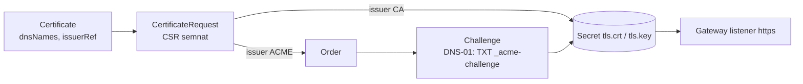

# Secrete, certificate și DNS

Trei probleme care apar imediat ce clusterul trebuie să fie folosit de cineva: cum ții o
parolă în Git fără ca Git-ul să o știe, cum primește fiecare serviciu un certificat
valid, și cum află PC-ul tău că `whoami.lab.merox.dev` e `10.10.100.10`.

## 1. Secrete în Git

Git e public (repo-ul `infrastructure` chiar este), istoria e veșnică, iar un Secret
Kubernetes e doar base64. Deci în Git ajunge o formă **criptată**, și cineva din cluster
o decriptează.

| Model | Cine decriptează | Cheia | Unde îl vezi |
|---|---|---|---|
| **SOPS + age** | Flux (`decryption: sops`), tu cu `sops` | perechea age: privata în `age.key` + secretul `sops-age` din cluster | prod: [.sops.yaml](../../.sops.yaml), `*.sops.yaml` |
| **Sealed Secrets** | un controller din cluster | perechea controller-ului, generată de el | lab |
| **External Secrets** | operatorul ESO, din alt sistem (1Password, Vault, AWS SM) | sistemul extern | prod: [grafana externalsecret](../../kubernetes/apps/observability/grafana/app/externalsecret.yaml) |
| **KSOPS / argocd-vault-plugin** | repo-server-ul ArgoCD, cu un plugin | ca SOPS | variante pentru ArgoCD |

> [!TIP]
> **🧠 Analogie: cutia poștală cu fantă**
> Sealed Secrets e o cutie poștală încuiată cu fantă: **oricine** poate băga o scrisoare
> (criptezi cu cheia publică, pe care o poate avea oricine), dar doar poștașul cu cheia
> (controller-ul din cluster) o poate deschide. Nici tu, după ce ai sigilat-o, nu o mai
> poți citi din Git. SOPS e un seif cu cheie pe care o ai **și tu, și Flux**: tu poți
> deschide oricând fișierul ca să-l editezi (`sops fișier.sops.yaml`).

| | SOPS + age (prod) | Sealed Secrets (lab) |
|---|---|---|
| Poți citi/edita secretul din Git? | da, cu `age.key` | nu — îl re-sigilezi de la zero |
| Ce e criptat | doar valorile (`encrypted_regex: ^(data\|stringData)$`) — cheile rămân lizibile | tot conținutul |
| Legat de nume/namespace? | nu | da, implicit (*strict scope*): mutat în alt namespace, nu se mai decriptează |
| Merge și în afara Kubernetes | da (prod criptează și `talsecret.sops.yaml`) | nu |
| Ce pierzi dacă pierzi cheia | tot ce e `*.sops.yaml` | toate SealedSecret-urile |

> [!CAUTION]
> **💥 Cheia e singurul lucru care nu se poate reconstrui**
> README-ul prod are o secțiune întreagă: „Three secrets you cannot lose”. `age.key` e
> primul — „No K8s secret decrypts”. Pentru Sealed Secrets, echivalentul e Secretul cu
> cheia controller-ului din `kube-system`. Ștergi controller-ul cu cascadă (de aceea
> Application-ul lui nu are finalizer) sau reconstruiești clusterul fără backup-ul cheii,
> și fiecare `*.sealed.yaml` din Git devine zgomot criptat.

### Laborator — Sealed Secrets

```bash
cd ~/k8s-lab
git mv argocd/later/sealed-secrets.yaml argocd/apps/
git commit -m "feat(sealed-secrets): enable" && git push
argocd app wait sealed-secrets --health

# kubeseal, pe lab-gw
V=$(curl -s https://api.github.com/repos/bitnami-labs/sealed-secrets/releases/latest | jq -r .tag_name)
curl -fsSL "https://github.com/bitnami-labs/sealed-secrets/releases/download/${V}/kubeseal-${V#v}-linux-amd64.tar.gz" \
  | tar -xz -C ~/.local/bin kubeseal
kubeseal --fetch-cert > ~/sealed-secrets.pub.pem      # cheia publică: poate sta oriunde, chiar în Git
```

Un secret pentru whoami, sigilat și comis:

```bash
kubectl create secret generic demo -n whoami --from-literal=token=s3cr3t --dry-run=client -o yaml \
  | kubeseal --format yaml > apps/whoami/demo.sealed.yaml
cat apps/whoami/demo.sealed.yaml                      # encryptedData, ilizibil
yq -i '.resources += ["./demo.sealed.yaml"]' apps/whoami/kustomization.yaml
git add -A && git commit -m "feat(whoami): sealed demo secret" && git push
argocd app get whoami --refresh
kubectl -n whoami get secret demo -o jsonpath='{.data.token}' | base64 -d; echo
```

Apoi trei experimente:

```bash
# 1. Sigilare offline, doar cu cheia publică (cum ai face pe un PC fără acces la cluster):
echo -n altceva | kubeseal --raw --cert ~/sealed-secrets.pub.pem --namespace whoami --name demo2
# 2. Mută SealedSecret-ul în alt namespace (editează namespace-ul în YAML, aplică de mână
#    într-un namespace de test) și citește evenimentul: „no key could decrypt secret”.
# 3. Backup-ul cheii — NU în Git; în managerul de parole, ca age.key:
kubectl -n kube-system get secret -l sealedsecrets.bitnami.com/sealed-secrets-key -o yaml > ~/sealed-secrets-key.backup.yaml
chmod 600 ~/sealed-secrets-key.backup.yaml
```

## 2. Certificate cu cert-manager

cert-manager e un controller (modulul 09, aceeași buclă) pentru certificate: tu declari
„vreau un certificat pentru `*.lab.merox.dev`, de la issuer-ul X”, el îl obține, îl pune
într-un Secret și îl reînnoiește la două treimi din viață.



| Issuer | Cine semnează | Bun pentru |
|---|---|---|
| `selfSigned` | certificatul se semnează singur | doar pentru a crea un CA |
| `ca` | un CA al tău, dintr-un Secret | lab, rețele interne — lanțul din modulul 05 |
| `acme` (Let's Encrypt) | o autoritate publică, după o probă | orice nume pe care îl controlezi în DNS-ul public |

Lab-ul pornește cu propriul CA, în trei pași — citește
[lab-ca.yaml](../lab/k8s-lab/platform/cert-manager/config/lab-ca.yaml): e exact
laboratorul openssl din modulul 05, declarat.

### Laborator — CA-ul lab-ului și Gateway-ul

```bash
cd ~/k8s-lab
git mv argocd/later/cert-manager.yaml argocd/later/gateway.yaml argocd/apps/
git commit -m "feat: cert-manager + internal gateway" && git push
argocd app wait cert-manager gateway --health --timeout 600
kubectl get clusterissuer
kubectl -n kube-system get certificate lab-wildcard
kubectl -n kube-system get gateway internal          # ADDRESS 10.10.100.10, PROGRAMMED True
```

Pune CA-ul root în încrederea Windows-ului (doar a utilizatorului tău, nu a mașinii):

```bash
# pe lab-gw
kubectl -n cert-manager get secret lab-root-ca -o jsonpath='{.data.ca\.crt}' | base64 -d > ~/lab-root-ca.crt
```

```powershell
# pe PC
scp lab-gw:lab-root-ca.crt $env:TEMP\
Import-Certificate -FilePath $env:TEMP\lab-root-ca.crt -CertStoreLocation Cert:\CurrentUser\Root
```

> [!WARNING]
> **⚠️ Un CA în trust store poate semna orice**
> Un CA root în care ai încredere poate emite un certificat valid pentru `google.com` sau
> pentru banca ta. Cheia lui stă acum într-un Secret din clusterul de lab. E acceptabil
> pentru un lab, pe contul tău, știind asta. La final (modulul 19), scoate-l:
> `certmgr.msc` → *Trusted Root* → `k8s-lab root CA` → Delete. Alternativa fără risc e
> Let's Encrypt, mai jos.

### Opțional — Let's Encrypt cu DNS-01, ca în prod

DNS-01 dovedește că deții domeniul printr-un record TXT în DNS-ul **public**, deci merge și
pentru nume care rezolvă la IP-uri private. Prod îl folosește pentru tot (`*.k8s.merox.dev`).

1. Cloudflare → *My Profile → API Tokens* → token cu *Zone:DNS:Edit* doar pentru `merox.dev`.
2. Sigilează-l: `kubectl create secret generic cloudflare-token -n cert-manager --from-literal=api-token=… --dry-run=client -o yaml | kubeseal --format yaml > platform/cert-manager/config/cloudflare-token.sealed.yaml`
3. Decomentează cele două linii din [kustomization.yaml](../lab/k8s-lab/platform/cert-manager/config/kustomization.yaml).
4. În [certificate.yaml](../lab/k8s-lab/platform/gateway/certificate.yaml), `issuerRef.name: letsencrypt-staging`. Push.
5. Urmărește: `kubectl -n kube-system get certificate,certificaterequest,order,challenge` și `dig TXT _acme-challenge.lab.merox.dev @1.1.1.1`.
6. Merge cu staging (certificat „fals”, dar emis)? Trece la `letsencrypt-production`.

> [!NOTE]
> **🏠 Cele două detalii din prod care fac DNS-01 sigur**
> [Valorile cert-manager](../../kubernetes/apps/cert-manager/cert-manager/app/helm/values.yaml):
> `dns01RecursiveNameservers` prin DoH la 1.1.1.1 și `…Only: true`. cert-manager își
> verifică singur record-ul TXT înainte să-i ceară lui Let's Encrypt validarea — iar
> resolver-ul clusterului (CoreDNS → pfSense, cu zone suprascrise local) ar putea vedea
> altceva decât internetul. Iar `profile: shortlived` din
> [clusterissuer.yaml](../../kubernetes/apps/cert-manager/cert-manager/app/clusterissuer.yaml)
> cere certificate de ~6 zile.

## 3. DNS: cum află PC-ul unde e `whoami.lab.merox.dev`

**k8s-gateway** e un server DNS care răspunde pentru un domeniu din resursele clusterului:
pentru fiecare `HTTPRoute` cu `hostnames`, întoarce adresa Gateway-ului de care e atașată;
pentru Service-urile `LoadBalancer`, adresa lor. Creezi o rută → numele există. Nu scrii
niciun record nicăieri.

```bash
cd ~/k8s-lab
git mv argocd/later/k8s-gateway.yaml argocd/apps/
git commit -m "feat(k8s-gateway): enable" && git push
argocd app wait k8s-gateway --health
dig @10.10.100.53 whoami.lab.merox.dev +short       # 10.10.100.10
```

Acum spune-i Windows-ului: „pentru `*.lab.merox.dev`, întreabă `10.10.100.53`” — o regulă
NRPT, adică *split DNS* doar pe PC-ul tău:

```powershell
# PowerShell ca administrator
Add-DnsClientNrptRule -Namespace ".lab.merox.dev" -NameServers "10.10.100.53"
Resolve-DnsName whoami.lab.merox.dev
Start-Process https://whoami.lab.merox.dev
```

Lacăt verde, `Hostname: whoami-…`. Același lucru pentru `argocd.lab.merox.dev`,
`hubble.lab.merox.dev` — rutele lor existau din modulul 12 și s-au atașat singure acum,
când Gateway-ul a apărut.

> [!NOTE]
> **🏠 Același design, la scara casei**
> În prod, pfSense are un *domain override*: `k8s.merox.dev → 10.57.57.111`
> ([REINSTALL.md](../../pfsense/REINSTALL.md)) — fiecare dispozitiv din casă rezolvă numele
> clusterului prin k8s-gateway. Iar pod-urile? Ele întreabă CoreDNS, care face forward la
> resolverele publice ale nodurilor și n-ar ști de `k8s.merox.dev`. De aceea
> [valorile CoreDNS din prod](../../kubernetes/apps/kube-system/coredns/app/helm/values.yaml)
> au o zonă `k8s.merox.dev` care merge **direct** la k8s-gateway — ocolind pfSense, după
> ce ~1 din 50 de interogări prin pfSense dădea SERVFAIL. Fă același lucru în lab:
> decomentează zona `lab.merox.dev` din [platform/coredns/values.yaml](../lab/k8s-lab/platform/coredns/values.yaml).

Drumul public din prod e altul și merită desenat o dată: client → Cloudflare (DNS proxied,
`external-dns` din [cloudflare-dns](../../kubernetes/apps/network/cloudflare-dns/app/helmrelease.yaml)
scrie CNAME-urile din `DNSEndpoint`) → tunelul Cloudflare (o conexiune **ieșită** din
cluster; zero porturi deschise) → `cilium-gateway-external` → HTTPRoute → pod.

## Taskuri

- [ ] Pornește sealed-secrets prin Git; instalează `kubeseal`
- [ ] Sigilează un Secret, comite-l, și verifică valoarea decriptată în cluster
- [ ] Sigilează offline, doar cu cheia publică
- [ ] Arată că un SealedSecret mutat în alt namespace nu se decriptează; citește evenimentul
- [ ] Fă backup la cheia controller-ului, în afara Git-ului
- [ ] Explică în notițe diferența dintre a pierde `age.key` în prod și a pierde cheia Sealed Secrets în lab
- [ ] Pornește cert-manager și gateway; `lab-wildcard` devine `Ready`
- [ ] Citește certificatul emis: `kubectl -n kube-system get secret lab-wildcard-tls -o jsonpath='{.data.tls\.crt}' | base64 -d | openssl x509 -noout -issuer -subject -ext subjectAltName -dates`
- [ ] Importă CA-ul root pe PC (CurrentUser)
- [ ] Pornește k8s-gateway; `dig @10.10.100.53` rezolvă `whoami.lab.merox.dev`
- [ ] Adaugă regula NRPT și deschide `https://whoami.lab.merox.dev` cu lacăt verde
- [ ] `curl -I http://whoami.lab.merox.dev` dă 301 spre https — de unde vine redirectul?
- [ ] Decomentează zona `lab.merox.dev` în CoreDNS; dintr-un pod, `nslookup argocd.lab.merox.dev` merge
- [ ] (Opțional) Let's Encrypt staging, apoi production, cu DNS-01

## Întrebări de verificare

<details>
<summary>De ce DNS-01 merge pentru un nume care rezolvă la 10.10.100.10, iar HTTP-01 nu?</summary>

HTTP-01 cere ca Let's Encrypt să facă un request HTTP la `http://nume/.well-known/acme-challenge/…`
— de pe internet, spre o adresă privată, imposibil. DNS-01 cere doar un record TXT
`_acme-challenge.nume` în DNS-ul public al domeniului; serviciul în sine nu e contactat
niciodată. De aceea prod emite certificate valide pentru servicii accesibile doar pe Tailscale.
</details>

<details>
<summary>Certificatul `lab-wildcard` expiră peste 90 de zile. Ce faci?</summary>

Nimic — cert-manager îl reînnoiește singur la două treimi din durată, iar Cilium încarcă
noul Secret în Envoy. Ce *trebuie* să ai e o alertă care sună dacă reînnoirea nu s-a
întâmplat (prod are `cert-rules`; modulul 15 îți face una). Automatizarea fără alertă
înseamnă că afli de eșec de la utilizatori.
</details>

<details>
<summary>De ce poți pune `sealed-secrets.pub.pem` în Git, dar niciodată backup-ul cheii?</summary>

Cheia publică doar *criptează* — cu ea oricine poate sigila, nimeni nu poate desigila. E
gândită să fie distribuită. Backup-ul conține cheia **privată**: cu el, oricine are acces la
repo poate decripta fiecare secret din istoria Git-ului. Aceeași logică pentru prod:
`age169…` (publica) e scrisă în `.sops.yaml`, iar `age.key` e în `.gitignore`.
</details>
