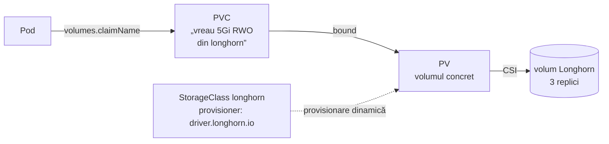
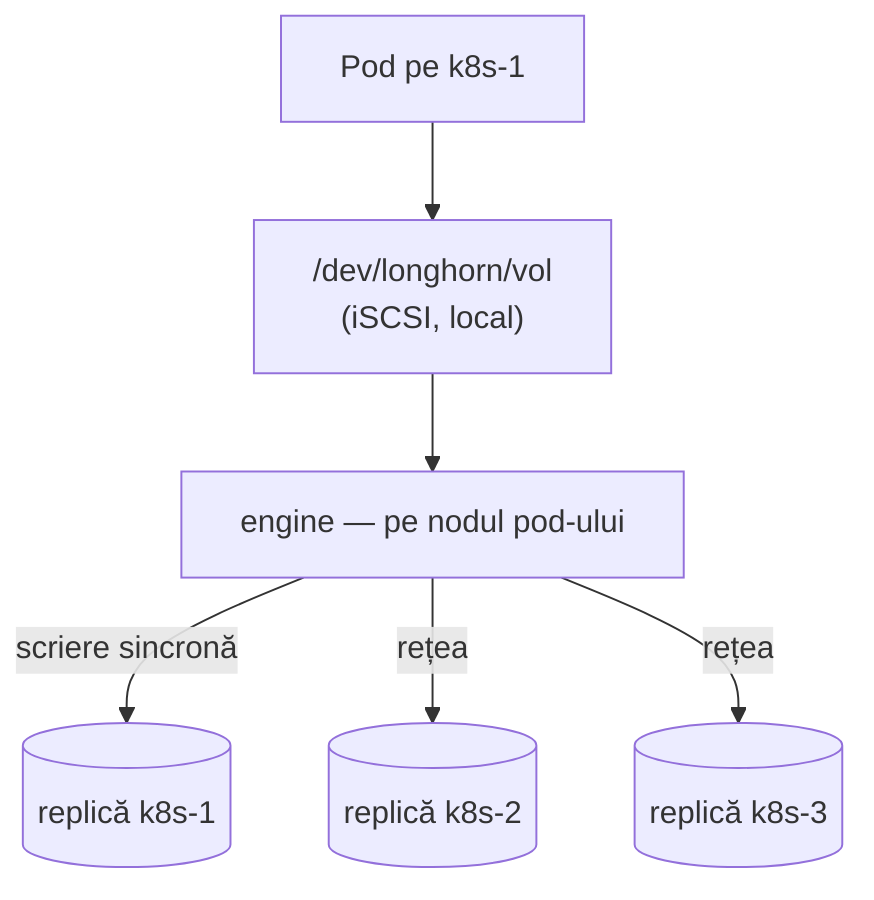

# Stocare: CSI, Longhorn, backup

Un pod e efemer: moare, reapare pe alt nod, cu un sistem de fișiere nou. Datele care
trebuie să supraviețuiască stau într-un **volum** care îl urmează. În modulul ăsta afli
cum ajunge un `PersistentVolumeClaim` să fie un bloc pe trei discuri, pe trei noduri, și
cum îl aduci înapoi după ce l-ai pierdut — cum face `DR.md` din prod.

## Tipurile de volume

| Volum | Trăiește cât | Pentru | Exemplu în prod |
|---|---|---|---|
| `emptyDir` | cât pod-ul | fișiere temporare, cache | `tmp` la Radarr (rootfs read-only) |
| `configMap` / `secret` | cât obiectul | configurație montată ca fișiere | [config-ul tunelului](../../kubernetes/apps/network/cloudflare-tunnel/app/resources/config.yaml) |
| `nfs` | pe server | date mari, partajate | `media` → NAS-ul (`${NAS_SERVER}:/volume1/media`) |
| `persistentVolumeClaim` | independent de pod | starea aplicațiilor | `radarr`, `radarr-cache` pe Longhorn |
| `hostPath` | pe nod | aproape niciodată — leagă pod-ul de un nod și îi dă acces la disc | — |

## PV, PVC, StorageClass



- **PVC** — cererea aplicației: dimensiune, mod de acces, clasă.
- **PV** — volumul real. Creat automat de provisioner (dinamic) sau de mână (static).
- **StorageClass** — „rețeta”: ce driver, ce parametri (replici), ce se întâmplă la ștergere
  (`reclaimPolicy: Delete` sau `Retain`).

| Mod de acces | Înseamnă |
|---|---|
| `ReadWriteOnce` (RWO) | montat read-write pe **un nod** odată (mai multe pod-uri pe același nod pot) |
| `ReadWriteOncePod` | un singur pod |
| `ReadWriteMany` (RWX) | pe mai multe noduri simultan — NFS, sau Longhorn prin share-manager |

> [!TIP]
> **🧠 Analogie: garderoba teatrului**
> PVC-ul e **bonul de garderobă**: „un cuier, mărimea M”. PV-ul e **cuierul concret** cu
> numărul 42. StorageClass e **regulamentul garderobei**: ce fel de cuiere există și ce se
> întâmplă cu haina dacă bonul se pierde (Delete — se donează; Retain — rămâne până o
> ridică cineva). Spectatorul (pod-ul) poate schimba sala (nodul); bonul rămâne valabil și
> haina îl urmează.

## CSI: cum vorbește Kubernetes cu orice sistem de stocare

CSI (Container Storage Interface) e pentru stocare ce e CNI pentru rețea: un contract.

| Bucată | Unde rulează | Ce face |
|---|---|---|
| **controller plugin** + sidecar-e (`csi-provisioner`, `csi-attacher`, `csi-resizer`, `csi-snapshotter`) | Deployment | creează/șterge volume, le atașează logic unui nod |
| **node plugin** (`longhorn-csi-plugin`) | DaemonSet | pe nod: formatează, montează volumul în directorul pod-ului |
| obiectele | API | `CSIDriver`, `CSINode`, `VolumeAttachment` |

> [!NOTE]
> **🏠 Sidecar-ele CSI și drain-ul blocat**
> `csi-attacher` și `csi-provisioner` sunt exact Deployment-urile care au blocat upgrade-ul
> din 2026-10-26: Longhorn 1.13 le-a dat PDB `minAvailable=1` cu o singură replică.
> Remedierea, în [helmrelease-ul Longhorn](../../kubernetes/apps/storage/longhorn/app/helmrelease.yaml)
> din prod, a fost să ruleze câte una pe nod.

## Longhorn, pe dinăuntru



Pentru fiecare volum, Longhorn pornește un **engine** pe nodul unde e atașat și ține
**replici** (fișiere *sparse* în `/var/lib/longhorn`) pe alte noduri. Engine-ul expune un
disc local prin **iSCSI** — de aceea fiecare nod are nevoie de `open-iscsi` (și Talos de
extensia `iscsi-tools`). Fiecare scriere merge **sincron** la toate replicile sănătoase
înainte de confirmare: o scriere costă trafic de rețea × numărul de replici.

| Stare volum | Înseamnă |
|---|---|
| `healthy` | toate replicile cerute există și sunt la zi |
| `degraded` | merge, dar lipsesc replici — Longhorn reconstruiește (*rebuild*) pe alt nod |
| `faulted` | nicio replică bună — datele nu sunt accesibile |

> [!NOTE]
> **🏠 Trei replici, și prețul lor**
> Citește secțiunea „Longhorn keeps one replica per node” din [THREE-NODE.md](../../talos/THREE-NODE.md).
> Pe scurt: cu două replici pe două noduri și scheduling oprit pe al treilea, pierderea
> oricărui nod lăsa fiecare volum cu o replică **și nicăieri unde să construiască a doua**.
> A treia replică a costat +36% scrieri fizice pe discul QLC — nu pentru că volumul scria
> mai mult, ci pentru că amplificarea zvol-ului a urcat de la 2.8× la 3.5×. „A pool's
> amplification factor is not a constant.” E una din cele mai bune analize de stocare din
> repo; merită citită integral.

## Snapshot vs backup

| | Snapshot | Backup |
|---|---|---|
| Unde stă | pe aceleași replici, în cluster | în afara clusterului (S3) |
| Cât de repede | instant (copy-on-write) | minute, depinde de date și rețea |
| Supraviețuiește pierderii clusterului | **nu** | da |
| Bun pentru | „am șters ceva acum o oră” | „a ars totul” |

Lab-ul are aceleași două joburi ca prod, mai mici: [recurringjobs.yaml](../lab/k8s-lab/platform/longhorn/config/recurringjobs.yaml).
Prod are și un al treilea — `system-backup`, care salvează **configurația** Longhorn
(setări, definițiile volumelor) — și un comentariu despre cum, lăsat implicit, ar fi făcut
backup și la volumele excluse intenționat.

## Laborator — Garage, Longhorn, date

### 1. Ținta de backup, în afara clusterului

```bash
sudo bash ~/infrastructure/learn/lab/infra/router/setup-garage.sh
# la final: Key ID (GK…) și Secret key — pentru pasul următor
```

Garage rulează pe lab-gw, nu în cluster: un backup care moare odată cu clusterul nu e un
backup. Prod are aceeași separare — Garage pe `pve-3`, cu datele pe NAS
([architecture.md](../../docs/architecture.md), „How a backup reaches three places”).

### 2. Credențialele, sigilate

```bash
cd ~/k8s-lab/platform/longhorn/config
cp garage-credentials.example.yaml /tmp/garage.secret.yaml
nano /tmp/garage.secret.yaml               # cele două chei de la pasul 1
kubeseal --format yaml < /tmp/garage.secret.yaml > garage-credentials.sealed.yaml && rm /tmp/garage.secret.yaml
sed -i 's|  # - ./garage-credentials.sealed.yaml|  - ./garage-credentials.sealed.yaml|' kustomization.yaml
```

`kubeseal` are nevoie de namespace-ul `longhorn-system` doar ca parte a identității
secretului — nu trebuie să existe încă.

### 3. Longhorn prin GitOps

```bash
cd ~/k8s-lab
git mv argocd/later/longhorn.yaml argocd/apps/
git add -A && git commit -m "feat(longhorn): enable with Garage backup target" && git push
argocd app wait longhorn --health --timeout 900
kubectl -n longhorn-system get nodes.longhorn.io       # 3 noduri, Ready, Schedulable
kubectl -n longhorn-system get backuptarget            # AVAILABLE true
```

UI-ul: `https://longhorn.lab.merox.dev`.

### 4. Un workload cu stare

```bash
kubectl create namespace data
kubectl -n data apply -f - <<'EOF'
apiVersion: v1
kind: PersistentVolumeClaim
metadata:
  name: notes
  labels:
    recurring-job.longhorn.io/source: enabled
    recurring-job-group.longhorn.io/backup: enabled
spec:
  accessModes: [ReadWriteOnce]
  storageClassName: longhorn
  resources: {requests: {storage: 1Gi}}
---
apiVersion: apps/v1
kind: Deployment
metadata: {name: writer}
spec:
  replicas: 1
  strategy: {type: Recreate}           # RWO: pod-ul vechi trebuie să elibereze volumul întâi
  selector: {matchLabels: {app: writer}}
  template:
    metadata: {labels: {app: writer}}
    spec:
      containers:
        - name: w
          image: busybox:1.37
          command: ["sh", "-c", "while true; do date -Is >> /data/log; sleep 5; done"]
          volumeMounts: [{name: d, mountPath: /data}]
      volumes: [{name: d, persistentVolumeClaim: {claimName: notes}}]
EOF
kubectl -n data get pvc notes                          # Bound
kubectl -n data exec deploy/writer -- tail -3 /data/log
NODE=$(kubectl -n data get pod -l app=writer -o jsonpath='{.items[0].spec.nodeName}')
ssh "$NODE" sudo iscsiadm -m session                   # discul Longhorn e o sesiune iSCSI locală
ssh "$NODE" lsblk | grep -A1 sd                         # și un disc nou
```

### 5. Strică și repară

**O replică pierdută.** Oprește un nod care **nu** rulează pod-ul (`qm stop` pe host).
În UI volumul devine `Degraded`. Pornește nodul înapoi și urmărește rebuild-ul. Câte minute
pentru 1 GiB aproape gol? (Longhorn copiază doar datele reale, nu dimensiunea alocată —
prod: „A full rebuild … moves ~35 GB, not the ~200 GB provisioned”.)

**Nodul cu pod-ul pierdut.** Acum oprește nodul pe care rulează `writer`. Cronometrează cât
durează până când pod-ul rulează pe alt nod, cu volumul atașat acolo. Setarea
`nodeDownPodDeletionPolicy` din [values.yaml](../lab/k8s-lab/platform/longhorn/values.yaml)
e motivul pentru care nu aștepți la nesfârșit.

**Snapshot și revert.** Din UI: *Take Snapshot*. Apoi `kubectl -n data exec deploy/writer --
sh -c '> /data/log'` (golește fișierul). Revert la snapshot cere volumul detașat: scalează
la 0, *Revert* în UI, scalează la 1, verifică log-ul.

**Backup și restore, ca la DR.**

```bash
# 1. backup manual (sau așteaptă jobul de noapte): UI → volum → Create Backup
# 2. verifică pe lab-gw că a ajuns în Garage:
sudo garage -c /etc/garage.toml bucket info longhorn
# 3. pierde totul
kubectl delete namespace data
# 4. UI → Backup → backup-ul lui `notes` → Restore, nume: notes
# 5. leagă volumul restaurat de un PVC cu același nume, printr-un PV static:
```

```yaml
apiVersion: v1
kind: PersistentVolume
metadata: {name: notes}
spec:
  capacity: {storage: 1Gi}
  accessModes: [ReadWriteOnce]
  persistentVolumeReclaimPolicy: Retain
  storageClassName: longhorn
  claimRef: {namespace: data, name: notes}
  csi: {driver: driver.longhorn.io, fsType: ext4, volumeHandle: notes}
```

Aplică PV-ul, recreează namespace-ul și manifestul de la pasul 4, și citește log-ul: datele
de dinainte de ștergere sunt acolo.

> [!NOTE]
> **🏠 Exact ce face DR-ul din prod, pentru 7 volume**
> [restore-pvs/pvs.yaml](../../kubernetes/apps/storage/restore-pvs/pvs.yaml) e lista de PV-uri
> statice, câte unul pe volum salvat, cu `claimRef` spre PVC-ul aplicației — „this file is
> the single list of what a DR brings back”. Comentariul spune și cum s-a pierdut biblioteca
> Immich: un volum salvat, dar absent din listă, era restaurat și apoi ignorat. `task
> longhorn:restore` din [DR.md](../../DR.md) (faza 4) e pasul 4–5 de mai sus, automatizat.

## Taskuri

- [ ] Rulează `setup-garage.sh`; `garage bucket info longhorn` funcționează
- [ ] Sigilează credențialele Garage și adaugă-le în kustomization
- [ ] Pornește Longhorn prin Git; BackupTarget `AVAILABLE`
- [ ] Creează workload-ul `writer`; găsește sesiunea iSCSI pe nodul lui
- [ ] Găsește pe noduri fișierele replicilor: `sudo ls /var/lib/longhorn/replicas/`
- [ ] Oprește un nod fără pod; volumul `Degraded`; repornește și cronometrează rebuild-ul
- [ ] Oprește nodul cu pod-ul; cronometrează mutarea pod-ului cu volumul
- [ ] Snapshot, golește fișierul, revert, verifică
- [ ] Backup în Garage, șterge namespace-ul, restore + PV static, datele revin
- [ ] Explică în notițe de ce `reclaimPolicy: Retain` pe PV-ul static, deși StorageClass-ul are `Delete`
- [ ] Citește comentariul `storageMinimalAvailablePercentage` din prod: ce s-ar fi întâmplat cu etcd?
- [ ] Curăță: `kubectl delete namespace data` și PV-ul `notes`

## Întrebări de verificare

<details>
<summary>De ce un volum RWO cere `strategy: Recreate` și nu `RollingUpdate`?</summary>

La un rolling update, pod-ul nou pornește înainte ca cel vechi să se oprească. Dacă ajunge
pe alt nod, volumul RWO e încă atașat de nodul vechi și pod-ul nou rămâne în
`ContainerCreating` cu `Multi-Attach error` — deadlock până la timeout. `Recreate` oprește
întâi pod-ul vechi, volumul se detașează, apoi pornește cel nou.
</details>

<details>
<summary>Prod nu face backup la Prometheus, Loki și cache-uri. E o greșeală?</summary>

Nu — e regula din [architecture.md](../../docs/architecture.md): backup se face după ce
pierzi și cât costă recrearea. Metricile și logurile sunt *tier 3*: le pierzi, pornesc goale,
nimic ireversibil. Backup-ul lor ar costa spațiu, bandă și timp de restore pentru date pe
care nimeni nu le-ar restaura. Excluderea e explicită (o linie în alerta
`LonghornVolumeNeverBackedUp`), nu o omisiune — „An exemption is a line in git. An omission
is not.”
</details>

<details>
<summary>Ce limitează viteza de scriere a unui volum Longhorn cu 3 replici?</summary>

Cea mai lentă replică sănătoasă și rețeaua spre ea: scrierea e confirmată doar după ce toate
replicile au scris-o. Pe 1 GbE, partajat cu etcd și cu traficul aplicațiilor, rebuild-urile
și scrierile mari concurează direct cu etcd — motivul pentru
`concurrentReplicaRebuildPerNodeLimit: "1"` în prod și pentru avertismentul din
THREE-NODE.md: „The safety net is the quorum, not a limit.”
</details>
