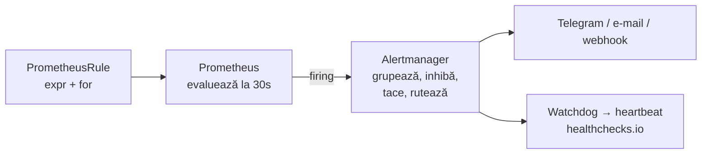

# Observabilitate: metrici, alerte, loguri

Un cluster pe care nu-l măsori e un cluster despre care afli de la utilizatori. Modulul
ăsta pune Prometheus, Alertmanager și Grafana în lab — prin GitOps, evident — și te învață
să pui întrebări în PromQL. Mai important: să scrii alerte care **chiar** pot suna.

## Trei semnale

| Semnal | Răspunde la | Unealta în prod |
|---|---|---|
| **Metrici** | „cât, cât de des, cât de repede?” — numere în timp, ieftine | Prometheus ([helmrelease](../../kubernetes/apps/observability/kube-prometheus-stack/app/helmrelease.yaml)) |
| **Loguri** | „ce s-a întâmplat exact?” — text, scump la volum | Loki + Alloy |
| **Evenimente / heartbeat-uri** | „a rulat?” — un ping când un job reușește | healthchecks.io, Watchdog |

## Modelul Prometheus

Prometheus **trage** (*scrape*): la fiecare 15–30 s face `GET /metrics` la fiecare țintă
și stochează ce primește. O serie de timp e un nume plus o mulțime de etichete:

```
lab_app_requests_total{namespace="lab-app", pod="lab-app-7d9…", instance="10.244.1.12:8080"}  1287
```

| Tip | Ce e | Cum îl citești |
|---|---|---|
| **counter** | doar crește (resetat la restart) | niciodată direct: `rate()` sau `increase()` |
| **gauge** | urcă și coboară | direct: memorie, temperatură, `lab_app_ready` |
| **histogram** | numără observațiile în *bucket*-uri (`_bucket{le="0.1"}`) | `histogram_quantile(0.99, …)` |

Cu **Prometheus Operator** (din kube-prometheus-stack), nu scrii configurația de scrape de
mână: creezi un `ServiceMonitor` („scrape Service-urile cu eticheta X, pe portul Y”) și
operatorul o generează. [servicemonitor.yaml-ul lab-app](../lab/k8s-lab/apps-later/lab-app/servicemonitor.yaml)
e tot ce trebuie ca metricile lui să apară.

> [!TIP]
> **🧠 Analogie: termometrele dintr-o seră**
> Fiecare serviciu are un termometru pe perete (`/metrics`). Prometheus e grădinarul care
> trece pe la fiecare la 15 secunde și notează valoarea în caiet. Nu întreabă de ce;
> notează. PromQL e felul în care citești caietul: „cât a crescut temperatura medie în ultima
> oră, pe fiecare rând de plante?”. Alertmanager e soneria pe care o pui: „dacă în rândul 3
> trece de 35° mai mult de 10 minute, sună-mă — dar o singură dată, nu la fiecare termometru”.

## Laborator 1 — stack-ul, prin Git

```bash
cd ~/k8s-lab
git mv argocd/later/kube-prometheus-stack.yaml argocd/apps/
git commit -m "feat(observability): kube-prometheus-stack" && git push
argocd app wait kube-prometheus-stack --health --timeout 900
kubectl -n observability get pods
```

Deschide `https://prometheus.lab.merox.dev` → *Status → Targets*. Etcd, controller-manager
și scheduler apar ca ținte, pe adresele nodurilor — ele nu sunt pod-uri (în hard way sunt
servicii systemd), deci [values.yaml](../lab/k8s-lab/platform/kube-prometheus-stack/values.yaml)
le listează explicit. `:2381` pentru etcd e exact `listen-metrics-urls` pe care l-ai pus în
[04-etcd.sh](../lab/hardway/04-etcd.sh) — și pe care prod îl setează în
[cluster.yaml](../../talos/patches/controller/cluster.yaml).

Apoi pornește ServiceMonitor-urile care așteptau CRD-ul: în `platform/*/values.yaml`,
`serviceMonitor.enabled: true` pentru Cilium (agent, operator, hubble), cert-manager,
Longhorn, metrics-server, sealed-secrets. Un singur commit, și numără țintele noi.

## PromQL: 12 întrebări pe care le vei pune des

Rulează-le în *Graph* și înțelege fiecare înainte să treci mai departe.

```promql
# 1. Ce ținte nu răspund?
up == 0

# 2. CPU folosit pe nod, procent (counter → rate)
100 * (1 - avg by (instance) (rate(node_cpu_seconds_total{mode="idle"}[5m])))

# 3. Memorie disponibilă pe nod, GiB
node_memory_MemAvailable_bytes / 2^30

# 4. Request-uri pe secundă la API, pe verb
sum by (verb) (rate(apiserver_request_total[5m]))

# 5. p99 latență API pentru scrieri
histogram_quantile(0.99, sum by (le) (rate(apiserver_request_duration_seconds_bucket{verb=~"POST|PUT|PATCH|DELETE"}[5m])))

# 6. p99 fsync WAL etcd — metrica pe care s-a construit tuning-ul din prod
histogram_quantile(0.99, sum by (instance, le) (rate(etcd_disk_wal_fsync_duration_seconds_bucket[5m])))

# 7. Schimbări de lider etcd în ultima oră
increase(etcd_server_leader_changes_seen_total[1h])

# 8. Pod-uri care nu sunt Running/Succeeded
sum by (namespace, phase) (kube_pod_status_phase{phase!~"Running|Succeeded"}) > 0

# 9. Restart-uri de containere în ultima oră
increase(kube_pod_container_status_restarts_total[1h]) > 0

# 10. Volume aproape pline (kubelet), procent
100 * kubelet_volume_stats_used_bytes / kubelet_volume_stats_capacity_bytes

# 11. Pachete aruncate de Cilium, pe motiv
sum by (reason) (rate(cilium_drop_count_total[5m]))

# 12. Când se umple discul nodului, la rata din ultimele 6 ore?
predict_linear(node_filesystem_avail_bytes{mountpoint="/"}[6h], 24*3600) < 0
```

> [!WARNING]
> **⚠️ Cardinalitatea**
> Fiecare combinație unică de etichete e o serie nouă, cu memorie proprie. O etichetă cu
> ID-ul utilizatorului sau URL-ul complet poate crea milioane de serii și poate omorî
> Prometheus. Etichetele descriu *de unde* vine măsurătoarea (pod, nod, verb), nu *ce* a
> cerut fiecare client. Prod limitează explicit etichetele preluate de kube-state-metrics
> (`metricLabelsAllowlist`).

## Alerte: de la regulă la telefon



O alertă bună:

- descrie un **simptom** care afectează pe cineva, nu o cauză internă oarecare;
- are un `for:` care filtrează zgomotul (o secundă de CPU mare nu e o problemă);
- e **acționabilă**: cine o primește știe ce să facă;
- **a sunat cel puțin o dată**, intenționat — altfel nu știi că expresia e corectă.

> [!NOTE]
> **🏠 Regulile prod-ului despre alerte**
> Din [architecture.md](../../docs/architecture.md): „**An alert that cannot fire is worse
> than no alert.**” În [helmrelease-ul kps](../../kubernetes/apps/observability/kube-prometheus-stack/app/helmrelease.yaml),
> `etcdHighNumberOfFailedGRPCRequests` e dezactivată pentru că „structurally unable to be
> anything but 0% or 100%” — suna la fiecare restart etcd — și înlocuită cu una scoped pe
> apelurile unare. Iar [alertmanagerconfig.yaml](../../kubernetes/apps/observability/kube-prometheus-stack/app/alertmanagerconfig.yaml)
> are un comentariu despre `groupBy` care merită citit: un restart de VM pe un host a fost
> înghițit în tăcere de grupul altui VM cu același număr, de pe alt host.

### Liniștea e alarma

Ce se întâmplă dacă Prometheus moare? Nicio alertă nu mai sună — și nu știi. Soluția din prod:
alerta **Watchdog** e *mereu* activă, iar Alertmanager o trimite la fiecare minut unui
serviciu extern (healthchecks.io). Când pingurile încetează, serviciul extern te anunță. La
fel, fiecare job programat din prod (backup-uri, vault-ul) raportează la healthchecks.io:
„Silence is the alarm” ([README](../../README.md)).

## Laborator 2 — o alertă care sună

[lab-rules.yaml](../lab/k8s-lab/platform/kube-prometheus-stack/config/lab-rules.yaml) are
două reguli. Adaugă a treia, pentru whoami:

```yaml
    - name: lab.apps
      rules:
        - alert: WhoamiUnavailable
          expr: kube_deployment_status_replicas_available{namespace="whoami", deployment="whoami"} == 0
          for: 1m
          labels:
            severity: critical
          annotations:
            summary: "whoami nu are nicio replică disponibilă"
```

Commit, push, apoi provoac-o. Atenție: ArgoCD are `selfHeal` — un `kubectl scale` ar fi
anulat în câteva secunde. Provoac-o **prin Git** (`replicas: 0`), sau suspendă temporar
self-heal-ul (`argocd app set whoami --self-heal=false`) — și gândește-te ce spune asta
despre cum s-ar comporta alertele într-un cluster GitOps.

```bash
# Urmărește-o trecând prin stări:
# Prometheus → Alerts: inactive → pending (în fereastra for:) → firing
# Alertmanager: https://alertmanager.lab.merox.dev
```

Apoi provoacă `EtcdSlowFsync`? Nu se poate ușor — și asta e o informație: o alertă pe care
nu o poți testa trebuie verificată măcar evaluând expresia manual și uitându-te că valorile
au sens. Provoacă în schimb `CiliumBGPSessionDown`: oprește FRR pe lab-gw
(`sudo systemctl stop frr`) două minute. Verifică etichetele reale ale metricii în
Prometheus și corectează `summary`-ul regulii dacă e cazul.

**Opțional — Telegram, ca prod.** Un bot (`@BotFather`), chat ID-ul tău, un Secret sigilat în
`observability`, și un `AlertmanagerConfig` după modelul celui din prod (receiver `telegram`,
rută pe `severity=~"critical|warning"`). Plus Watchdog-ul spre un check gratuit pe
healthchecks.io.

## Grafana

`https://grafana.lab.merox.dev` (admin / `prom-operator` — schimbă-l: primul task). Panourile
incluse în kps (*Kubernetes / Compute Resources / …*, *etcd*, *Node Exporter*) sunt bune ca
punct de plecare. Construiește unul propriu pentru lab-app (după modulul 16): rata de
request-uri, `lab_app_ready` pe pod, restart-uri.

> [!NOTE]
> **🏠 Panouri ca cod**
> Prod generează panoul principal dintr-un script: [homelab-overview.py](../../kubernetes/apps/observability/grafana/app/dashboards/homelab-overview.py)
> produce [homelab-overview.json](../../kubernetes/apps/observability/grafana/app/dashboards/homelab-overview.json).
> Un panou făcut prin click-uri în UI se pierde la primul DR; unul din Git, nu.

## Loguri, pe scurt

`kubectl logs` citește fișierele pe care kubelet-ul le ține pe nod
(`/var/log/pods/…`) — dispar odată cu pod-ul și sunt rotite. Pentru istorie și căutare în tot
clusterul, prod colectează cu **Alloy** (un agent pe fiecare nod) în **Loki** (o bază de date
de loguri indexată doar după etichete, nu după conținut — de aceea e ieftină). Și Loki poate
alerta: [lokirule.yaml-ul Radarr](../../kubernetes/apps/default/radarr/app/lokirule.yaml)
sună când apare „database is locked” în loguri.

Ca exercițiu de recapitulare GitOps (fără manifeste date): adaugă Loki în lab ca Application
nouă, pornind de la [helmrelease-ul din prod](../../kubernetes/apps/observability/loki/app/helmrelease.yaml),
cu stocarea pe Longhorn.

## Taskuri

- [ ] Pornește kube-prometheus-stack prin Git; toate pod-urile din `observability` rulează
- [ ] În *Targets*, găsește etcd pe `:2381` pe toate cele trei noduri
- [ ] Activează ServiceMonitor-urile din valorile platformei într-un commit; numără țintele noi
- [ ] Rulează cele 12 interogări și scrie în notițe ce înseamnă fiecare rezultat
- [ ] Interogarea 6: compară p99 fsync în lab cu cele 512 ms/1 s din comentariul prod
- [ ] Schimbă parola Grafana cu un SealedSecret (`grafana.admin.existingSecret`)
- [ ] Adaugă `WhoamiUnavailable`, provoac-o prin Git și urmărește pending → firing → resolved
- [ ] Provoacă `CiliumBGPSessionDown` oprind FRR; corectează etichetele din regulă dacă e nevoie
- [ ] Explică în notițe de ce alerta Watchdog trebuie să sune mereu
- [ ] (Opțional) Telegram + heartbeat pe healthchecks.io
- [ ] (Opțional) Loki ca Application nouă

## Întrebări de verificare

<details>
<summary>De ce `rate(counter[5m])` și nu valoarea counter-ului?</summary>

Valoarea brută a unui counter depinde de când a pornit procesul și se resetează la restart:
„1 287 de request-uri” nu spune nimic. `rate()` calculează creșterea pe secundă în fereastră
și tratează corect resetările (o scădere bruscă e interpretată ca restart, nu ca valoare
negativă). Aproape orice întrebare utilă despre un counter e despre ritmul lui.
</details>

<details>
<summary>O alertă are `for: 10m`. Problema apare 9 minute, dispare 1 minut, apare iar 9 minute. Sună?</summary>

Nu. `for` cere ca expresia să fie adevărată **continuu** pe toată durata; o întrerupere
resetează cronometrul. E filtrul împotriva zgomotului — și o capcană pentru probleme
intermitente. Pentru ele scrii expresia pe o fereastră (`max_over_time(…[15m])`,
`increase(…[1h]) > N`), cum face prod cu `EtcdSlowFsyncBurst`.
</details>

<details>
<summary>Prometheus rulează în același cluster pe care îl monitorizează. Ce nu poate detecta?</summary>

Propria moarte și moartea clusterului întreg: dacă nodurile, rețeaua sau Prometheus cad,
nimeni nu mai evaluează reguli. De aceea există un semnal din *afara* sistemului: Watchdog
spre healthchecks.io, iar în prod și `homelab-watch` pe VPS, care trimite pe Telegram „când
casa dispare de pe tailnet” ([architecture.md](../../docs/architecture.md)).
</details>
