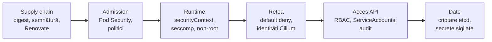

# Securitate în straturi

Niciun strat nu e suficient singur. Securitatea unui cluster e o succesiune de bariere,
fiecare presupunând că cea dinainte a cedat: o imagine compromisă e oprită de restricțiile
pod-ului; un pod compromis, de politica de rețea; un token furat, de RBAC; un nod
compromis, de faptul că secretele din etcd sunt criptate.



> [!TIP]
> **🧠 Analogie: castelul**
> Nu construiești un zid perfect; construiești un șanț, un zid, o poartă cu pod mobil,
> o curte interioară și un turn. Atacatorul care trece de unul dă de următorul — iar tu ai
> timp să-l vezi (auditul). Un cluster cu un singur strat de apărare e o casă cu o ușă
> blindată și ferestrele deschise.

## 1. Pod Security Admission

Un plugin de admission (modulul 07) care verifică fiecare pod față de un profil:

| Profil | Interzice, printre altele | Pentru |
|---|---|---|
| `privileged` | nimic | componente de sistem: Cilium, Longhorn, node-exporter |
| `baseline` | `privileged: true`, `hostNetwork`, `hostPath`, capabilities periculoase | aplicații care nu pot fi încă `restricted` |
| `restricted` | și root, escaladarea de privilegii, capabilities în afară de `NET_BIND_SERVICE`, seccomp lipsă | ținta pentru orice aplicație |

Pe namespace, trei moduri independente, prin etichete:

```yaml
pod-security.kubernetes.io/enforce: restricted   # respinge
pod-security.kubernetes.io/warn: restricted      # avertizează clientul (kubectl)
pod-security.kubernetes.io/audit: restricted     # scrie în audit log
```

> [!NOTE]
> **🏠 Prod: enforce privileged, warn/audit restricted**
> [admission-controller-patch.yaml](../../talos/patches/controller/admission-controller-patch.yaml)
> pune implicitul clusterului pe `enforce: privileged` și `warn`/`audit: restricted`: nimic
> nu e blocat, dar orice pod care n-ar trece de `restricted` lasă urme. E o strategie de
> migrare sinceră — vezi ce ar pica înainte să strângi șurubul. `default` are explicit
> `privileged` ([namespace.yaml](../../kubernetes/apps/default/namespace.yaml)): Jellyfin
> are nevoie de GPU, qBittorrent de capabilities de rețea pentru VPN.

### Laborator 1 — restricted pe aplicațiile lab-ului

ApplicationSet-ul creează namespace-urile (`CreateNamespace=true`). Etichetele le pune tot
el, prin `managedNamespaceMetadata`. În [argocd/apps/apps.yaml](../lab/k8s-lab/argocd/apps/apps.yaml),
în `template.spec.syncPolicy`:

```yaml
        managedNamespaceMetadata:
          labels:
            pod-security.kubernetes.io/enforce: restricted
            pod-security.kubernetes.io/warn: restricted
            pod-security.kubernetes.io/audit: restricted
```

Push, apoi testează că bariera există:

```bash
kubectl get ns whoami lab-app --show-labels
kubectl -n whoami run root --image=busybox:1.37 -- sleep 3600
# Error … violates PodSecurity "restricted:latest": allowPrivilegeEscalation != false, … runAsNonRoot != true …
kubectl -n whoami get pods                  # whoami și lab-app rulează: manifestele lor erau deja restricted
```

## 2. securityContext: ce cere `restricted`, și de ce

Manifestele [whoami](../lab/k8s-lab/apps/whoami/deployment.yaml) și
[lab-app](../lab/k8s-lab/apps-later/lab-app/deployment.yaml) au tot setul:

| Câmp | Ce oprește |
|---|---|
| `runAsNonRoot: true`, `runAsUser: 65532` | un exploit în aplicație nu e root în container (și, fără user namespaces, nici pe nod) |
| `allowPrivilegeEscalation: false` | un binar setuid nu poate urca privilegii (`no_new_privs`) |
| `capabilities.drop: [ALL]` | chiar și ca root, fără puterile mici: raw sockets, chown, kill… |
| `readOnlyRootFilesystem: true` | nimeni nu scrie un binar nou în imagine și nu-l rulează |
| `seccompProfile: RuntimeDefault` | ~40 de syscall-uri periculoase blocate (`mount`, `kexec_load`, `ptrace` limitat…) |
| `automountServiceAccountToken: false` | un pod care nu vorbește cu API-ul nu are un token de furat |

## 3. RBAC

| Obiect | Scop | Exemplu |
|---|---|---|
| `Role` / `ClusterRole` | **ce** verbe pe **ce** resurse | `get, list, watch` pe `pods` |
| `RoleBinding` | dă un Role (sau ClusterRole) cuiva, **într-un namespace** | `view` în `whoami` pentru `ana` |
| `ClusterRoleBinding` | dă un ClusterRole cuiva, **în tot clusterul** | homepage citește noduri și pod-uri peste tot |
| subiecți | `User`, `Group` (din certificat sau OIDC), `ServiceAccount` | `system:node:k8s-1`, `system:nodes` |

RBAC e **doar aditiv**: nu există „deny”. Tot ce nu e permis explicit e interzis.

> [!NOTE]
> **🏠 RBAC minim, cu motiv scris**
> [homepage/app/rbac.yaml](../../kubernetes/apps/default/homepage/app/rbac.yaml): un
> ClusterRole cu doar `get/list/watch` pe namespace-uri, pod-uri, noduri și metrici —
> „so a compromised dashboard cannot change anything — the same reason Portainer's cluster
> agent was removed on 2026-09-07 for holding a standing cluster-admin”. Un dashboard cu
> cluster-admin e o cheie universală lăsată în ușă.

### Laborator 2 — un utilizator nou, prin API-ul de CSR

```bash
mkdir -p ~/users && cd ~/users
openssl genpkey -algorithm EC -pkeyopt ec_paramgen_curve:P-256 -out ana.key
openssl req -new -key ana.key -subj "/O=lab-devs/CN=ana" -out ana.csr

kubectl apply -f - <<EOF
apiVersion: certificates.k8s.io/v1
kind: CertificateSigningRequest
metadata: {name: ana}
spec:
  request: $(base64 -w0 ana.csr)
  signerName: kubernetes.io/kube-apiserver-client
  expirationSeconds: 86400
  usages: [client auth]
EOF
kubectl certificate approve ana             # controller-manager semnează cu ca.key (modulul 07)
kubectl get csr ana -o jsonpath='{.status.certificate}' | base64 -d > ana.crt
openssl x509 -in ana.crt -noout -subject -dates

cp ~/.kube/config ana.kubeconfig
kubectl --kubeconfig ana.kubeconfig config set-credentials ana --client-certificate=ana.crt --client-key=ana.key --embed-certs
kubectl --kubeconfig ana.kubeconfig config set-context --current --user=ana

kubectl --kubeconfig ana.kubeconfig get pods -n whoami          # Forbidden: autentificată, neautorizată
kubectl create rolebinding lab-devs-view -n whoami --clusterrole=view --group=lab-devs
kubectl --kubeconfig ana.kubeconfig get pods -n whoami          # merge
kubectl --kubeconfig ana.kubeconfig get secrets -n whoami       # Forbidden: `view` exclude secretele
kubectl auth can-i --list -n whoami --as=ana --as-group=lab-devs
```

Observă trei lucruri: grupul vine din `O=` al certificatului; `view` nu include Secretele
(intenționat); iar certificatul expiră în 24 de ore, pentru că **certificatele client nu pot
fi revocate în Kubernetes** — singura apărare e durata scurtă și ștergerea binding-ului.

> [!CAUTION]
> **💥 `system:masters` nu poate fi oprit**
> Certificatul `admin` din [02-pki.sh](../lab/hardway/02-pki.sh) are `O=system:masters`.
> Grupul ăsta **ocolește RBAC cu totul**: nu există binding de șters, iar certificatul nu
> poate fi revocat. Cine are fișierul are clusterul, timp de un an. De aceea kubeadm (din
> 1.29) dă în `admin.conf` grupul `kubeadm:cluster-admins`, legat prin RBAC — revocabil —
> și ține un `super-admin.conf` cu `system:masters` doar pentru urgențe. Exercițiu: fă-ți
> un utilizator `lab-admin` în grupul `lab-admins`, leagă grupul de `cluster-admin`, folosește-l
> zilnic, și pune certificatul `admin` deoparte.

### ServiceAccount-uri și token-urile lor

```bash
kubectl -n whoami create serviceaccount reader
kubectl -n whoami create token reader --duration=10m | cut -d. -f2 | base64 -d 2>/dev/null | jq
```

Un token modern e un JWT semnat cu `sa.key`, cu **audiență**, **expirare** și legat de pod-ul
care îl folosește (*bound*). Kubelet-ul îl reînnoiește automat în pod. Câmpul `iss` e
`--service-account-issuer` din apiserver.

## 4. Rețeaua: default deny

Prod are o politică de bază pe namespace ([default/network-policy.yaml](../../kubernetes/apps/default/network-policy.yaml))
și excepții lângă fiecare aplicație. Lab-app are deja una
([networkpolicy.yaml](../lab/k8s-lab/apps-later/lab-app/networkpolicy.yaml)). Fă whoami la fel,
prin Git, și verifică cu Hubble că nimic legitim nu e aruncat — iar un pod de test din alt
namespace nu mai ajunge la el.

## 5. Auditul: cine a făcut ce

Politica din [05-control-plane.sh](../lab/hardway/05-control-plane.sh) scrie fiecare
modificare (și orice acces la Secrete, fără conținut) în `/var/log/kubernetes/audit.log` pe
nodul care a primit cererea.

```bash
kubectl -n whoami delete pod -l app.kubernetes.io/name=whoami --wait=false
for n in k8s-1 k8s-2 k8s-3; do
  ssh $n "sudo jq -c 'select(.verb==\"delete\" and .objectRef.namespace==\"whoami\") | {time: .requestReceivedTimestamp, user: .user.username, groups: .user.groups, res: .objectRef.resource, name: .objectRef.name}' /var/log/kubernetes/audit.log | tail -3"
done
```

Vei vedea ștergerea ta (`admin`, `system:masters`) și apoi ArgoCD sau controller-ul de
ReplicaSet recreând pod-urile. Încearcă același lucru cu un `kubectl get secret` ca `ana`
(refuzat) — și cu unul permis, ca admin: nivelul `Metadata` arată cine, nu ce.

## 6. Supply chain, recapitulat

Digest-uri fixate (modulul 16), imagini semnate și verificabile, acțiuni fixate pe SHA,
Renovate care le ține la zi, `validate` pe fiecare PR. Pasul următor, pe care lab-ul nu-l
face: **impunerea** — un admission controller (Kyverno, sigstore policy-controller) care
refuză orice imagine nesemnată de workflow-ul tău. Exercițiu de lectură: ce ar trebui să
semneze prod-ul ca să poată face asta, având în vedere că majoritatea imaginilor lui vin de
la alții?

> [!NOTE]
> **🏠 Securitatea care nu e în Kubernetes**
> Cele mai puternice decizii de securitate din prod nu sunt în YAML-uri de cluster: zero
> porturi deschise (Tailscale pentru intrare, tunelul Cloudflare ieșit pentru public);
> vault-ul care trage backup-urile și e oprit 22 de ore pe zi; un repo public cu o regulă
> explicită în [.gitignore](../../.gitignore) — auditul de securitate nu se publică, pentru
> că „in a public repo that is a map, not documentation”.

## Taskuri

- [ ] Adaugă `managedNamespaceMetadata` cu `restricted` în ApplicationSet; un pod root e respins în `whoami`
- [ ] Verifică că whoami și lab-app trec de `restricted` fără modificări
- [ ] Explică fiecare câmp din `securityContext` al lab-app fără tabel
- [ ] Laborator 2: utilizatorul `ana` prin CSR, grupul `lab-devs`, `view` în `whoami`
- [ ] Arată că `ana` nu poate citi Secretele și explică de ce `view` le exclude
- [ ] Creează `lab-admin` în grupul `lab-admins`, legat de `cluster-admin`; revocă-l ștergând binding-ul
- [ ] Explică în notițe de ce certificatul cu `system:masters` e periculos și ce face kubeadm altfel
- [ ] Decodează un token de ServiceAccount și identifică `iss`, `aud`, `exp`
- [ ] Politică default-deny pentru whoami prin Git; verifică cu Hubble
- [ ] Găsește în audit log ștergerea făcută de tine și recrearea făcută de controller
- [ ] `kubectl get pods -A -o json | jq` — găsește toate pod-urile care rulează ca root (indiciu: `securityContext.runAsNonRoot`)

## Întrebări de verificare

<details>
<summary>Un atacator obține execuție de cod în lab-app. Ce îl oprește, strat cu strat?</summary>

Rulează ca UID 65532, fără capabilities, fără escaladare, pe un rootfs read-only, cu seccomp:
nu poate instala unelte sau deveni root ușor. Nu are token de ServiceAccount
(`automountServiceAccountToken: false`): nu poate vorbi cu API-ul. Politica de rețea permite
intrare doar de la Gateway și Prometheus; ieșirea nu e restricționată în lab — asta e
spărtura de reparat (o politică de egress). Imaginea e distroless: nu există shell de folosit.
</details>

<details>
<summary>De ce nu există reguli „deny” în RBAC?</summary>

Pentru că un model doar aditiv e ușor de raționat: drepturile cuiva sunt reuniunea
binding-urilor lui, și nicio regulă nu poate anula alta în mod surprinzător. Prețul e că
nu poți spune „tot, mai puțin Secretele” — trebuie să enumeri ce dai. Exact de aceea există
ClusterRole-uri ca `view` și `edit`, gândite să excludă ce e sensibil.
</details>

<details>
<summary>Prod rulează `enforce: privileged`. E o greșeală?</summary>

Nu, e o etapă. Cu `warn` și `audit` pe `restricted`, fiecare pod neconform e vizibil fără să
fie blocat. Pasul următor e să treci namespace cu namespace pe `enforce: restricted` (sau
`baseline`), începând cu cele care deja trec. Unele aplicații (Jellyfin cu GPU, VPN-ul
qBittorrent) vor rămâne justificat `privileged` — dar izolate în namespace-ul lor, nu
amestecate cu restul.
</details>
