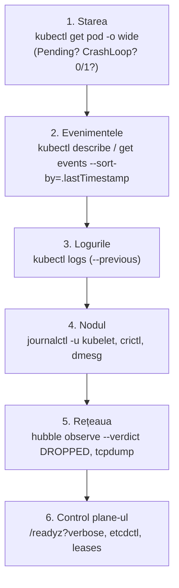

# Day-2: upgrade-uri, backup etcd, exerciții de avarie

„Day 1” e instalarea. „Day 2” e tot restul vieții clusterului: upgrade-uri fără downtime,
certificate care expiră, noduri care mor, și momentul în care ceva e stricat și trebuie să
afli ce — repede, cu metodă. Modulul ăsta e cel mai apropiat de munca reală.

## 1. Version skew: ordinea upgrade-ului

Componentele Kubernetes tolerează diferențe de versiune, dar doar într-o direcție:

| Componentă | Față de kube-apiserver |
|---|---|
| kube-apiserver (HA) | instanțele pot diferi cu cel mult 1 minor între ele, pe durata upgrade-ului |
| controller-manager, scheduler | egal sau cu 1 minor **mai vechi**; niciodată mai nou |
| **kubelet** | egal sau până la 3 minore **mai vechi**; **niciodată mai nou** |
| kubectl | ±1 minor |

Deci: **întâi control plane-ul, apoi kubelet-ele**, un minor odată (1.36 → 1.37, nu 1.36 → 1.38).

> [!NOTE]
> **🏠 Regula de mai sus, încălcată de un bot, în prod**
> Descrierile din [.renovaterc.json5](../../.renovaterc.json5): Renovate a ridicat kubelet-ul
> la 1.37 pe un Talos care servea Kubernetes până la 1.36 — „every node generated from
> talenv.yaml would have joined with a kubelet newer than the API server”. A fost prins,
> pinned back, și a revenit o săptămână mai târziu ascuns într-un PR grupat. De aici
> plafonul `allowedVersions`. Iar [docs/operations.md](../../docs/operations.md) cere, înainte
> de orice minor, trei verificări: matricea Talos, versiunile testate de Cilium, notele de
> upgrade. *O minoră Kubernetes nu se poate da înapoi.*

## 2. Upgrade nod cu nod, în hard way

Un upgrade de patch (de exemplu 1.36.5 → 1.36.6). Scripturile acceptă `ONLY=<nod>`: refac
doar nodul ăla, cu binarele noi, și repornesc serviciile.

```bash
cd ~/infrastructure/learn/lab
# 1. noua versiune, și descărcarea verificată
sed -i 's/^KUBERNETES_VERSION=.*/KUBERNETES_VERSION=v1.36.6/' versions.env
bash hardway/00-jumpbox.sh

# 2. pentru fiecare nod, pe rând:
N=k8s-1
kubectl drain $N --ignore-daemonsets --delete-emptydir-data --timeout=10m
ONLY=$N bash hardway/05-control-plane.sh        # apiserver, controller-manager, scheduler
ONLY=$N bash hardway/06-nodes.sh                # kubelet
kubectl uncordon $N
kubectl get nodes -o wide                       # VERSION pe $N = v1.36.6

# 3. așteaptă ca clusterul să fie „întreg” înainte de următorul nod
```

„Întreg” are o definiție precisă în prod, și merită copiată: [talos-upgrade-cluster.sh](../../scripts/talos-upgrade-cluster.sh)
așteaptă ca **fiecare nod să fie Ready, toți trei membrii etcd să răspundă, și niciun volum
Longhorn atașat să nu fie `degraded`**. Ultima condiție e cea care contează: după un drain,
replicile nodului se reconstruiesc 10–20 de minute; dacă golești următorul nod în fereastra
asta, poți lua cu tine ultima replică sănătoasă a unui volum.

```bash
# verificarea, de mână
kubectl get nodes
source ~/hardway/etcdctl.env && etcdctl endpoint health --cluster
kubectl -n longhorn-system get volumes.longhorn.io -o custom-columns=NAME:.metadata.name,STATE:.status.state,ROBUSTNESS:.status.robustness
```

> [!WARNING]
> **⚠️ Drain-ul care nu se termină**
> Dacă `kubectl drain` stă la nesfârșit, aproape mereu e un PDB cu zero întreruperi permise:
> `kubectl get pdb -A` și caută `ALLOWED DISRUPTIONS 0`. Nodul rămâne *cordoned* — nu primește
> pod-uri noi, dar nu s-a golit. Repară cauza (replici, PDB), nu forța drain-ul. Exercițiul
> [07-drain.yaml](../lab/exercises/07-drain.yaml) e exact incidentul din 2026-10-26.

**Upgrade de minor** (1.36 → 1.37): aceeași procedură, dar înainte: verifică Cilium
(versiunea din lab trebuie să testeze 1.37 — dacă nu, întâi upgrade Cilium prin Git), citește
*Urgent Upgrade Notes* din changelog, și fă un snapshot etcd. Cu kubeadm (modulul 19) ar fi
`kubeadm upgrade plan` / `apply` — care face aceiași pași, plus regenerarea manifestelor.

**etcd** se face la fel, separat și tot unul câte unul: `ONLY=$N bash hardway/04-etcd.sh`,
apoi `etcdctl endpoint health --cluster` înainte de următorul. Niciodată doi deodată — ai
pierde quorum-ul.

## 3. Backup și restore etcd

Prod nu face backup la etcd (modulul 06 — tier 3, totul e reconstruibil din Git). Tu faci
unul, ca să știi cum, și ca să vezi o consecință interesantă a GitOps-ului.

```bash
source ~/hardway/etcdctl.env
kubectl create namespace inainte-de-snapshot
etcdctl --endpoints=https://10.10.0.11:2379 snapshot save ~/etcd-$(date +%F-%H%M).db
etcdutl snapshot status ~/etcd-*.db -w table
kubectl create namespace dupa-snapshot
```

Restaurarea într-un cluster HA e o operație **pe toți membrii odată**: oprești API-ul și
etcd peste tot, fiecare membru primește un data dir nou din același snapshot, cu propria
identitate, apoi pornești totul.

```bash
SNAP=$(ls -t ~/etcd-*.db | head -1)
for n in k8s-1 k8s-2 k8s-3; do ssh $n 'sudo systemctl stop kube-apiserver kube-controller-manager kube-scheduler etcd'; done
for n in k8s-1 k8s-2 k8s-3; do scp "$SNAP" $n:/tmp/snap.db; done

INITIAL="k8s-1=https://10.10.0.11:2380,k8s-2=https://10.10.0.12:2380,k8s-3=https://10.10.0.13:2380"
for n in k8s-1 k8s-2 k8s-3; do
  ip=$(getent hosts $n | awk '{print $1}')
  ssh $n "sudo mv /var/lib/etcd /var/lib/etcd.broken-$(date +%s) && sudo etcdutl snapshot restore /tmp/snap.db \
    --name $n --data-dir /var/lib/etcd --initial-cluster $INITIAL \
    --initial-advertise-peer-urls https://$ip:2380 --initial-cluster-token lab-etcd-restore"
done

for n in k8s-1 k8s-2 k8s-3; do ssh $n 'sudo systemctl start --no-block etcd' & done; wait
sleep 10; etcdctl endpoint health --cluster
for n in k8s-1 k8s-2 k8s-3; do ssh $n 'sudo systemctl start kube-apiserver kube-controller-manager kube-scheduler'; done
kubectl get ns | grep -E 'inainte|dupa'
```

`inainte-de-snapshot` există, `dupa-snapshot` nu — clusterul s-a întors în timp. Acum
uită-te la ArgoCD: tot ce era în Git și s-a schimbat între snapshot și restore e readus în
câteva minute. **Un restore etcd te duce în trecut; GitOps te aduce înapoi în prezent** —
cu excepția a ce nu e în Git (namespace-ul tău de test, datele din volume). Asta e, concret,
argumentul prod-ului pentru tier 3.

> [!CAUTION]
> **💥 Restaurarea pe un singur membru**
> Dacă restaurezi doar unul dintre membri, vei avea două istorii diferite cu același cluster
> ID: membrii refuză să vorbească între ei sau, mai rău, unul își suprascrie istoria. Restore =
> toți membrii, din același snapshot, cu `--initial-cluster-token` nou.

## 4. Certificate care expiră

Certificatele din hard way au un an. Află când:

```bash
for f in ~/hardway/pki/*.crt ~/hardway/pki/etcd/*.crt; do
  printf '%-45s %s\n' "$(basename "$f")" "$(openssl x509 -enddate -noout -in "$f" | cut -d= -f2)"
done | sort -k5
```

Rotația unui certificat de kubelet, ca exercițiu:

```bash
rm ~/hardway/pki/kubelet-k8s-2.{crt,key} ~/hardway/kubeconfigs/kubelet-k8s-2.kubeconfig
bash hardway/02-pki.sh && bash hardway/03-kubeconfigs.sh     # regenerează doar ce lipsește
ONLY=k8s-2 bash hardway/06-nodes.sh
kubectl get node k8s-2                                          # Ready, fără restart de pod-uri
```

Rotația **CA-ului** e o altă poveste (toate certificatele, toate kubeconfig-urile, o perioadă
în care ambele CA-uri sunt de încredere) — motivul pentru care CA-urile au 10 ani și certificatele
frunză un an. Talos și kubeadm rotesc automat certificatele frunză; CA-ul rămâne o operațiune
planificată.

## 5. Capacitate

```bash
kubectl describe node k8s-1 | sed -n '/Allocated resources/,/Events/p'
kubectl top nodes && kubectl top pods -A --sort-by=memory | head
```

`Allocatable` e capacitatea minus ce rezervă sistemul. *Allocated* e suma **requests**-urilor
— ce a promis scheduler-ul, nu ce se folosește. Un nod poate fi „plin” la requests și pe
jumătate gol în realitate (requests prea mari) sau invers (fără requests, deci BestEffort).

> [!NOTE]
> **🏠 `KubeCPUOvercommit` din cauza unui upgrade**
> Comentariul de la `concurrentAutomaticEngineUpgradePerNodeLimit` din
> [helmrelease-ul Longhorn](../../kubernetes/apps/storage/longhorn/app/helmrelease.yaml):
> după un upgrade de chart, instance-manager-ul vechi a rămas lângă cel nou și a cerut încă
> 12% din CPU-ul nodului — destul ca alerta de overcommit să sune. Requests-urile se adună
> și din componente pe care nu le vezi.

## 6. Metoda de depanare

Nu începe cu logurile. Începe de sus, și coboară doar cât trebuie:



| Simptom | Primul loc unde te uiți |
|---|---|
| `Pending` | Events: `FailedScheduling` spune exact de ce (resurse, taint, afinitate, PVC) |
| `ContainerCreating` blocat | Events: imagine, volum (`Multi-Attach`, `FailedMount`), CNI |
| `CrashLoopBackOff` | `kubectl logs --previous` — logul instanței care a murit |
| `ImagePullBackOff` | Events, apoi `crictl pull` pe nod pentru eroarea brută |
| `Running`, `0/1` | readiness probe: `describe` arată eșecurile |
| Service fără răspuns | EndpointSlice gol? → selectorul. Plin? → politica de rețea sau portul |
| Restart-uri, exit 137 | `OOMKilled` în `describe`; `dmesg` pe nod |
| Totul lent / API timeout | `etcd` (fsync, lider), `/readyz?verbose`, apoi resursele nodurilor |

### Laborator — opt defecte

[learn/lab/exercises/](../lab/exercises/README.md) are opt workload-uri, fiecare stricat
într-un singur fel. Pentru fiecare: aplică în `drill`, diagnostichează **fără să citești
YAML-ul** până nu ai o ipoteză, repară, și scrie în notițe *comanda care ți-a dat răspunsul*.

```bash
kubectl create namespace drill
kubectl -n drill apply -f ~/infrastructure/learn/lab/exercises/01-crashloop.yaml
```

### Laborator — exercițiul de avarie

Cel mai valoros exercițiu din prod e documentat în [THREE-NODE.md](../../talos/THREE-NODE.md):
`pve-1` oprit brusc, fără avertisment, cu un cronometru. Fă-l pe lab:

1. Pornește bucla de `curl` spre `whoami` și `lab-app` (modulele 10 și 16) și un `kubectl get pods -A -w`.
2. Pe hostul Proxmox: `qm stop` nodul care deține VIP-ul **și** are cele mai multe pod-uri.
3. Notează, cu ora: când pică API-ul și când revine (VIP), când devine nodul `NotReady`, când
   pornesc pod-urile pe celelalte noduri, când se reatașează volumele Longhorn, ce rămâne jos.
4. Repornește nodul și notează revenirea.
5. Scrie rezultatul ca tabelul „Drilled, 2026-09-04” din prod: ce s-a întâmplat, cât a durat,
   ce n-ai anticipat.

## Taskuri

- [ ] Explică ordinea de upgrade și de ce kubelet-ul nu poate fi niciodată mai nou decât apiserver-ul
- [ ] Fă un upgrade de patch nod cu nod cu `ONLY=…`; verifică „întreg” între noduri
- [ ] Upgrade etcd membru cu membru; quorum-ul nu se pierde niciodată
- [ ] Snapshot etcd, restore pe toți membrii; `inainte` există, `dupa` nu
- [ ] Observă ArgoCD readucând starea din Git după restore; explică ce nu revine
- [ ] Listează expirarea tuturor certificatelor; rotește certificatul kubelet-ului k8s-2
- [ ] Interpretează *Allocated resources* pentru un nod și găsește cel mai mare consumator de requests
- [ ] Rezolvă toate cele 8 exerciții; pentru fiecare, comanda care a dat răspunsul
- [ ] Exercițiul de avarie, cu tabel cronometrat în notițe
- [ ] Citește [docs/troubleshooting.md](../../docs/troubleshooting.md) din prod și compară cu tabelul de simptome de mai sus

## Întrebări de verificare

<details>
<summary>De ce ai face upgrade la control plane cu o versiune înaintea kubelet-elor, și niciodată invers?</summary>

API-ul trebuie să înțeleagă tot ce trimit clienții lui. Un apiserver nou știe și formatele
vechi (păstrează compatibilitatea pentru câteva minore); un kubelet nou poate folosi câmpuri
sau API-uri pe care un apiserver vechi nu le are — și eșuează în moduri subtile. Politica de
skew formalizează asta: clienții (kubelet, controllere) pot rămâne în urmă, serverul nu.
</details>

<details>
<summary>Prod nu face backup la etcd. După exercițiul de restore, ce ar costa adăugarea unuia?</summary>

Un job (CronJob sau timer) care salvează un snapshot în afara clusterului, o alertă pentru
când nu rulează (liniștea e alarma), și — cel mai scump — un restore exersat periodic, altfel
backup-ul e o speranță. Iar câștigul e mic: Git readuce starea dorită, Longhorn readuce
datele. Restore-ul etcd ar recupera doar ce nu e nicăieri altundeva — exact lucrurile pe care
GitOps îți spune să nu le ai.
</details>

<details>
<summary>Un nod e `NotReady`, iar pod-urile lui rulează încă după 2 minute. E un bug?</summary>

Nu. Controller-ul de noduri pune taint-ul `node.kubernetes.io/unreachable` și pod-urile au,
implicit, o toleranță de 300 de secunde pentru el. Abia după aceea sunt marcate pentru
ștergere și recreate în altă parte. Un `NotReady` scurt (o rețea care clipește) nu trebuie
să mute tot clusterul. Pentru volumele RWO Longhorn, `nodeDownPodDeletionPolicy` grăbește
exact pasul ăsta.
</details>
